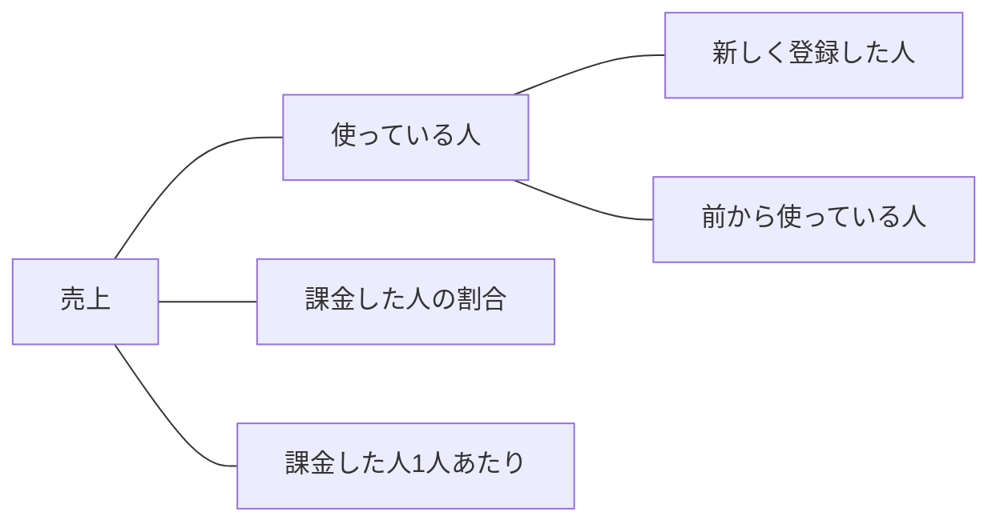
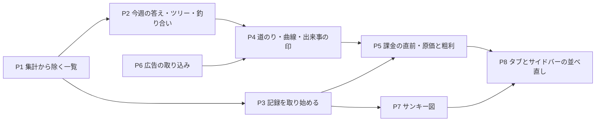

# 管理ダッシュボードを「売上への道筋」で並べ直す計画

- 作成: 2026-10-26（同日に書き直し: 売上のツリーとペルコインの釣り合いを中心にした形へ）
- 状態: 計画（概要タブの見本はユーザーの OK 済み・2026-10-26）

## 1. 目的

ユーザーの言葉（2026-10-26）:

> 売上を上げるための道筋がデータからの情報をもとに分析させ、どこを改善するべきなのかがダッシュボード全体を通して理解できる形がいい

> 記録が無い場合は、取得できるようにすれば良いので、あなたが考える、または他の企業がしているダッシュボードとしてのあり方を考えて。

今のダッシュボードは「生成」「ペルコイン」「GA4」など、データの種類ごとにカードが並んでいる。これを、**売上がどこから来て、何が足りないのか**が上から順に読める形に並べ直す。記録が無くて答えられない問いは、記録を取り始める。

### きっかけ

- 2026-10-25: Meta と X に計約37,600円を使ったが、広告の目印が付いた登録は0人だった。確かめるのに、広告の書き出しと DB のクエリを手で突き合わせる必要があった。
- 2026-10-26: 概要の見本を作るために実データを集めたところ、**課金されない一番の理由と思われる数字**が見つかった（次の節）。画面の流れ（どこで離脱したか）を見る形だけでは、これは見えない。

## 2. 2026-10-26 時点の実データ

直近30日（9/27〜10/26）。運営と内部アカウント（4-1）を除く。

| 項目 | 直近30日 | 前の30日 |
|---|---|---|
| 売上 | 980円（1人・サブスク 10/03） | 980円（1人） |
| 生成した人 | 43人（新しく登録した人 16・前から 27） | 33人 |
| 課金した人の割合 | 2.3%（1人） | 3.0%（1人） |
| 新しく登録した人 | 29人 → 課金 0人 | 19人 → 課金 0人 |
| 無料で配ったペルコイン | **21,357** | 23,683 |
| 使われたペルコイン | **17,350** | 17,780 |

- 無料の内訳（直近30日）: 投稿ボーナス 8,280・連続ログイン 6,135・人のプロンプトで生成して投稿 4,060・登録ボーナス 1,450・プロンプトが使われた還元 1,232・紹介 200。
- よく使う上位10人で、使われた量の77%（13,440）。その10人は、使った分の 98.6%（13,252）を無料でもらっている。
- 配られて残っているペルコインは合計 35,800（使う量の約2か月分）。今の使い方で残高が3日以内になくなる人は5人。
- 登録から7日たった人で比べると、7日以内に2日目も生成した人は 5/9 人（前）→ 3/8 人（今）。差は2人で、たまたまの範囲。
- 登録した月ごとの継続（その週に1回でも生成した割合）: 8月登録 38人は 1週目 63%・2週目 13%・4週目 11%。9月登録 14人は 43%・14%・15%。2週目以降は1割強で下げ止まっている。
- 登録の流入元: 29人中15人が「目印なし」（企画ページ以外から登録したため、流入元が残っていない）。

**読み方**: 使う人は増えているが、ペルコインが足りなくならないので、買う理由が生まれていない。配り方・値段をどうするかはこの計画の範囲外で、ダッシュボードはまずこの事実を毎回見えるようにする（6章）。

## 3. 考え方（よく使われるやり方）

| やり方 | この計画での使い方 |
|---|---|
| 売上を式に分ける（指標のツリー） | 売上 ＝ 使っている人 × 課金した人の割合 × 1人あたり。新しく登録した人と前からの人に分ける |
| 比べる長さをそろえる（登録した日ごとのまとまり） | 「登録から7日以内」のように同じ長さで比べる。日の浅い人を混ぜない |
| 続けて使う人の曲線 | 登録した月（人数が増えたら週）ごとに、1・2・4週目に残った割合。下げ止まるかを見る |
| 課金の直前の流れ | 足りなくなった → 購入画面を見た → 支払いを始めた → 完了／途中でやめた |
| ゲーム内のお金の釣り合い | 配る量（ルートごと）と使う量（使い道ごと）、残高の分布、なくなるまでの日数 |
| 出来事の印 | 企画・広告・値段の改定・リリースの日を、日ごとのグラフに線で入れる |
| 人数が少ないときの作法 | 割合の横に必ず人数。分母が30人に届かない段階は「まだ判断できません」と出し、「ここを直す」を付けない |

## 4. 前提をそろえる

### 4-1. 集計から除くアカウント（今の `admin_users` だけでは足りない）

- `admin_users` には本人の1件しか入っていない。外部審査用の「あかね」と、本人の Gmail の別名31件（`+001`〜`+030` など）が数に入っていた。
- 新しい表 `analytics_excluded_users`（user_id・理由・足した日・足した人）を作り、ダッシュボードのすべての集計で同じ一覧を使う。
  - 中身（どのアカウントか）はマイグレーションに書かない。適用後に、ユーザーの承認を取ってから1回だけ入れる。
  - 管理画面から足す・外すことができるようにする。
- 今のカード（ペルコイン・コレクションのタブなど）の「運営を除く」も、P8 でこの一覧にそろえる。

### 4-2. 「購入者」と「売上」の定義

- 購入者は `credit_transactions` の `purchase` と `subscription`、`metadata.mode = 'live'`。金額は `metadata.revenueYen`。
- オペレーションサマリーは subscription を含み（`get-admin-dashboard-data.ts:459`）、ファネルは purchase だけ（同 392-394）。これを1つにそろえる。

### 4-3. 期間

- 既定は直近30日と前の30日。24h/7d/30d/90d を切り替えられる。
- 段階の比べ方は「その期間に登録した人のうち、登録から N 日たった人」でそろえる（既定 N=7）。

## 5. 概要タブ（上から順に）

見本: 2026-10-26 にユーザーへ送った「概要」の画像（実データ入り）。

| 順 | カード | 答える問い | データ | 作る PR |
|---|---|---|---|---|
| ① | 今週の答え（3行） | 今、何をすればよい？ | ②〜⑥から決まりで選ぶ | P2 |
| ② | 売上のツリー | 売上はどこから来て、何が足りない？ | DB（既存） | P2 |
| ③ | ペルコインの釣り合い | 買う理由があるか？ | DB（既存） | P2 |
| ④ | 課金の直前の流れ | どこで買うのをやめた？ | **新しい記録**（P3） | P5 |
| ⑤ | 流入元ごとの道のり | どこから来た人が、お金につながる？ | DB（既存）＋広告の数字（P6）＋GA4 | P4 |
| ⑥ | 続けて使う人の曲線 | 定着しているか？ | DB（既存） | P4 |
| ⑦ | 原価と粗利 | 売れるほど、もうかるか？ | 今の AI 原価カード（`AdminAiCostCard.tsx`）を移す | P5 |
| くわしく見る | サンキー図 | 登録の前に、どの画面でどこへ帰った？ | GA4（BigQuery） | P7 |

### ① 今週の答え

3枚のカードを決まりで埋める。

1. **売上**: 金額と前の期間との差。新しく登録した人から／前からの人から、に分ける。
2. **一番効く直し所**: 次の順に見て、最初に当てはまったものを出す。
   1. 無料で配った量 ≥ 使った量、かつ、新しく登録した人の課金が0人 → 「ペルコインが足りなくならない」
   2. 分母が30人以上ある段階のうち、前の期間の割合に戻したときに売上が一番増える段階
   3. どれにも当てはまらない → 「まだ判断できません」
3. **そのほか**: 判断を出していない段階と、その理由（人数が足りない、など）。

### ② 売上のツリー

- 「使っている人」＝期間内に1回以上生成した人。
- 前の期間と比べて、動いていない・下がった枝に枠を付ける。

### ③ ペルコインの釣り合い

- 配った量（`credit_transactions` の種類ごと）と、使った量・買った量を横棒で並べる。
- 使い道の内訳: 消費の `related_generation_id` から `generated_images` をたどり、生成の種類ごとに分ける（直近30日の消費 2,049件のうち 1,866件がたどれる。残りは「その他」）。
- よく使う上位10人が、使った分のうち何%を無料でもらったか。
- 日ごとの出入り（配った／使った）と、出来事の印。
- 今の使い方で、残高があと何日もつか（3日以内・4〜7日・8〜30日・31〜90日・91日以上）。3日以内の人は「買う一歩手前の人」として、人の一覧を開ける。

### ④ 課金の直前の流れ

足りなくなった → 購入画面を見た → 支払いを始めた → 途中でやめた／買った。P3 で記録を取り始め、たまってから出す。それまでは「記録はこれから」と出す。

### ⑤ 流入元ごとの道のり

| 列 | 中身 |
|---|---|
| 来た | 広告の行は広告の数字（Meta はページを開いた数、X はリンクを押した数）。ほかの行は GA4 の人数。数え方が違うことを、列の見出しに書く |
| 登録 | 期間内の登録（`profiles.signup_source` を来た場所でまとめる。値そのものの行も開ける） |
| 登録して7日たった | 比べる分母 |
| 7日以内に生成／2日目も生成 | 人数と割合 |
| 課金・売上 | 人数と金額 |

- 合計の行と、前の期間の行を並べる。
- 分母が30人に届かない段階には「まだ判断できません」と出す。
- 「来た → 登録」を押すと、サンキー図（P7）を開く。
- `generated_images` などは `fetchAllRows` で全件たどる（1,000行の打ち切り）。

### ⑥ 続けて使う人の曲線

- 登録した月ごとに、1・2・4週目に1回でも生成した割合を線で出す。
- 日がたっていない点は描かない（「まだ途中」と書く）。
- まとまりの人数が増えたら、週ごとに切り替えられるようにする。

### ⑦ 原価と粗利

- 今の AI 原価カード（推定＝単価表×生成数、実額＝OpenAI の請求）を移す。
- 売上と並べて粗利を出す。広告費が取れるようになったら（P6）、広告費を引いた額も出す。
- 無料で配ったペルコインで生成された分の原価も、ここで分けて見えるようにする。

### 出来事の印

- 新しい表 `admin_timeline_events`（日付・名前・種類＝企画／広告／値段／リリース／お知らせ）。管理画面から足す。
- 日ごとのグラフ（③、⑤ の日ごと表示）に縦の点線で出す。
- 最初の中身の例: 10/16 ハロウィン企画・Meta 広告、10/19 X 広告、10/24 Nano Banana 2.1 公開・値段の改定、10/25 広告停止・個人あてのお知らせ、10/26 広告再開。

## 6. 新しく取る記録

### 6-1. 課金の手前の出来事（`monetization_events`）

| 列 | 中身 |
|---|---|
| user_id | 本人（サーバーのセッションから決める。リクエストの本文からは受け取らない） |
| event_type | `percoin_shortage` / `purchase_view` / `checkout_start` / `checkout_expired` |
| feature | 足りなくなった場所（例: `generate`・`style_generate`・`gacha_split`・`name_input`）、または買おうとした商品 |
| required / balance | 足りなかったときの、必要な量と残高 |
| stripe_session_id | 支払いの画面の ID（`checkout_start` と `checkout_expired` を結ぶ） |
| created_at | 時刻 |

- **足りなくなった**: 生成の API は残高不足をもう返している。返すところで1行書く。
  - `app/api/generate-async/handler.ts:544-545`（`GENERATION_INSUFFICIENT_BALANCE`）
  - `app/(app)/style/generate-async/handler.ts:470`（`STYLE_INSUFFICIENT_PERCOIN_BALANCE`）
  - ガチャの分割・文字入力の残高不足（`app/api/gacha-prompt/split/handler.ts`・`app/api/name-input/create/handler.ts`）
- **購入画面を見た**: 購入の画面（`features/credits/components/PercoinPurchaseGrid.tsx`・`features/my-page/components/PercoinPurchaseSection.tsx`）を開いたときに、サーバーへ1回送る。
- **支払いを始めた**: `app/api/credits/checkout/route.ts`・`app/api/subscription/checkout/route.ts` で、Stripe の支払い画面を作ったときに書く。
- **途中でやめた**: `app/api/stripe/webhook/route.ts` に `checkout.session.expired` を足す（今は `checkout.session.completed` などだけ・834行目〜）。Stripe のダッシュボードで、この通知を送る設定を足す必要がある（ユーザーの作業）。
- **買った**: 今の `credit_transactions` をそのまま使う。
- 書き込みに失敗しても、生成や支払いは止めない（記録だけ落とす）。
- RLS を有効にし、policy は作らない（service_role だけが書く・読む）。

### 6-2. どの画面から来ても流入元を残す

- 今は、URL に `signup_source` か `utm_source` があるときだけ、cookie（`persta_signup_source`・最初に来た時だけ）に残す（`features/auth/components/SignupSourceCapture.tsx`・`components/AppShell.tsx:90,116` で常駐）。
- 目印の無い訪問では、来る前のサイトから値を作って残す: `ref_x`・`ref_instagram`・`ref_google`・`ref_yahoo`・`ref_other`・`direct`。
- あとで目印つきの URL で来たときは、目印のほうで上書きする（目印は、こちらが意図して付けたものなので優先する）。目印どうしは今までどおり「最初に来た時」を守る。
- 最初に開いた画面のパス（例: `/style`・`/posts/...`）も一緒に残し、登録の時に保存する。

### 6-3. GA4

- GA4 に、ペルスタの中だけで使う番号（Supabase のユーザー ID）を `user_id` として送る。メールアドレスなど、個人が分かるものは送らない。今は user property の `logged_in` だけ（`features/analytics/components/Ga4LoginStatus.tsx`）。
- 出来事を GA4 が用意している名前で送る: `sign_up`・`begin_checkout`・`purchase`。生成は `generation_complete`（独自の名前）。送るのは `features/analytics/lib/track-event.ts` の `trackEvent` から。
- これで、サンキー図（P7）の最後の列を「登録した・生成した・課金した」にできる。

### 6-4. 広告の数字

前の計画のまま（P6）。

- **表** `ad_platform_daily_stats`: platform・stat_date・campaign/adset/ad の ID と名前・signup_source・breakdown_type/value・spend_jpy・impressions・reach・clicks・landing_page_views・video_views・source（`api`/`upload`）・imported_at。一意キーは platform・stat_date・ad_id・breakdown_type・breakdown_value。RLS 有効・policy なし。
- **Meta**: Vercel の `META_ADS_ACCESS_TOKEN`・`META_AD_ACCOUNT_ID`（システムユーザー・`ads_read` だけ・無期限）。`vercel.json` の cron で毎朝6時、直近7日を取り直す（`CRON_SECRET` で守る）。insights を `level=ad` で、breakdowns なし・`age`・`gender`・`publisher_platform,platform_position`。creative の `url_tags` から `signup_source` を読む。「今すぐ取り込む」ボタン。トークンが無ければ「未設定」。
- **X**: 書き出した `.xlsx` を管理画面からアップロード。新しい依存は入れず、Node の `zlib` で読む。広告（Ad name）ごとに `signup_source` を選び、覚えておく。

## 7. 進める順番（PR ごと）

| PR | 中身 | DB | 備考 |
|---|---|---|---|
| P1 | `analytics_excluded_users`（表・管理画面・集計で使う共通の関数） | **あり** | SQL を見せて承認をもらってから `supabase db push`。中身はそのあと、承認を取って入れる |
| P2 | 概要の ①②③（今の「すべて」タブの一番上に置く） | なし | 今ある記録だけで作れる。今日の発見がすぐ見えるようになる |
| P3 | 記録を取り始める: 6-1・6-2・6-3 | **あり**（`monetization_events`） | 早いほどデータがたまる。Stripe の通知の設定と、GA4 についてのプライバシーポリシーの直し（8章）が要る |
| P4 | ⑤ 道のり・⑥ 曲線・出来事の印 | **あり**（`admin_timeline_events`） | 広告の「来た」は、P6 の前は空欄 |
| P5 | ④ 課金の直前の流れ・⑦ 原価と粗利 | なし | P3 の記録が2〜4週たまってから |
| P6 | 広告の表・Meta の取り込み・X のアップロード | **あり**（`ad_platform_daily_stats`） | Meta のトークンの登録が先。ほかと並行して進められる |
| P7 | サンキー図（GA4 BigQuery・今ある `features/analytics/lib/get-ga4-page-flow-data.ts` を土台に） | なし | 新しいライブラリは入れず、自前で描く |
| P8 | タブ（概要／集客／利用／課金／企画／運用）とサイドバーのグループ分け、重なりの整理、期間の統一、旧 URL の転送、今のカードの除外を 4-1 にそろえる | なし | 見た目が大きく変わるので、手元の画面で見てもらってからマージ |

各 PR で次を行う。

- lint・typecheck・test・`build --webpack` を流す。
- /code-review を流し、指摘を直すか理由を書く。
- マージしてよいか聞いてから、マージする。

### タブとサイドバー（P8・前の計画のまま）

| タブ | 中身 |
|---|---|
| 概要（既定） | 5章の ①〜⑦ |
| 集客 | 流入元ごとの道のりの詳しい版・広告・外部流入・入口ページ・Top Landing・注目ページ・ログイン方法別・サンキー図 |
| 利用 | ユーザー・生成トレンド・DAU/MAU・モデル別・インプレッション・One-Tap Style・Top Pages・ページ遷移・離脱 |
| 課金 | 売上の内訳・最新決済・ペルコイン（今のペルコインタブ）・課金の直前の流れの詳しい版 |
| 企画 | 今のコレクションタブ |
| 運用 | 優先アラート・オペレーションサマリー・モデレーション通知・クイックアクション |

サイドバーのグループ: 分析／ユーザー・審査／ペルコイン／コンテンツ／お知らせ・配信／広告／システム。今の URL（`tab=one-tap-style`・`tab=percoin`・`tab=collections`）は新しいタブへ転送する。

## 8. 決めておくこと・確かめること

- **プライバシーポリシー**: 今の文（`app/(marketing)/privacy/page.tsx`）は「Cookie 等の技術」とだけ書いていて、Google アナリティクスの名前が無い。GA4 に `user_id` を送る前に、解析ツールを使うことと、その中身を書き足すかどうかを決める（P3 の前）。
- **「判断できません」の人数**: まず分母30人とする。画面を見て変える。
- **目印の無い訪問の値**（6-2）: `ref_*`・`direct` の名前で良いか、P3 で見てもらう。
- **配り方・値段**: この計画では変えない。③で見えた数字をもとに、別に決める。
- **Meta のトークン**: 予定どおり 2026-10-27 の朝に Vercel へ登録してもらう。使うのは P6。10/29 までの広告の答え合わせは、今回は書き出しと DB で行う。

## 9. 戻し方

- P2・P5・P7・P8 は画面とサーバーの処理だけなので、revert で戻せる。
- P1・P3・P4・P6 は新しい表を足すだけで、既存の表は変えない。不要になったら表を消すマイグレーション（承認が要る）で戻す。
- P3 の記録は、書き込みに失敗しても本来の処理を止めない作りにするので、止めたいときは書き込みの行を外す PR で戻せる。
- Meta の取り込みを止めたいときは、Vercel のトークンを消すか、cron の1行を消す。
