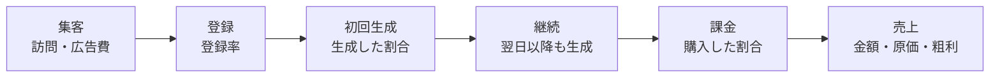
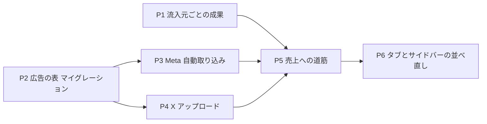

# 管理ダッシュボードを「売上への道筋」で並べ直す計画

- 作成: 2026-10-26
- 状態: 計画（ユーザーの OK 待ち）

## 1. 目的

ユーザーの言葉（2026-10-26）:

> 売上を上げるための道筋がデータからの情報をもとに分析させ、どこを改善するべきなのかがダッシュボード全体を通して理解できる形がいい

今のダッシュボードは「生成」「ペルコイン」「GA4」など、データの種類ごとにカードが並んでいる。これを、**売上につながる順番**に並べ直す。そして、いちばん直すべき段階が一目で分かるようにする。

あわせて、広告（Meta・X）の数字をダッシュボードに入れる。「広告1円あたり、何人が登録し、いくら売上になったか」まで追えるようにする。

### きっかけ

2026-10-25 の答え合わせで、次のことが分かった。

- Meta と X に計約37,600円を使ったが、広告の目印が付いた登録は0人だった。
- これを確かめるのに、広告の管理画面の書き出しと、DB のクエリを手で突き合わせる必要があった。
- 新規登録の流入元（`profiles.signup_source`）は、画面では `style` と `wardrobe` の2つしか数えていない。広告や企画の流入元は、どこにも出ていない。

## 2. 今の並び（棚卸しの要点・HEAD 80194c0）

- **タブ**は4つある: すべて／ワンタップスタイル／コレクション／ペルコイン（`features/admin-dashboard/lib/dashboard-tab.ts:3-17`）。
- **「すべて」タブ**には24のカードが並ぶ。主なものは次のとおり。
  - KPI 4つ、売上トレンド
  - GA4 の DAU/MAU、外部流入、入口ページ、インプレッション
  - ユーザー・生成トレンド、One-Tap Style、コンバージョンファネル、モデル別、ログイン方法別
  - AI 原価、Top Pages、Top Landing、注目ページ、ページ遷移、離脱、最新決済
  - 優先アラート、オペレーションサマリー、モデレーション通知、クイックアクション
- **重なっているもの**
  - 新規登録数が6か所以上に出ていて、数え方が少しずつ違う。
  - 「購入者」の定義が2つある。オペレーションサマリーは subscription を含み（`get-admin-dashboard-data.ts:459`）、ファネルは purchase だけ（同 392-394）。
  - One-Tap Style カードが2つのタブに同じものとして出る。
  - 審査待ち・失敗ジョブ・失効は、KPI・アラート・サマリーに重複して出る。
- **期間の決まりがばらばら**
  - One-Tap Style カードは上の期間タブに連動しない（`styleRange`、既定30日）。
  - ペルコインタブには期間の切り替えがない。
- **サイドバー**は26項目が、グループ分けなしで1列に並ぶ（`app/(app)/admin/admin-nav-items.ts:23-187`）。

## 3. 新しい並び

### 3-1. 「売上への道筋」（新しいトップ）

期間（24h/7d/30d/90d）ごとに、各段階の**人数**と、**次の段階に進んだ割合**を出す。それぞれ前の期間と比べる。

| 段階 | 数えるもの | データ元 |
|---|---|---|
| 集客 | 外部から来た訪問（セッション）、広告費、広告のクリック | GA4（既存）、広告の表（新規） |
| 登録 | 期間内の新規登録 | `profiles` |
| 初回生成 | 期間内に登録した人のうち、1回以上生成した人 | `profiles` × `generated_images` |
| 継続 | 期間内に登録した人のうち、登録した日より後の日にも生成した人 | 同上 |
| 課金 | 期間内に購入した人（purchase と subscription。定義を1つにそろえる） | `credit_transactions` |
| 売上 | 売上、AI 原価（推定・実額）、粗利（売上 − 原価 − 広告費） | 既存の売上・AI 原価、広告の表 |

**「ここを直す」の印**
- 前の期間より割合がいちばん大きく下がった段階に、印を付ける。前の期間のデータがなければ、割合がいちばん低い段階に付ける。
- その段階の割合が前の期間並みに戻ったら、売上がおよそいくら変わるかを出す。
  - 計算: 今の売上 ×（前の割合 ÷ 今の割合 − 1）。
  - 段階を掛け算でつないだ、目安の数字として出す。
- 段階ごとの詳しい画面（下のタブ）へのリンクを付ける。

**気をつけること**
- 訪問（GA4）と登録（DB）は、人を結び付けられない。なので「訪問→登録」の割合は「目安」と書く。
- 運営アカウント（`admin_users`）は数えない。コレクション・ペルコインのタブと同じ決まりにそろえる。

### 3-2. タブを段階ごとに並べ直す

| タブ | 中身 | 今のカードの移し先 |
|---|---|---|
| **概要**（既定） | 売上への道筋・「ここを直す」・KPI 4つ・売上トレンド | KPI・売上トレンド |
| **集客** | **流入元ごとの成果（新規）**・**広告（新規）**・外部流入・入口ページ・Top Landing・注目ページ・ログイン方法別 | GA4 系とログイン方法別を移す |
| **利用** | ユーザー・生成トレンド・DAU/MAU・モデル別・インプレッション・One-Tap Style（今のワンタップタブの中身）・Top Pages・ページ遷移・離脱 | ワンタップタブをここにまとめる |
| **課金** | 売上の内訳・最新決済・AI 原価（推定・実額）・粗利・ペルコイン（今のペルコインタブの中身） | ペルコインタブをここにまとめる |
| **企画** | 今のコレクションタブ | そのまま |
| **運用** | 優先アラート・オペレーションサマリー・モデレーション通知・クイックアクション | 「すべて」の下の部分を移す |

**あわせて直すこと**
- 期間の切り替えを、すべてのタブで同じ場所・同じ動きにする。One-Tap Style の `styleRange` と、コレクションの「会期」は、タブの中で上書きできるように残す。
- 重なっているカードを、1か所にまとめる。
  - One-Tap Style カード → 利用タブだけにする。
  - 審査待ち・失敗ジョブ・失効 → 運用タブだけにする。KPI の審査待ちは、運用タブへのリンクにする。
- 「購入者」の定義を1つにそろえる（purchase と subscription）。
- 今の URL（`tab=one-tap-style`・`tab=percoin`・`tab=collections`）は、新しいタブへ転送して、ブックマークが切れないようにする。

### 3-3. サイドバーをグループに分ける

| グループ | 項目 |
|---|---|
| 分析 | ダッシュボード |
| ユーザー・審査 | ユーザー検索・投稿審査・通報一覧・異議申立て・操作ログ |
| ペルコイン | デフォルト枚数・ボーナス付与・一括付与・減算・ペルコイン集計 |
| コンテンツ | One-Tap Style 管理・プリセットカテゴリ・スタイルテンプレート審査・生成プロンプト・フリー素材・Creator Looks・クリエイター招待・カタログ企画・カタログ審査 |
| お知らせ・配信 | 運営お知らせ・個人あてのお知らせ・プッシュ通知・バナー・ポップアップバナー |
| 広告 | 広告の取り込み（新規。X の書き出しのアップロードと、Meta の取り込みの状況） |
| システム | 画像最適化 |

## 4. 広告の数字の取り込み

### 4-1. 流入元ごとの成果（DB の変更なし）

`profiles.signup_source` ごとに、期間内に登録した人を数える。

- 生成した人・翌日以降も生成した人・投稿した人・エントリーした人・購入した人と、その売上
- 流入元の値は「企画キー＋来た場所＋目印」になっている（例: `halloween-best-shot_meta_ig_henshin`）。なので、来た場所（`_meta` / `_x_ad` / `_x`）でまとめた行と、値そのものの行の両方を出す。
- `generated_images` などは `fetchAllRows` で全件たどる（1,000行の打ち切りに気をつける）。

### 4-2. 広告の数字を入れる表（マイグレーション・本番への適用は承認が要る）

`ad_platform_daily_stats`（案）

| 列 | 中身 |
|---|---|
| platform | `meta` / `x` |
| stat_date | 日付（日本時間） |
| campaign_id / campaign_name | キャンペーン |
| adset_id / adset_name | 広告セット（X は広告グループ） |
| ad_id / ad_name | 広告 |
| signup_source | その広告の行き先 URL にある `signup_source`（4-1 と結ぶための値） |
| breakdown_type | `none` / `age` / `gender` / `placement` / `device` |
| breakdown_value | 例: `25-34`、`instagram_reels` |
| spend_jpy / impressions / reach / clicks / landing_page_views / video_views | 数字 |
| source | `api` / `upload`（どこから入ったか） |
| imported_at | 取り込んだ時刻 |

- 一意キー: platform・stat_date・ad_id・breakdown_type・breakdown_value。取り込み直すと上書きする。
- RLS を有効にし、policy は作らない（service_role だけが読み書きする）。管理画面はサーバーで、管理者を確かめてから読む。

### 4-3. Meta: 毎日自動で取り込む

- **トークン**: Vercel の `META_ADS_ACCESS_TOKEN` と `META_AD_ACCOUNT_ID`。システムユーザー・`ads_read` だけ・無期限。ユーザーが 2026-10-27 の朝に登録する。
- **cron**: `vercel.json` の cron に1本足す（毎朝6時）。直近7日を取り直す（Meta は数字があとから少し変わるため）。既存の `/api/internal/account-purge` と同じく、`CRON_SECRET` で守る。
- **取る中身**: Marketing API の insights（`level=ad`）。breakdowns なしと、`age`・`gender`・`publisher_platform,platform_position` の4通り。
- **signup_source の結び付け**: 広告の creative の `url_tags`（トラッキングの URL パラメーター）から `signup_source` を読む。
- **手で取り込み直す**: 管理画面に「今すぐ取り込む」ボタンを置く。
- **トークンが無いとき**: カードに「未設定」と出す（AI 原価の実額と同じ動き）。

### 4-4. X: 書き出しファイルのアップロード

- X の広告 API は、申し込みと審査が要り、通るまでの時間が読めない。なので、まずは書き出した Excel（`.xlsx`）を管理画面からアップロードして取り込む。
  - 2026-10-25 にもらったファイルの形に合わせる（日別・Location・Platform・Age・Gender のシート）。
- **Excel の読み込み**: 新しい依存は入れない。`.xlsx` は zip の中の XML なので、Node 標準の `zlib` で読む小さな関数を書く。依存を足したほうがよい場合は、別に相談する。
- **signup_source の結び付け**: 書き出しには行き先 URL が入っていないので、アップロード画面で、広告（Ad name）ごとに `signup_source` を選ぶ。一度選べば覚えておく。
- X の Ads API の申し込みは、並行してユーザーに出してもらう（任意）。

## 5. 進める順番（PR ごと）

| PR | 中身 | DB | 備考 |
|---|---|---|---|
| P1 | 流入元ごとの成果のカード（いまは「すべて」タブに置き、P6 で集客タブへ移す） | なし | 今回の広告（〜10/29）の答え合わせに使う |
| P2 | `ad_platform_daily_stats` のマイグレーション | **あり** | SQL を見せて承認をもらってから `supabase db push` |
| P3 | Meta の取り込み（cron・ボタン・カード） | なし | トークンの登録後に本番で確認 |
| P4 | X のアップロード（画面・読み込み・結び付け） | なし | |
| P5 | 「売上への道筋」と「ここを直す」 | なし | |
| P6 | タブとサイドバーの並べ直し、重なりの整理、期間の統一、旧 URL の転送 | なし | 見た目が大きく変わるので、手元の画面で見てもらってからマージ |

各 PR で次を行う。

- lint・typecheck・test・`build --webpack` を流す。
- /code-review を流し、指摘を直すか理由を書く。
- マージしてよいか聞いてから、マージする。

## 6. 決めておくこと・確かめること

- 「継続」の定義は、まず「登録した日より後の日にも生成した」とする。7日目・30日目も出すかは、P5 の画面を見て決める。
- 粗利から広告費を引く「利益」まで出すかは、P5 で決める。広告費が取れるのは P3 以降。
- 売上の目標（月の目標額など）を入れて達成率を出すかは、あとで決める。
- 運営アカウントを数えない決まりを、トップのファネルにも入れる。今のトップは運営を含んでいて、ペルコイン・コレクションのタブとずれている。

## 7. 戻し方

- P1・P3〜P6 は画面とサーバーの処理だけなので、revert で戻せる。
- P2 は新しい表を足すだけで、既存の表は変えない。不要になったら表を消すマイグレーション（承認が要る）で戻す。
- Meta の取り込みを止めたいときは、Vercel のトークンを消すか、cron の1行を消す。
