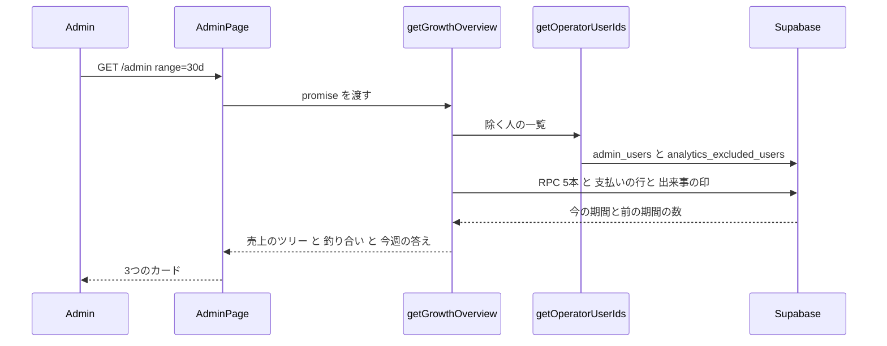
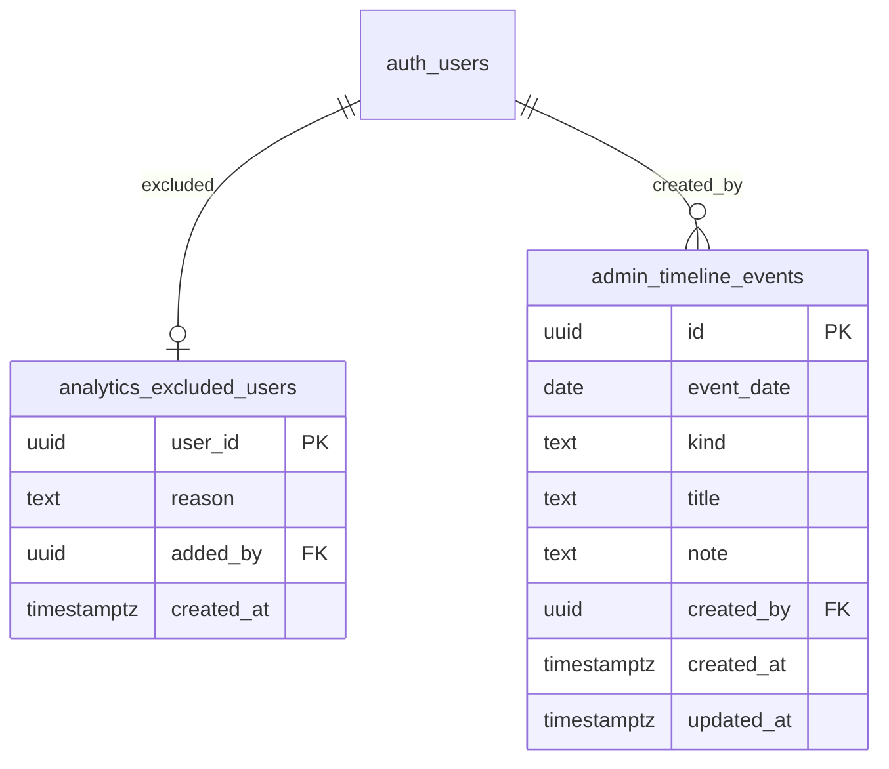
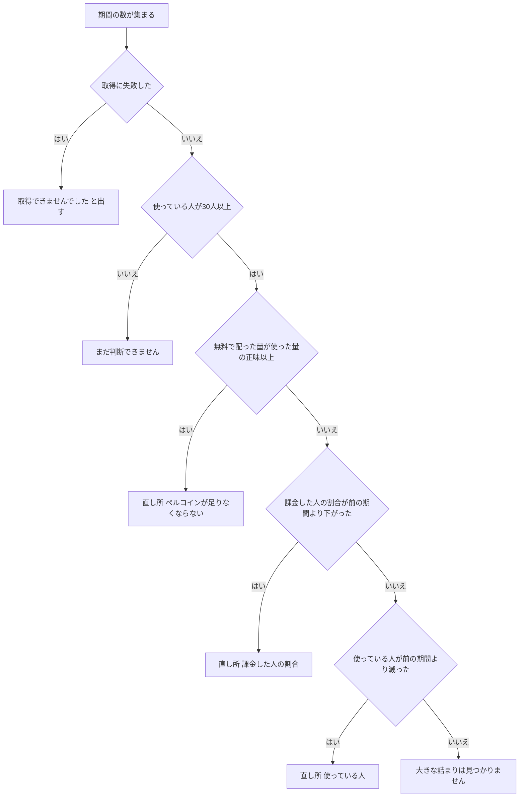
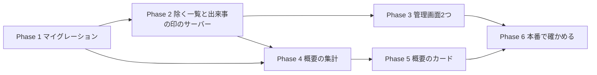

# 管理ダッシュボード P1+P2 実装計画: 集計から除く一覧・出来事の印・概要 ①②③

- 作成: 2026-10-26
- 親の計画: `docs/planning/admin-growth-dashboard-plan.md`（#802）の P1・P2。出来事の印は親の計画では P4 だったが、「直したあと効いたかを見る」ために前へ移した（2026-10-26 ユーザー OK）。
- 状態: 計画（ユーザーの OK 待ち）

## 0. 範囲

**含める**
- **集計から除く一覧** `analytics_excluded_users`
  - 表を作り、管理画面で探して足す・外す（理由つき）。
  - 今の `getOperatorUserIds` にこの表を足す。今のペルコインと企画のタブも、自動で正しい数になる。
- **出来事の印** `admin_timeline_events`
  - 表を作り、管理画面で足す・直す・消す。
- **概要の ①②③**
  - ① 今週の答え（直し所ごとに「効いたかを見る数字」を添える）
  - ② 売上のツリー
  - ③ ペルコインの釣り合い（日ごとのグラフには出来事の印を出す）
  - 今の「すべて」タブの一番上に置く。期間の切り替え（24h/7d/30d/90d）に連動し、前の期間と比べる。
- **集計の関数**
  - ①②③の集計用の RPC を4本作る。
  - 上の表2つと同じマイグレーションにまとめるので、承認は1回で済む。

**含めない**
- 今の「すべて」タブのほかのカード（KPI・売上トレンドなど）を新しい除外にそろえること（親の計画の P8）
- 新しい記録を取ること（P3）、④〜⑦、サンキー図
- ペルコインの配り方・値段の変更

## 1. コードベース調査結果（origin/main 9775dad）

| 観点 | 今の作り | この計画での使い方 |
|---|---|---|
| 運営の除外 | `features/admin-dashboard/lib/get-operator-user-ids.ts`。`ADMIN_USER_IDS`・`ADMIN_PREVIEW_USER_IDS`（env）と `admin_users` の和集合。DB の読み込みに失敗したら env の分だけで続ける | ここに `analytics_excluded_users` を4つ目の元として足す |
| 除外の使われ方 | `get-percoin-analytics.ts`・`get-collection-kpi.ts`・`get-collection-campaign-summaries.ts`・`get-collection-completions.ts`・`app/api/admin/collections/route.ts`。行を取ってから純関数で落とす（`operator-exclusion.ts`。`not.in` はゲスト行まで落とすため） | 新しい集計も同じ関数で落とすか、RPC の `p_exclude_user_ids` に渡す |
| 「すべて」タブの除外 | `get-admin-dashboard-data.ts` は運営を除いていない（例: 10/16 の本人の PayPay の確認の支払いが、売上に入る） | 今回は触らない（P8）。新しいカードには「運営と内部アカウントを除く」と書く |
| ペルコインの集計 RPC | `supabase/migrations/20260831100000_add_percoin_analytics_rpcs.sql`。`LANGUAGE sql STABLE SECURITY DEFINER SET search_path = public`、`p_exclude_user_ids uuid[]`、`REVOKE ALL … FROM PUBLIC` と `GRANT EXECUTE … TO service_role` | 新しい RPC も同じ形にする。付与の内訳は今ある `get_percoin_grant_breakdown` を使い回す |
| ペルコインの取得 | `get-percoin-analytics.ts`。RPC が失敗したら throw して `/admin` の error boundary に任せる（0 を出さない） | 0 を出さない決まりは守る。ただし「すべて」タブの一番上なので、落ちたときはカードの中で「取得できませんでした」と出す（ADR-003） |
| 売上の数え方 | 本番だけ・purchase と金額の決まる subscription（`get-admin-dashboard-data.ts:812-830`）。金額は `resolveTransactionRevenue`（`purchase-value.ts:79`） | この絞り方を `isRevenueTransaction` として切り出し、両方で使う |
| 支払いの記録の実際（本番 10/26） | live 20件（うち内部アカウント7件）・test 13件・mock 12件・mode なし7件（すべて内部アカウント・1〜4月） | 本番だけ、かつ内部アカウントを除く |
| 消費の記録 | `metadata.from_paid` などで有料分が分かる。`related_generation_id` から生成の種類（free・one_tap_style）が分かる。たどれない行は `metadata.source`（`edge_function`＝job が失敗したもの・`name_input_create_api`・`gacha_split_api`） | 使い道の内訳と「使ったうち有料」を出す |
| 期間 | `dashboard-range.ts` の `getRangeBounds`（今と前の期間・同じ長さ） | そのまま使う |
| ページ | `app/(app)/admin/page.tsx`。既定のタブで `AdminPageAnalyticsSectionServer` に promise を渡している | その上に新しいセクションを置き、promise と Suspense で読み込む |
| 管理画面の一覧の CRUD | `app/(app)/admin/creator-allowlist/`（ページは `getUser` と `getAdminUserIds` で守る。API は `requireAdmin` と `ensureSameOrigin`。`/api/admin/users/search` で探す。`logAdminAction` で操作を記録） | 除く一覧と出来事の印の画面は、これを写す |
| 表の作り方の手本 | `supabase/migrations/20260602100200_create_creator_looks_allowlist.sql`（RLS を有効にし、PUBLIC・anon・authenticated から REVOKE） | 同じ形。今回は authenticated にも何も渡さない |
| 監査ログ | `lib/admin-audit.ts` の `AdminAuditAction`（TS の型だけ。DB に CHECK は無い） | 操作の種類を5つ足す |
| メニュー | `app/(app)/admin/admin-nav-items.ts`（グループなし） | 2つ足す（グループ分けは P8） |
| グラフ | `recharts`（^3.7.0） | 日ごとのグラフに使う。新しい依存は足さない |
| 言語 | 管理画面は日本語の直書き（`messages/*` を使わない） | 同じ |
| テスト | `tests/unit/features/admin-dashboard/*.test.ts`（純関数の build-* を中心に） | 新しい純関数を同じ場所でテストする |
| 型 | Supabase の生成型は使っていない（行の型は手で書く） | 同じ |

## 2. 概要図

### 2-1. データの流れ



### 2-2. 表



### 2-3. 今週の答えの決め方



- 決まり2・3（割合と人数の比べ）は、前の期間も30人以上いるときだけ判断する。足りなければ「まだ判断できません」にする。

## 3. EARS（要件）

### 集計から除く一覧

| ID | 要件 |
|---|---|
| EX-1 | When an admin adds a user with a reason, the system shall insert one row into `analytics_excluded_users` and record `analytics_exclusion_add` in the audit log. 管理者が理由をつけて足すと、1行入れて監査ログに残す。 |
| EX-2 | If the user does not exist in `profiles`, or the reason is empty or longer than 200 characters, then the system shall reject with 400. ユーザーがいない、または理由が空か200文字を超えるときは 400 で断る。 |
| EX-3 | If the user is already excluded, then the system shall return 409 and keep the existing row. すでに入っているときは 409 で、今の行を残す。 |
| EX-4 | When an admin removes a user, the system shall delete the row and record `analytics_exclusion_remove`. 外すと行を消して監査ログに残す。 |
| EX-5 | `getOperatorUserIds` shall return the union of env IDs, `admin_users`, and `analytics_excluded_users`; if the DB read fails, it shall continue with what it could read and log the error. 4つの元の和集合を返す。読めなかった元があっても、読めた分で続けてログに残す。 |
| EX-6 | While a non-admin calls any of these APIs or opens the page, the system shall return 401/403 or redirect to `/`. 管理者でなければ断る。 |
| EX-7 | The table shall not be readable or writable by `anon` or `authenticated`; only `service_role` shall access it. anon と authenticated からは読めず書けない。 |

### 出来事の印

| ID | 要件 |
|---|---|
| TL-1 | When an admin creates an event with a date, kind and title, the system shall insert it and record `timeline_event_create`. 日付・種類・名前で作ると入れて記録する。 |
| TL-2 | If the kind is not one of `campaign` / `ad` / `pricing` / `release` / `notice` / `other`, or the title is empty or longer than 60 characters, then the system shall reject with 400 (and the DB CHECK shall also reject it). 種類が決まった6つ以外、または名前が空か60文字を超えるときは断る（DB の CHECK でも断る）。 |
| TL-3 | When an admin edits or deletes an event, the system shall update or delete it and record `timeline_event_update` / `timeline_event_delete`. 直す・消すと記録する。 |
| TL-4 | While the daily chart is shown, the system shall draw a vertical line with the title for each event whose date falls in the chart range. グラフの範囲に入る出来事を縦線と名前で出す。 |

### 概要 ①②③

| ID | 要件 |
|---|---|
| OV-1 | While the default tab is shown, the system shall render the overview above the existing cards, for the selected range and the previous range of the same length, excluding operator and internal accounts. 既定のタブで、今のカードの上に、選んだ期間と前の同じ長さの期間で、運営と内部アカウントを除いて出す。 |
| OV-2 | The revenue tree shall show revenue = active users × payer rate × revenue per payer, split into users who signed up in the period and earlier users. 売上 ＝ 使っている人 × 課金した人の割合 × 1人あたり。期間内に登録した人と前からの人に分ける。 |
| OV-3 | Revenue shall count only live purchases and subscriptions with a resolvable amount, using `resolveTransactionRevenue`. 売上は本番の支払いだけで、今ある関数で金額を決める。 |
| OV-4 | The percoin balance shall show free grants by source, net consumption (consumption minus refunds), refunds, the paid part of consumption, purchases, usage by kind, the top-10 consumers' self-funded share, a daily flow chart, and a runway distribution with a list of users whose balance lasts 3 days or less. ペルコインの釣り合いには、配った量（元ごと）・使った量の正味・返金・使ったうち有料分・買った量・使い道・上位10人の自前の割合・日ごとのグラフ・残りの日数の分布と3日以内の人の一覧を出す。 |
| OV-5 | The weekly answer shall follow the rules in 2-3, and each finding shall list the metrics to watch to tell whether a change worked. 今週の答えは 2-3 の決まりで選び、直し所ごとに「効いたかを見る数字」を添える。 |
| OV-6 | If any aggregate fails, then the system shall show "取得できませんでした" in the overview and shall not show zeros; the rest of the dashboard shall still render. 集計が1つでも失敗したら、0 を出さずに「取得できませんでした」と出し、ほかのカードはそのまま出す。 |
| OV-7 | Where the range is 24h or 7d, the daily chart shall cover the last 7 days; otherwise it shall cover the selected range. 24h・7d のとき、日ごとのグラフは直近7日。それ以外は選んだ期間。 |
| OV-8 | Every rate shall be shown with its numerator and denominator. 割合の横には必ず人数を出す。 |

## 4. ADR

### ADR-001: 除く人は表で持ち、今の `getOperatorUserIds` に足す

- **Context**: 内部アカウント（本人の Gmail の別名31件・審査用の「あかね」）は `admin_users` にも env にも入っていない。10/26 の見本で「あかね」が登録の数にまざった。別名をメールの決まりで見分ける方法もあるが、本人のメールに頼る決まりになり、新しい審査用アカウントは拾えない。
- **Decision**: 表 `analytics_excluded_users` を作って管理画面で足し引きする。`getOperatorUserIds` の4つ目の元にする。
- **Reason**: 一覧を見て直せるうえ、今の呼び出し元5か所（ペルコイン・企画）も1行の変更で正しくなる。
- **Consequence**: 今のペルコインと企画のタブの数が、内部アカウントの分だけ減る（これが正しい数）。最初の中身は、マイグレーションに書かずに、適用後に承認を取って1回だけ入れる。user_id をリポジトリに残さないため。

### ADR-002: 集計は SQL（RPC）で行い、アプリは組み立てるだけ

- **Context**: `credit_transactions` と `generated_images` は1,000行を大きく超える。行を取ってアプリで数えると、黙って過小になる（#579）。
- **Decision**: 使っている人の数・使い道・日ごとの出入り・消費した人ごとの数は RPC で出す。支払いの行（期間で多くて数十件）だけは、今と同じく行を取り、`fetchAllRows` と `resolveTransactionRevenue` で数える。
- **Reason**: 売上の金額の決まり（パッケージの値段で補うなど）が TS 側にあり、SQL に書き写すと二重になる。
- **Consequence**: RPC は4本増える。どれも service_role だけが呼べる。

### ADR-003: 概要が落ちても、ダッシュボード全体は落とさない

- **Context**: 今のペルコインタブは、集計に失敗すると throw して error boundary で画面全体を止める。概要は「すべて」タブの一番上なので、同じにすると、ほかの全部のカードも見えなくなる。
- **Decision**: 概要の取得は1つの promise にまとめ、失敗したらカードの中で「取得できませんでした」と、どの集計が落ちたかを出す。数字は1つも出さない（0 を出さない決まりは守る）。
- **Consequence**: 一部だけ出す作りにはしない（①は②③の数を使うので、欠けた数での判断を出さないため）。

### ADR-004: 「今週の答え」は決まりで出し、打ち手は書かない

- **Context**: 配り方や値段をどう変えるかは、ユーザーが決めることと約束した。
- **Decision**: 直し所と「効いたかを見る数字」だけを出す。たとえば「ペルコインが足りなくならない」なら、見る数字は正味の出入り（配った ÷ 使った）・3日以内に尽きる人の数・課金した人の割合の3つ。
- **Consequence**: 決まりは純関数 `buildWeeklyAnswer` に置き、テストで固める。閾値（30人）は定数1つにまとめる。

## 5. DB 設計（マイグレーション1本）

ファイル: `supabase/migrations/20261027100000_add_growth_overview_tables_and_rpcs.sql`

### 5-1. `analytics_excluded_users`

```sql
CREATE TABLE public.analytics_excluded_users (
  user_id uuid PRIMARY KEY REFERENCES auth.users(id) ON DELETE CASCADE,
  reason text NOT NULL CHECK (char_length(btrim(reason)) BETWEEN 1 AND 200),
  added_by uuid REFERENCES auth.users(id) ON DELETE SET NULL,
  created_at timestamptz NOT NULL DEFAULT now()
);
ALTER TABLE public.analytics_excluded_users ENABLE ROW LEVEL SECURITY;
REVOKE ALL ON TABLE public.analytics_excluded_users FROM PUBLIC, anon, authenticated;
-- policy は作らない（service_role は RLS を通らない）
```

### 5-2. `admin_timeline_events`

```sql
CREATE TABLE public.admin_timeline_events (
  id uuid PRIMARY KEY DEFAULT gen_random_uuid(),
  event_date date NOT NULL,                -- 日本時間の日付
  kind text NOT NULL CHECK (kind IN ('campaign','ad','pricing','release','notice','other')),
  title text NOT NULL CHECK (char_length(btrim(title)) BETWEEN 1 AND 60),
  note text CHECK (note IS NULL OR char_length(note) <= 500),
  created_by uuid REFERENCES auth.users(id) ON DELETE SET NULL,
  created_at timestamptz NOT NULL DEFAULT now(),
  updated_at timestamptz NOT NULL DEFAULT now()
);
CREATE INDEX admin_timeline_events_event_date_idx ON public.admin_timeline_events (event_date);
-- RLS・REVOKE は 5-1 と同じ。updated_at は API が更新時に入れる
```

### 5-3. RPC（4本・すべて `LANGUAGE sql STABLE SECURITY DEFINER SET search_path = public`、`REVOKE ALL … FROM PUBLIC`、`GRANT EXECUTE … TO service_role`）

| RPC | 返すもの | 中身 |
|---|---|---|
| `get_growth_active_users(p_start, p_end, p_exclude_user_ids)` | `active_users`・`active_new_users`・`active_existing_users` | 期間内に `generated_images` を1件以上作った人。期間内に登録した人（`profiles.created_at >= p_start`）と、それより前の人に分ける |
| `get_percoin_usage_breakdown(p_start, p_end, p_exclude_user_ids)` | `use_key`・`consumed`・`paid_part`・`tx_count` | `consumption` を使い道で分ける。`use_key` は、`related_generation_id` からたどった `generated_images.generation_type` → たどれなければ `metadata.source`（`gacha_split_api`・`name_input_create_api`。`edge_function` は `failed_job`）→ それ以外は `other`。`paid_part` は `metadata.from_paid` の合計 |
| `get_percoin_daily_flow(p_start, p_end, p_exclude_user_ids)` | `day`（JST の日付）・`free_granted`・`consumed`・`refunded`・`purchased` | 日ごとの出入り。無料は「amount > 0 で、purchase・subscription・refund 以外」 |
| `get_percoin_consumer_stats(p_start, p_end, p_exclude_user_ids)` | `user_id`・`nickname`・`consumed_net`・`free_granted`・`balance`・`paid_balance` | 期間内に消費した人ごと。アプリ側で上位10人・残りの日数（`balance ÷ (consumed_net ÷ 期間の日数)`）を出す |

- 付与の元ごとの内訳は、今ある `get_percoin_grant_breakdown`（`bonus_source` 単位）を使う。アプリで purchase・subscription・refund を外して「無料」にし、表示名は `labelForGrantSource` を使う。
- どの関数も `user_id IS NOT NULL AND NOT (user_id = ANY (coalesce(p_exclude_user_ids, '{}')))` で除く（今の RPC と同じ）。

### 5-4. 適用の手順

1. PR のプレビューのブランチで SQL を流し、上の関数を2026-10-26 の実データ相当で動かして確かめる（`supabase-preview-branch-sql-harness` の手順）。
2. SQL の差分をユーザーに見せ、承認をもらってから `supabase db push`。
3. 適用後、`analytics_excluded_users` に入れる候補を出す（`admin_users`・4つのニックネーム・本人の Gmail の別名・`+review` のアドレス）。**ニックネームと件数をユーザーに見せて承認をもらってから**、1回だけ入れる。入れる SQL はリポジトリに残さない。
4. 入れたあと、10/26 の数（登録29人・使っている人43人など）と合うかを確かめる。

## 6. 実装計画

### フェーズ間の依存関係



PR は2つに分ける。**PR-A = Phase 1〜3**（表・RPC・管理画面）、**PR-B = Phase 4〜5**（概要）。PR-A をマージして DB を適用し、除く一覧を入れてから PR-B を出す（PR-B の数を本番で照らし合わせるため）。

#### Phase 1: マイグレーション（PR-A）

目的: 表2つと RPC 4本を作る。
ビルド確認: SQL だけなので、アプリのビルドは変わらない。

- [ ] `supabase/migrations/20261027100000_add_growth_overview_tables_and_rpcs.sql` を作る（5章）。手本は `20260831100000_add_percoin_analytics_rpcs.sql` と `20260602100200_create_creator_looks_allowlist.sql`
- [ ] プレビューのブランチで、RPC の結果を 10/26 の手計算と照らし合わせる（使っている人43・正味の消費16,870・上位10人 13,440/13,252 など）
- [ ] anon と authenticated から表を読めない・RPC を呼べないことを確かめる
- [ ] `.cursor/rules/database-design.mdc` に表2つを書き足す

#### Phase 2: サーバー（PR-A）

目的: 除く一覧を集計に効かせ、2つの表を API から触れるようにする。
ビルド確認: lint・typecheck・test・`build --webpack`。

- [ ] `getOperatorUserIds` に `analytics_excluded_users` を足す（`get-operator-user-ids.ts`。今の失敗時の続け方と同じ）
- [ ] `features/admin-dashboard/lib/analytics-exclusion-repository.ts`（一覧・追加・削除。`features/creators/lib/creator-allowlist-repository.ts` を参考）
- [ ] `features/admin-dashboard/lib/timeline-event-repository.ts`（一覧〈期間で絞る〉・作る・直す・消す）
- [ ] `app/api/admin/analytics-exclusions/route.ts`（GET・POST）と `[userId]/route.ts`（DELETE）。`app/api/admin/creator-allowlist/` を参考に、`requireAdmin`・`ensureSameOrigin`・`isUuid`・`profileExistsForUserId`・`logAdminAction`
- [ ] `app/api/admin/timeline-events/route.ts`（GET・POST）と `[id]/route.ts`（PATCH・DELETE）
- [ ] `lib/admin-audit.ts` の `AdminAuditAction` に5つ足す: `analytics_exclusion_add`・`analytics_exclusion_remove`・`timeline_event_create`・`timeline_event_update`・`timeline_event_delete`
- [ ] 入力の検証は純関数に切り出す（理由の長さ・種類・名前の長さ・日付の形）

#### Phase 3: 管理画面（PR-A）

目的: 一覧を見て足し引きできるようにする。
ビルド確認: 同上。手元の dev で画面を見てもらう。

- [ ] `app/(app)/admin/analytics-exclusions/page.tsx` と `AnalyticsExclusionsClient.tsx`
  - `creator-allowlist` を写す。ユーザーを `/api/admin/users/search` で探し、理由を入れて足す。
  - 一覧にはニックネーム・理由・足した日・足した人を出し、「外す」ボタンを置く。
  - 上に「env・`admin_users` から入っている人は N人（ここでは外せません）」と出す。
- [ ] `app/(app)/admin/timeline-events/page.tsx` と `TimelineEventsClient.tsx`
  - 日付・種類・名前・メモで足す。一覧で直す・消す。
- [ ] `admin-nav-items.ts` に「集計から除く」「出来事の印」を足す

#### Phase 4: 概要の集計（PR-B）

目的: ①②③に要る数を、今の期間と前の期間でまとめて返す。
ビルド確認: 同上。純関数のテストを先に書く。

- [ ] `features/admin-dashboard/lib/revenue-transaction.ts`: `isRevenueTransaction`（`get-admin-dashboard-data.ts:812-830` の決まりを切り出す。元の場所もこれを使う形にし、挙動は変えない）
- [ ] `features/admin-dashboard/lib/get-growth-overview.ts`（server-only）
  - `getOperatorUserIds` → RPC 4本＋`get_percoin_grant_breakdown` を今と前の期間で呼ぶ（`Promise.all`）
  - 支払いの行は `fetchAllRows` で取り、`excludeOperatorRows`・`isRevenueTransaction`・`resolveTransactionRevenue` で数える。課金した人が期間内に登録した人かどうかは、その人たちの `profiles.created_at` を引いて分ける
  - 出来事の印をグラフの範囲で取る
  - どれかが失敗したら `{ status: "error", failed: [...] }` を返す（throw しない・ADR-003）
- [ ] `features/admin-dashboard/lib/build-revenue-tree.ts`（純関数）
- [ ] `features/admin-dashboard/lib/build-percoin-balance.ts`（純関数。無料の仕分け・正味・上位10人・残りの日数の分け方〈3日以内・4〜7日・8〜30日・31〜90日・91日以上〉・グラフの範囲〈OV-7〉）
- [ ] `features/admin-dashboard/lib/build-weekly-answer.ts`（純関数。2-3 の決まり・閾値30・「効いたかを見る数字」）

#### Phase 5: 概要のカード（PR-B）

目的: 見本（2026-10-26 に OK をもらった概要の画像）の①②③を出す。
ビルド確認: 同上。手元の dev と本番のデータで、画面を見てもらう。

- [ ] `features/admin-dashboard/components/AdminGrowthOverviewSection.tsx`（server。promise を受けて Suspense の中で描く。失敗の表示）
- [ ] `AdminWeeklyAnswerCard.tsx`・`AdminRevenueTreeCard.tsx`・`AdminPercoinBalanceCard.tsx`
- [ ] `AdminPercoinDailyFlowChart.tsx`（recharts。配った・使ったの2本の線と、出来事の縦線。`AdminRevenueChart.tsx` の作りを参考）
- [ ] 3日以内の人の一覧は、ニックネームを出し、`/admin/users` の詳細へのリンクにする
- [ ] `app/(app)/admin/page.tsx` の既定のタブで、`AdminPageAnalyticsSectionServer` の上に置く
- [ ] 見出しの横に「運営と内部アカウント（N人）を除く」と出す

#### Phase 6: 本番で確かめる

- [ ] PR-A: マイグレーションを適用し、除く一覧を入れ、画面で足す・外すを試す（試しの1件は消す）。出来事の印に10/16〜10/26 の5件を入れる
- [ ] PR-B: 30d の数が 10/26 の手計算と合うかを照らし合わせる（日がずれた分の差は説明をつける）
- [ ] 今のペルコインと企画のタブで、除外の人数の表示が増えていることを確かめる

## 7. 修正対象ファイル一覧

| ファイル | 操作 | 変更内容 |
|---|---|---|
| `supabase/migrations/20261027100000_add_growth_overview_tables_and_rpcs.sql` | 新規 | 表2つ・RPC 4本 |
| `.cursor/rules/database-design.mdc` | 修正 | 表2つを書き足す |
| `features/admin-dashboard/lib/get-operator-user-ids.ts` | 修正 | 4つ目の元を足す |
| `features/admin-dashboard/lib/analytics-exclusion-repository.ts` | 新規 | 一覧・追加・削除 |
| `features/admin-dashboard/lib/timeline-event-repository.ts` | 新規 | 出来事の印の読み書き |
| `features/admin-dashboard/lib/admin-list-validation.ts` | 新規 | 入力の検証（純関数） |
| `app/api/admin/analytics-exclusions/route.ts`・`[userId]/route.ts` | 新規 | API |
| `app/api/admin/timeline-events/route.ts`・`[id]/route.ts` | 新規 | API |
| `lib/admin-audit.ts` | 修正 | 操作の種類を5つ足す |
| `app/(app)/admin/analytics-exclusions/page.tsx`・`AnalyticsExclusionsClient.tsx` | 新規 | 画面 |
| `app/(app)/admin/timeline-events/page.tsx`・`TimelineEventsClient.tsx` | 新規 | 画面 |
| `app/(app)/admin/admin-nav-items.ts` | 修正 | メニューを2つ足す |
| `features/admin-dashboard/lib/revenue-transaction.ts` | 新規 | 売上に数える支払いの決まり |
| `features/admin-dashboard/lib/get-admin-dashboard-data.ts` | 修正 | 上の決まりを使う（挙動は変えない） |
| `features/admin-dashboard/lib/get-growth-overview.ts` | 新規 | 概要の集計 |
| `features/admin-dashboard/lib/build-revenue-tree.ts`・`build-percoin-balance.ts`・`build-weekly-answer.ts` | 新規 | 組み立て（純関数） |
| `features/admin-dashboard/components/AdminGrowthOverviewSection.tsx` ほか4つ | 新規 | カードとグラフ |
| `app/(app)/admin/page.tsx` | 修正 | 既定のタブに概要を置く |
| `tests/unit/features/admin-dashboard/*.test.ts` | 新規 | 8章のテスト |

## 8. 品質・テスト観点

### 品質チェックリスト

- [ ] エラー: 集計の失敗で 0 を出さない。概要が落ちても、ほかのカードは出る
- [ ] 権限: ページは `getUser`＋`getAdminUserIds`、API は `requireAdmin`＋`ensureSameOrigin`。表は service_role だけ。RPC は service_role だけ
- [ ] 入力: user_id は UUID か、`profiles` にいるかを確かめる。理由・名前・メモの長さ。種類は決まった6つ（DB の CHECK でも）
- [ ] 1,000行の打ち切り: 行を取るのは支払いだけで、`fetchAllRows` を通す
- [ ] ゲスト行: 除外は `user_id IS NOT NULL` の行だけに効かせる（使っている人は生成した人なので、ゲストは入らない）
- [ ] 言語: 管理画面は日本語の直書き（今と同じ）

### テスト観点

| カテゴリ | テスト内容 |
|---|---|
| 正常系 | `buildRevenueTree`: 10/26 の数（43人・1人・980円、新16/前27）で、割合と前との差が見本どおりになる |
| 正常系 | `buildPercoinBalance`: 無料の仕分けで purchase・subscription・refund が外れる／正味＝消費−返金／上位10人の割合／残りの日数の分け方の境界（3日・4日・7日・8日・30日・31日・90日・91日） |
| 正常系 | `buildWeeklyAnswer`: 2-3 の分かれ道を1本ずつ（足りなくならない・課金率が下がった・使っている人が減った・詰まりなし） |
| 境界 | 使っている人が29人と30人／前の期間だけ30人未満／消費0の人がいる（残りの日数を出さない）／24h と 7d でグラフが7日になる |
| 異常系 | RPC が1本失敗すると `status: "error"` になり、失敗した名前が入る／カードに数字が出ない |
| 権限 | 管理者でない人の API は 401/403／ページはトップへ戻す／`getOperatorUserIds` が表の読み込みに失敗しても、env と `admin_users` の分を返す |
| 入力 | 理由が空・201文字で 400／すでに入っている人で 409／種類が決まった6つ以外で 400／名前が61文字で 400 |
| 挙動を変えない | `isRevenueTransaction` を切り出したあとも、今のダッシュボードの売上の数が変わらない（今のテスト `purchase-value.test.ts`・`dashboard-critical-fetch-errors.test.ts` が通る） |
| 本番 | 30d の数を 10/26 の手計算と照らし合わせる |

テストは `/test-flow` の手順で、`/spec-extract` → `/spec-write` → `/test-generate` → `/test-reviewing` → `/spec-verify` の順に進める（対象: `build-weekly-answer`・`build-percoin-balance`・`build-revenue-tree`・除く一覧の API）。

## 9. 整合性チェック

| 観点 | 結果 |
|---|---|
| 図とスキーマ | 出来事の種類6つは、CHECK・API の検証・画面の選択肢を1つの定数（`TIMELINE_EVENT_KINDS`）から作る |
| 認証の一貫性 | 表は service_role だけ。ページと API は管理者だけ。未ログインに開く経路は無い |
| データの取り方 | 既定のタブは今と同じく、サーバーで promise を作って渡す（`AdminPageAnalyticsSectionServer` と同じ） |
| イベントの網羅 | 足す・外す・作る・直す・消すの5つすべてを監査ログに残す。「取得できなかった」も画面に出す |
| パラメーターの出どころ | `added_by`・`created_by` は `requireAdmin()` の戻り値から入れる。リクエストの本文からは受け取らない。除く人の一覧は RPC の引数だが、サーバーの `getOperatorUserIds` からしか作らない |
| DB での強制 | 理由と名前の長さ・種類は CHECK で守る。同じ人を2回入れられないのは主キーで守る |

## 10. ロールバック

- **PR-A の画面と API**: revert で戻せる。`getOperatorUserIds` の1行を戻せば、今の除外に戻る。
- **PR-B**: 画面とサーバーの処理だけなので、revert で戻せる。`get-admin-dashboard-data.ts` の切り出しは挙動を変えないので、そこだけ残しても害はない。
- **DB**: 表2つと RPC 4本を足すだけで、今ある表は変えない。不要になったら、消すマイグレーション（承認が要る）で戻す。

## 11. 使用スキル

| スキル | 用途 | フェーズ |
|---|---|---|
| `/supabase-sync` | マイグレーションの差分の確認と適用 | Phase 1 |
| `/git-create-worktree` | 作業フォルダを作る | 実装開始時 |
| `/tdd` | 純関数と API をテストから作る | Phase 2・4 |
| `/test-flow` ほか | テストの手順 | テスト |
| `/git-create-pr` | PR を作る | PR-A・PR-B |
| `/code-review` | PR を作ったあとに流す | PR-A・PR-B |

## 12. 決めておくこと

- 閾値は30人とする（親の計画と同じ）。画面を見て変える。
- 出来事の種類は6つ（企画・広告・値段・リリース・お知らせ・そのほか）とする。
- 3日以内の人の一覧には、ニックネームを出す（管理画面の中だけ）。
