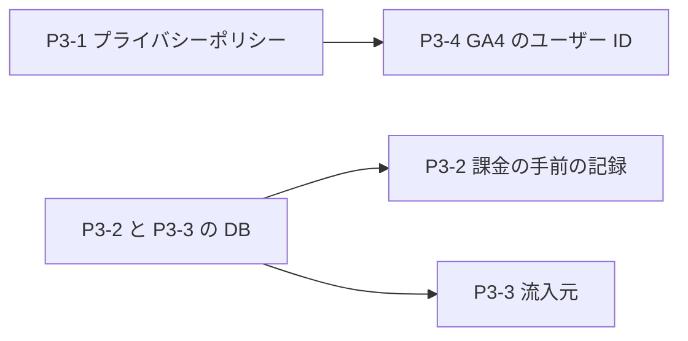

# 管理ダッシュボード P3 実装計画: 記録を取り始める（課金の手前・流入元・GA4）

- 作成: 2026-10-26
- 親の計画: `docs/planning/admin-growth-dashboard-plan.md`（#802）の P3・6章
- 状態: 計画（プライバシーポリシーの文と、進め方の OK 待ち）

## 0. なぜ今か

概要（#805）で、課金されない一番の理由は「ペルコインが足りなくならない」ことだと見えた。次に知りたいのは、**足りなくなった人が、そのあとどうしたか**（購入画面まで来たか・途中でやめたか・待ったか）と、**どこから来た人がお金につながるか**。どちらも今は記録が無い。記録は、取り始めた日からしかたまらない。

## 1. 範囲

**含める**
- **P3-1** プライバシーポリシーに、Google アナリティクスとユーザー ID を送ることを書き足す（文はユーザーの OK をもらう）
- **P3-2** 課金の手前の出来事の記録 `monetization_events`
  - 足りなくなった・購入画面を見た・支払いを始めた・やめて戻った・期限切れ
- **P3-3** どの画面から来ても流入元を残す
  - 別の cookie と `profiles` の新しい列
- **P3-4** GA4 にユーザー ID を送る（P3-1 のあと）

**含めない**
- これらの数を出すカード（④課金の直前の流れ・P5）。記録が2〜4週たまってから作る。
- プラン変更の支払いの記録（`docs/planning/subscription-change-revenue-recording-plan.md`。別に決める）

## 2. コードベース調査結果（origin/main 6193ae6）

| 観点 | 今の作り |
|---|---|
| 残高不足（画面） | `features/generation/components/GenerationFormContainer.tsx:986`（`balance < requiredPercoins` で API を呼ばずに戻る）、`features/style/components/OneTapStyleGenerationForm.tsx:578-585`（`hasEnoughPercoins` が false だとボタンを押せない） |
| 残高不足（API） | `app/api/generate-async/handler.ts:544-545`（`GENERATION_INSUFFICIENT_BALANCE`）、`app/(app)/style/generate-async/handler.ts:470`（`STYLE_INSUFFICIENT_PERCOIN_BALANCE`）、ガチャの分割・文字入力 |
| 購入の画面 | `features/credits/components/PercoinPurchaseGrid.tsx`・`features/my-page/components/PercoinPurchaseSection.tsx` |
| 支払いの開始 | `app/api/credits/checkout/route.ts`（`client_reference_id: user.id`・167行目、`origin` を metadata に入れる・107/173行目、やめたら `?canceled=true`・117行目）、`app/api/subscription/checkout/route.ts`（`client_reference_id`・125行目、戻り先は `?tab=subscription`・120行目で、やめた印が無い） |
| Stripe の通知 | `app/api/stripe/webhook/route.ts` は `checkout.session.completed` などを扱う（834行目〜）。`checkout.session.expired` は扱っていない |
| 流入元 | `features/auth/components/SignupSourceCapture.tsx`（cookie `persta_signup_source`・30日・すでにあれば書かない・65-68行目）。`components/AppShell.tsx:90,116` に常駐。来た場所は `features/auth/lib/signup-source.ts:85` の `detectSignupChannel`（`x_ad`/`x`/`meta`） |
| 登録の時の保存 | `features/auth/lib/auth-client.ts:668`、`app/auth/callback/route.ts:86-117`（`signup_source` を user_metadata と `profiles` に書く） |
| GA4 | `features/analytics/components/Ga4Script.tsx`（`gtag('config', id)`）、`features/analytics/components/Ga4LoginStatus.tsx`（user property `logged_in` だけを `components/LocaleShell.tsx` で設定） |
| プライバシーポリシー | `app/(marketing)/privacy/page.tsx`。「5. Cookie等の利用」は「Cookie等の技術を使用することがあります」とだけ書いていて、Google アナリティクスの名前が無い。「4. 第三者提供」の委託先の例にも、解析ツールが無い。改定日の欄が無い |
| 表の作り方の手本 | `20261025233400`（RLS 有効・policy なし・`FROM PUBLIC, anon, authenticated` で REVOKE） |

## 3. P3-1 プライバシーポリシーの書き足し（案・ユーザーの OK をもらう）

⚠️ 法律の文なので、最終的な判断はユーザーが行う。必要なら専門家に確かめてもらう。

**「5. Cookie等の利用」に足す段落（案）**

> 当サービスは、利用状況を把握してサービスを改善するため、Google LLC が提供するアクセス解析ツール「Google アナリティクス」を利用しています。Google アナリティクスは Cookie を使って、閲覧したページや利用した端末・ブラウザなどの情報を集めます。
>
> ログインしているユーザーについては、当サービスの中だけで使う識別子（ユーザー ID）を Google アナリティクスに送り、閲覧の記録と当サービス内での利用（登録・生成・購入など）を結び付けて分析することがあります。メールアドレス・氏名など、個人を直接特定できる情報は送りません。
>
> 集められた情報は、Google のプライバシーポリシー（https://policies.google.com/privacy ）に基づいて管理されます。Google アナリティクスによる情報の収集を望まない場合は、Google アナリティクス オプトアウト アドオン（https://tools.google.com/dlpage/gaoptout ）で止めることができます。

**「4. 第三者提供」の委託先の例に足すもの（案）**

> …画像生成 API 提供元（OpenAI、Google 等）、**アクセス解析ツールの提供元（Google 等）**、その他のクラウドインフラ事業者…

**ほかに**
- 英語版の要約（`Major topics covered in the Japanese version include: …`）に `use of analytics tools (Google Analytics)` を足す。
- 改定日（例: 「2026年◯月◯日 改定」）をページの終わりに足すかどうかを決める。

**進め方**: 文が決まったら、文だけの小さな PR にする。P3-4（ユーザー ID を送る）は、この PR が本番に出てから行う。

## 4. P3-2 課金の手前の出来事（`monetization_events`）

### 表

| 列 | 中身 |
|---|---|
| id | uuid |
| user_id | 本人。画面からの記録はサーバーのセッションから決める（本文から受け取らない）。Stripe の通知からの記録は `client_reference_id` から決める |
| event_type | `percoin_shortage` / `purchase_view` / `checkout_start` / `checkout_cancel` / `checkout_expired`（CHECK） |
| feature | 足りなくなった場所: `generate` / `style_generate` / `gacha_split` / `name_input` |
| where_detected | `client`（画面で止めた）/ `server`（API が返した） |
| origin | 買いに来た場所（今の購入の `origin` と同じ値） |
| product | パッケージ・プラン |
| required / balance | 足りなかったときの、必要な量と残高 |
| stripe_session_id | 支払い画面の ID（開始・やめた・期限切れを結ぶ） |
| created_at | 時刻 |

- RLS 有効・policy なし。PUBLIC・anon・authenticated から REVOKE。service_role だけが書く・読む。
- インデックス: `(event_type, created_at)`、`(user_id, created_at)`。

### 記録する所

| 出来事 | 場所 | 書き方 |
|---|---|---|
| 足りなくなった（画面） | `GenerationFormContainer.tsx:986` の早期 return の直前、`OneTapStyleGenerationForm.tsx` で `hasEnoughPercoins` が false になったとき（1回の訪問で1回） | 新しい API `POST /api/monetization-events`（ログイン必須・same-origin・1人あたり1分に10回まで）へ送る |
| 足りなくなった（API） | 上の4つの handler の残高不足の返り値の直前 | サーバーから直接書く |
| 購入画面を見た | `PercoinPurchaseGrid`・`PercoinPurchaseSection` を開いたとき（1回の訪問で1回） | 新しい API へ送る |
| 支払いを始めた | 2つの checkout の route で、Stripe の支払い画面を作ったあと | サーバーから直接書く |
| やめて戻った | 購入画面が `?canceled=true` で開かれたとき。サブスクの戻り先にも、やめた印（`&canceled=true`）を足す | 新しい API へ送る（`session_id` を戻り先に載せて結ぶ） |
| 期限切れ | webhook に `checkout.session.expired` を足す（Stripe のダッシュボードで、この通知を送る設定もする・ユーザーの作業） | サーバーから直接書く |

- 書き込みに失敗しても、生成や支払いは止めない（ログに残して続ける）。
- 新しい API は、本文の `user_id` を受け取らない。`event_type` は画面から送れる3つ（`percoin_shortage`・`purchase_view`・`checkout_cancel`）だけを受け付ける。

## 5. P3-3 どの画面から来ても流入元を残す

- ⚠️ 今の cookie（`persta_signup_source`）には書かない。すでにあると何も書かないので、目印の無い訪問の値を先に書くと、あとで開いた企画ページの既定値が書けなくなる。
- 別の cookie `persta_first_visit`（30日・最初に来た時だけ）に、次の2つを残す。
  - **来た場所**: `detectSignupChannel` を広げて使う。広げるのは `search`（Google・Yahoo・Bing）・`other`・`direct` の3つ。
  - **最初に開いた画面のパス**（クエリは残さない・200文字まで）。
- 登録の時、`profiles` の新しい列に保存する。保存する所は、今 `signup_source` を書いている2か所（`auth-client.ts:668`・`auth/callback/route.ts:86-117`）。
  - `first_visit_channel`（text・CHECK で決まった値だけ）
  - `first_landing_path`（text・200文字まで）

## 6. P3-4 GA4 にユーザー ID を送る（P3-1 のあと）

- `Ga4LoginStatus.tsx` で、ログインしているときは `gtag('set', { user_id: <Supabase のユーザー ID> })`、ログアウトしたら `user_id: null` にする。
- 登録・生成・課金のできごとは、GA4 には送らない。DB の記録を正として、GA4 の生データ（BigQuery）と `user_id` で結ぶ（親の計画 6-3）。

## 7. DB の変更（マイグレーション1本・P3-2 と P3-3）

- `monetization_events` の表（4章）
- `profiles` に `first_visit_channel`・`first_landing_path`（5章）。どちらも NULL 可。今ある行は変えない。
- 適用の前に、SQL を見せて承認をもらう。マージより前に適用する。

## 8. 進める順番

- P3-1 と P3-2/P3-3 は並行して進められる。
- PR は4つに分ける: ① プライバシーポリシー ② DB と課金の手前の記録 ③ 流入元 ④ GA4。

## 9. テストの観点

| 種類 | 中身 |
|---|---|
| 新しい API | 未ログインは 401、別のサイトからは 403。受け付けない `event_type` は 400。本文の `user_id` は使わない。1分に11回目は 429 |
| 画面 | 残高不足で止めたとき、1回だけ送る（同じ訪問で2回目は送らない）。送れなくても生成の画面はふつうに動く |
| API の残高不足 | 残高不足を返すとき1行書く。書けなくても、返す内容は今と同じ |
| checkout | 支払い画面を作ったら `checkout_start` を書き、`stripe_session_id` が入る |
| webhook | `checkout.session.expired` で `checkout_expired` を書き、`client_reference_id` の人になる |
| 流入元 | 今の cookie があっても `persta_first_visit` を書く。すでにあれば書き直さない。企画ページの既定値の動きは今と同じ |
| GA4 | ログインで `user_id` を設定し、ログアウトで null にする |

## 10. 決めてもらうこと

1. **プライバシーポリシーの文（3章）**: このままでよいか。直したい所があれば教えてください。改定日を足すか。
2. **Stripe のダッシュボードで `checkout.session.expired` を送る設定**: P3-2 のマージの前に、ユーザーにしてもらう（手順はそのときに伝える）。
3. **進め方**: P3-1 の文が決まるのを待たずに、P3-2（DB と課金の手前の記録）から始めてよいか。
