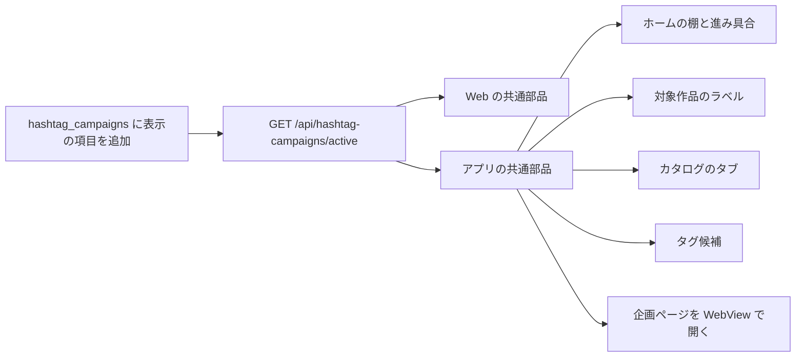
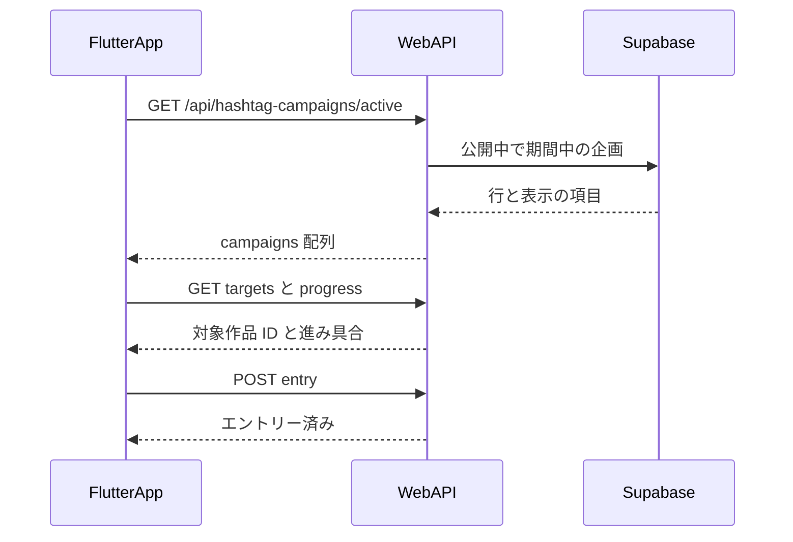
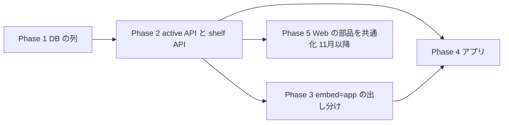

# ハッシュタグ企画の共通化(Web の設定を DB へ・アプリ対応)計画書

作成: 2026-10-22

## ゴール

次のハッシュタグ企画を、**企画の表に 1 行足すだけ**で Web とアプリ(Flutter)の両方に出せるようにする。
いまのハロウィン企画「うちの子のベストショット」は、数え方(DB と API)は共通化済みだが、
画面に出す文言と設定がコードに直接書いてあるため、アプリからは読めない。

決まっていること(2026-10-22 ユーザー決定):

- 企画ページ(賞品・規約・作例など、企画ごとに作りが違うもの)は、アプリで作り直さず **Web のページをアプリ内の WebView で開く**(アプリから離れないように)
- エントリー・進み具合・対象作品のラベル・ホームの棚・カタログのタブ・タグ候補のように**毎回同じもの**は、アプリの画面として共通の部品で作る

## コードベース調査結果

| 層 | いま | 共通か |
|---|---|---|
| DB | `hashtag_campaigns`(key / hashtag_normalized / starts_at / ends_at)、`hashtag_campaign_submissions`、`hashtag_campaign_entries`(20261015100000)。RLS は service_role だけ | 共通 |
| DB 関数 | `get_hashtag_campaign_progress`、`enter_hashtag_campaign`、`get_user_style_campaign_page`(20261016120000) | 共通 |
| API | `/api/hashtag-campaigns/[key]/{entry,progress,targets,celebration}` | celebration だけハロウィン依存(`TICKET_TIERS_BY_CAMPAIGN` が `HALLOWEEN_BEST_SHOT.tickets` を読む) |
| カタログ | `/user-styles?campaign=<key>`(`get-user-style-page.ts`) | 共通。タブ名はハロウィン定数 |
| タグ候補 | `features/posts/lib/hashtag-suggestions.ts` が `hashtag_campaigns` を読む | 共通 |
| 表示の設定 | `features/campaigns/halloween/halloween-best-shot.ts`(題名・タグの表記・棚の見出し・ラベル・期間の表記・口数のしきい値・賞品) | **ハロウィン専用** |
| 画面 | `HomeHalloweenCatalogShelf` / `HomeHalloweenEntryProgress` / `home-halloween-shelf.ts` / `HomeStylePresetCarousel`(注記と遅れ) / `HalloweenTargetBadge` / `useHalloweenTargets` / `HalloweenTicketCelebration*` / `UserStylesFeedClient`(タブ名) | **ハロウィン専用** |
| 制約 | `hashtag_campaign_entries.celebrated_tickets` の CHECK が `BETWEEN 0 AND 3` 固定 | 口数の段が 3 段を超える企画で困る |

アプリ(`~/AndroidStudioProjects/persta-app`)には WebView の依存がない(`url_launcher` だけ)。企画まわりの画面もない。

## 全体像





## データ設計

`hashtag_campaigns` に表示の項目を足す(新しい表は作らない)。どれも NULL 可にして、ハロウィンの行は値を入れて埋める。

| 列 | 型 | 中身(ハロウィンの値) |
|---|---|---|
| `title` | text | うちの子のベストショット |
| `subtitle` | text | with Halloween Magic |
| `hashtag_label` | text | #うちの子のベストショット(正規化前の表記) |
| `page_path` | text | /campaigns/halloween-best-shot |
| `catalog_tab_label` | text | 🎃 #うちの子のベストショット |
| `target_badge_label` | text | ハロウィン企画対象！ |
| `home_shelf_title` | text | ハロウィン企画 |
| `home_shelf_caption` | text | 生成して投稿すると、1カウント！ |
| `home_shelf_max_items` | smallint | 12 |
| `home_carousel_note` | text | ※ハロウィン企画には関係ありません |
| `ticket_tiers` | jsonb | `[{"works":3,"tickets":1},{"works":6,"tickets":2},{"works":10,"tickets":3}]` |
| `locales` | text[] | `{ja}`(出す画面の言語。企画は日本国内向け) |
| `is_published` | boolean | true(false なら期間中でもどこにも出さない。準備中の行のため) |

- `celebrated_tickets` の CHECK は「0 以上」だけにし、上限は `ticket_tiers` の最大口数と RPC で比べる
- 期間の表記(「10/16(金) 20:00」)は列にせず、`starts_at` / `ends_at` から画面で作る
- 賞品・規約・作例は列にしない(企画ページの中身なので Web のコードに残す)

## API

`GET /api/hashtag-campaigns/active`(新規)

- 公開中(`is_published`)で、いまが期間中で、`locales` に画面の言語(`Accept-Language` / next-intl)が入っている企画を返す
- 未ログインでも返す。見る人で変わらないので `public, s-maxage=60, stale-while-revalidate=60`(targets と同じ)
- 返す形:

```json
{
  "campaigns": [
    {
      "key": "halloween-best-shot",
      "title": "うちの子のベストショット",
      "subtitle": "with Halloween Magic",
      "hashtagLabel": "#うちの子のベストショット",
      "startsAt": "2026-10-16T11:00:00Z",
      "endsAt": "2026-10-31T15:00:00Z",
      "pageUrl": "https://persta.ai/campaigns/halloween-best-shot",
      "catalogTabLabel": "🎃 #うちの子のベストショット",
      "targetBadgeLabel": "ハロウィン企画対象！",
      "homeShelf": { "title": "ハロウィン企画", "caption": "生成して投稿すると、1カウント！", "maxItems": 12 },
      "homeCarouselNote": "※ハロウィン企画には関係ありません",
      "ticketTiers": [{ "works": 3, "tickets": 1 }, { "works": 6, "tickets": 2 }, { "works": 10, "tickets": 3 }]
    }
  ]
}
```

ホームの棚の作品は、Web のホームと同じ並び(`getCampaignSubmissionPages`)を返す `GET /api/hashtag-campaigns/[key]/shelf` も足す(アプリはサーバーの描画を使えないため)。

## WebView で企画ページを開くときの扱い

WebView の中は Web にログインしていない(アプリのログインとクッキーを共有しない)。そのため:

- アプリは `?embed=app` を付けて開く。Web はこのとき、ヘッダー・下のナビ・浮いた参加ボタン・**エントリーと進み具合のカード**を出さない
- エントリーと進み具合は、WebView の上か下にアプリの部品(共通の進み具合カード)を重ねて出す
- WebView の中のリンクは、アプリの画面にあるもの(`/free`、`/user-styles?campaign=…`、`/posts/<id>`、ハッシュタグ検索)をアプリの画面で開き、それ以外の Persta のページは WebView のまま、外のサイトは外部ブラウザで開く
- 計測: `?embed=app` のときは `SignupSourceCapture` の来た場所を `_app` にする(企画の計測の決まりに合わせる)

## EARS(要件)

- When the app or web home loads during an open, published campaign, the system shall show that campaign's shelf above 「簡単お着替え！」.
  開催中で公開済みの企画があるとき、ホームの「簡単お着替え！」の上にその企画の棚を出す。
- While a campaign is not published or outside its period, the system shall not return it from `/active`.
  公開していない企画、期間外の企画は `/active` に含めない。
- Where the viewer's locale is not in `locales`, the system shall not show the campaign UI.
  画面の言語が `locales` にないときは企画の表示を出さない。
- When a signed-in user taps entry in the app, the system shall call `POST /api/hashtag-campaigns/[key]/entry` with the Bearer session.
  アプリでエントリーを押したら、Bearer のセッションでエントリーの API を呼ぶ。
- If `/active` fails, then the app and web shall render as if there were no campaign (no error shown).
  `/active` が失敗したときは、企画がないときと同じ画面にする(エラーは出さない)。
- When a link inside the campaign WebView points to a screen the app has, the app shall open its own screen.
  WebView の中のリンクの先がアプリにある画面なら、アプリの画面で開く。
- When the used-works count crosses a tier in `ticket_tiers`, the system shall celebrate once per ticket.
  使った作品の数が `ticket_tiers` の段を越えたら、1 口ごとに 1 回お祝いを出す。

## ADR

### ADR-001: 表示の設定は新しい表でなく `hashtag_campaigns` の列にする
- Context: 企画 1 つにつき設定は 1 組。期間とタグはすでにこの表が正本
- Decision: 列を足す
- Reason: 期間とタグと表示を 1 行で見られ、取り違えが起きない
- Consequence: 多言語の文言が要る企画が来たら、そのとき `jsonb` か別の表を考える(いまは日本語だけ)

### ADR-002: 企画ページは WebView、毎回同じ部品はアプリで作る
- Context: 企画ページは賞品・規約・作例など毎回作りが違う
- Decision: 企画ページは `?embed=app` 付きの WebView、エントリー・進み具合・棚・ラベル・タブはアプリの部品
- Reason: 企画ごとのアプリの作業と審査待ちをなくす。WebView にはログインがないので、ログインが要るものはアプリ側で出す
- Consequence: アプリに `webview_flutter` を足す。Web に `embed=app` の出し分けが入る

### ADR-003: Web のハロウィン専用部品の置き換えは企画の終了後
- Context: ハロウィンは 10/31 まで開催中で、Web の画面は本番で確認済み
- Decision: Phase 1〜2(列と API)は既存の画面を変えずに足す。Web の部品を共通版へ置き換えるのは 11/1 以降
- Reason: 開催中の企画の見た目と数え方を動かさない
- Consequence: 11 月まではハロウィンの設定がコードと DB の両方にある。同じ値であることをテストで確かめる

## 実装計画



### Phase 1: DB(Web リポジトリ)
- [ ] マイグレーション: 上の列を追加、`celebrated_tickets` の CHECK を 0 以上へ、ハロウィンの行に値を入れる
- [ ] `ticket_tiers` の形を CHECK(jsonb の配列)で確かめる
- [ ] プレビューの DB で流して確かめる → 本番は `supabase db push`(差分を先に見せる)

### Phase 2: API(Web リポジトリ)
- [ ] `features/campaigns/hashtag-campaign/get-active-campaigns.ts`(読めなければ空配列)
- [ ] `app/api/hashtag-campaigns/active/route.ts` + handler
- [ ] `app/api/hashtag-campaigns/[key]/shelf/route.ts` + handler(`getCampaignSubmissionPages` の先頭から `home_shelf_max_items` 件)
- [ ] celebration の `TICKET_TIERS_BY_CAMPAIGN` を DB の `ticket_tiers` に置き換え
- [ ] ハロウィンの定数と DB の値が一致するテスト
- [ ] `docs/API.md`

### Phase 3: 企画ページの `embed=app`(Web リポジトリ)
- [ ] `app/campaigns/halloween-best-shot/page.tsx`: `embed=app` のとき、ヘッダー・ナビ・浮いたボタン・エントリーカードを出さない
- [ ] 来た場所の計測 `_app`

### Phase 4: アプリ(persta-app、PR を分ける)
- [ ] 4-1 `HashtagCampaign` のモデルと repository(active / targets / progress / entry / shelf / celebration)
- [ ] 4-2 ホーム: 棚(簡単お着替えの上)+ エントリーした人の進み具合 + 簡単お着替えの注記
- [ ] 4-3 投稿カード・フィード・詳細の対象作品ラベル(targets を 1 回取って使い回す)
- [ ] 4-4 みんなのカタログの企画タブ
- [ ] 4-5 投稿画面のタグ候補の先頭に企画のタグ
- [ ] 4-6 企画ページの WebView(`webview_flutter`)+ 上に進み具合カード + リンクの振り分け
- [ ] 4-7 お祝い(ミッション達成のあと)

### Phase 5: Web の部品を共通化(11/1 以降)
- [ ] `HomeHalloween*` → `HomeCampaign*`、`HalloweenTargetBadge` → `CampaignTargetBadge` など、`/active` の値で描く
- [ ] `halloween-best-shot.ts` から、DB へ移した値を消す(賞品・規約は残す)

## 修正対象ファイル

| ファイル | 操作 | 内容 |
|---|---|---|
| supabase/migrations/2026102xxxxxxx_add_hashtag_campaign_display.sql | 新規 | 列の追加・CHECK の変更・ハロウィンの値 |
| features/campaigns/hashtag-campaign/get-active-campaigns.ts | 新規 | 開催中の企画を読む |
| app/api/hashtag-campaigns/active/{route,handler}.ts | 新規 | 開催中の企画 |
| app/api/hashtag-campaigns/[key]/shelf/{route,handler}.ts | 新規 | ホームの棚の作品 |
| app/api/hashtag-campaigns/[key]/celebration/handler.ts | 修正 | 口数の段を DB から |
| app/campaigns/halloween-best-shot/page.tsx ほか | 修正 | `embed=app` |
| docs/API.md | 修正 | 2 本追加 |
| tests/integration/api/hashtag-campaigns-*.test.ts | 新規 | active / shelf / celebration |
| persta-app: lib/domain/models/hashtag_campaign.dart ほか | 新規 | Phase 4 |

## 品質・テスト観点

| カテゴリ | 内容 |
|---|---|
| 正常系 | 期間中・公開・日本語なら `/active` に出る。棚・ラベル・タブ・タグ候補・WebView が出る |
| 境界 | `starts_at` ちょうどは出る、`ends_at` ちょうどは出ない。`is_published=false` は期間中でも出ない |
| 異常系 | `/active` が 500 / タイムアウトでも、ホームと投稿画面は普段どおり |
| 権限 | `/active` と `/shelf` は未ログインで読める。progress / entry / celebration は本人のセッションだけ |
| 回帰 | 開催中のハロウィンの Web 画面と数え方が変わらない(Phase 1〜3) |
| 実機 | WebView のリンクの振り分け、エントリー後の進み具合の更新 |

## ロールバック

- 列はすべて追加なので、戻すときは API を消すだけで既存の画面は動く
- `celebrated_tickets` の CHECK を戻すときは、3 を超える値がないことを確かめてから
- アプリは `/active` が空なら何も出ないので、企画の行の `is_published` を false にすれば止められる

## 決めてほしいこと(実装前)

1. WebView の上に重ねるエントリーと進み具合のカードの位置(上に固定 / 下に浮かせる)
2. 次の企画が日本語だけか(`locales` を最初から持つかどうか)
