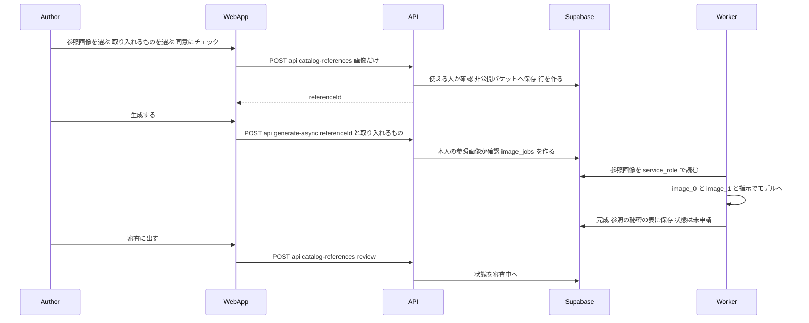
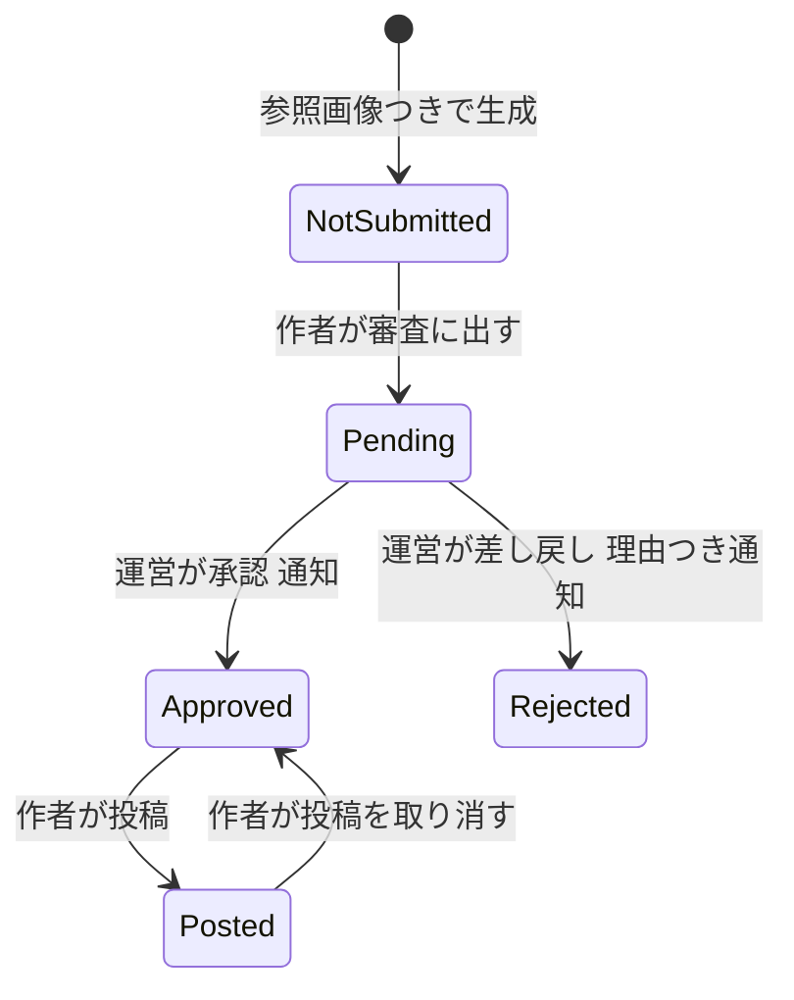
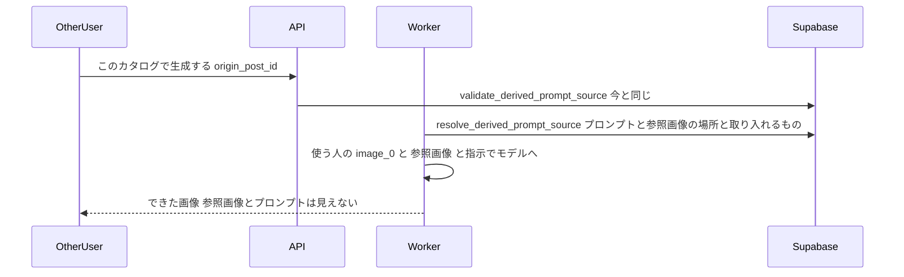
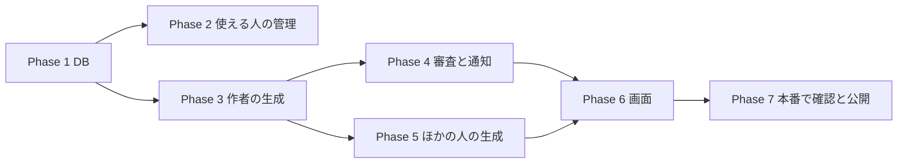

# 参照画像つきのカタログ（i2i・審査あり）実装計画

作成: 2026-10-28 / 対象: `main` @ a35a388

## 0. この計画で作るもの

「カタログをつくる」（CREATE・`/free`）で、うちの子の画像（image_0）に加えて **参照画像（image_1）** を入れて生成できるようにする。
参照画像からは、衣装・ポーズ・カメラアングル・背景の4つから取り入れるものを選べる（組み合わせ可）。

参照画像を使った作品は、**運営の審査で承認されるまで投稿できない**。承認されると作者に通知が届き、投稿ボタンが押せるようになる。
投稿されたあとは、ほかの人も「このカタログで生成する」から使える。そのとき、隠したプロンプトと参照画像が一緒にモデルへ送られるが、**参照画像はほかの人には見せない**。

### ユーザーが決めたこと（2026-10-27〜28・変えない前提）

| 論点 | 決定 |
|---|---|
| 進め方 | パターン1（審査あり）を先に作る。パターン2（メタイラスト経由・審査なし）はあと |
| 置き場所 | 「カタログをつくる」に「参照画像（任意）」の欄を足す（別の画面にしない） |
| 使える人 | **運営が選んだ人だけ**（管理画面で足す・外す） |
| 審査中の作者 | 作者本人はそのカタログを使える |
| 承認後 | 承認の通知が届き、詳細画面などで投稿ボタンが押せるようになる（自動では公開しない）。承認までは「審査中」 |
| 取り入れるもの | 最初から4つ全部（衣装・ポーズ・アングル・背景） |
| 審査に出す | 作者が選んで押す（完成のたびには回さない） |
| 差し戻し | 同じ画像は出し直せない。作り直して新しく申請する |
| ペルコイン | 今のまま（参照画像を足しても上乗せしない） |
| 参照画像 | ほかの人には見せない（公開するのは今と同じ After と Before） |

### 含めないもの

- パターン2（メタイラスト・自動チェック）
- アプリ（Flutter）での参照画像の入力（アプリは今の投稿 API の応答が変わるだけ。§6）
- 参照画像つきのカタログのペルコインの上乗せ（ADR-006）
- One-Tap Style・コーデ画面への参照画像の追加

## 1. コードベース調査結果

### 1.1 今の CREATE の生成

- 画面は `features/generation/components/FreePageBody.tsx:66-80` → `GenerationFormContainer mode="free"`。
- クライアントは画像を縮めて（長辺2048px・2MB超は1024px/JPEG 0.7、`features/generation/lib/normalize-source-image.ts:8-12`）、**base64 を JSON に入れて** `POST /api/generate-async` へ送る（`features/generation/lib/async-api.ts:136-174`）。
- サーバーは `generated-images` バケット（**公開**、`20250109000001_initial_setup.sql:74`）の `temp/{uid}/…` に上げ、`image_jobs.input_image_url` に入れる（`app/api/generate-async/handler.ts:467-518`）。
- プロンプトは `image_jobs` には残さず、RPC `create_image_job_with_prompt_execution` で別の表に入れる（`handler.ts:723-730`）。

### 1.2 2枚目の画像を送る仕組みは、すでにある

- worker は `image_jobs.style_reference_image_url`（＋`style_reference_image_bucket`）から2枚目を読む（`supabase/functions/image-gen-worker/index.ts:2383-2433`）。いまは `inspire` と `one_tap_style` だけ。
- Gemini は `parts=[image_0, image_1, text]`（`index.ts:2580`）、OpenAI は `callOpenAIImageEditMultiInputBatch`（`openai-image.ts:397`）で2枚送る（`index.ts:2706-2775`）。
- 「何を取り入れるか」の選択は Inspire の `features/inspire/components/InspireOverrideCheckbox.tsx:38-44`、指示文は `shared/generation/prompt-registry.ts:381-436`（`inspire.*_on/_off`）、組み立ては `prompt-core.ts:323`。
- 著作権の同意は Inspire の `copyright_consent_at`（`20260502124531_add_user_style_templates.sql:17,24-25`）。

### 1.3 ほかの人が使うとき（派生生成）

- API は `validate_derived_prompt_source` で使ってよいかを確かめ、`origin_post_id` だけを入れる（`handler.ts:606-645,705`）。
- worker は課金の前にもう一度確かめ（`index.ts:1939,1963-1990`）、`resolve_derived_prompt_source` で隠したプロンプトを取り出して、メモリの中だけで使う（`index.ts:2213-2244`）。
- 作者のプロンプトは、完成時に `generated_image_prompt_secrets`（service_role 専用、`20260729100000_add_prompt_secret_tables.sql:41`）に入る（`complete_image_job_with_prompt_secrets`）。
- 本人は**未投稿の自分の画像からも**派生生成できる（`20260731110000_allow_own_unposted_origin.sql`）。→「審査中も作者は使える」は、この決まりのまま満たせる。

### 1.4 投稿

- `POST /api/posts/post`（`app/api/posts/post/route.ts`）→ `postImageServer`（`features/generation/lib/server-database.ts:129-162`）が `is_posted=true` にする。
- **ブラウザから直接 UPDATE する道もある**（`features/generation/lib/database.ts:154-177`）。`generated_images` は「本人は自分の行を更新できる」RLS（本番で確認）。
- だから止めるのは DB のトリガー。前例は `enforce_no_publish_while_removed`（`20260728160000_unpost_on_suspension.sql:25-65`）で、ルートは 409 に変える（`route.ts:270-281`）。
- 投稿ボタンがある画面: 投稿詳細（本人・未投稿、`PostDetailStatic.tsx:614-618` → `PostActions.tsx:78-87`）、生成結果の一覧（`GeneratedImageGallery.tsx:234-258,287-298`、`GeneratedImageList.tsx:365,461-472`）。どれも `/posts/new/[imageId]` へ移る（`app/posts/new/[imageId]/page.tsx`）。マイページのカードには投稿ボタンがなく、詳細へ移る（`MyImageCard.tsx:63`）。

### 1.5 マイページ

- タブは `features/my-page/components/ImageTabs.tsx:7`（`all|posted|unposted`）、取得は `getMyImagesServer`（`features/my-page/lib/server-api.ts:274-331`）、API は `app/api/my-page/images/route.ts:32`。
- カードにしるしはまだない（`MyImageCard.tsx`）。

### 1.6 審査・通知・使える人の管理

- 「承認・差し戻し（理由）→ 監査ログ → 通知」の前例: カタログ申請の判定（`app/api/admin/catalog/entries/[id]/decision/route.ts`: zod `{action, reason≤500}` :19-22、RPC :94、`logAdminAction` :118、通知 :170-181）。
- 通知は `public.notifications` に service_role で入れる。`type`（最新は `20261018120000_add_personal_notices.sql:31-61`）と `entity_type`（`20260602100400_extend_notifications_for_creator_looks.sql:43-52`）の CHECK を広げる。プッシュは `push_category_for_notification_type`（`20261013120100_add_push_outbox.sql:124-157`）に足すと届く。画面の種類は `features/notifications/types.ts:5-17`・`presentation.ts`。
- 「運営が特定の人に機能を開く」前例: `creator_looks_allowlist`（`20260602100200_create_creator_looks_allowlist.sql:16-60`）＋ `/admin/creator-allowlist`（API は `requireAdmin`＋`ensureSameOrigin`＋監査）、判定は fail-closed の `isInCreatorLooksAllowlist`（`lib/auth/creator-looks.ts:45-72`）。⚠️ Inspire の `isInspireSubmitterAllowed` は環境変数で、空だと全員に開く（`lib/auth.ts:93-100`）ので使わない。
- 管理画面の認可: ページは `ensureAdminPage`（`lib/admin-page-guard.ts`）、API は `requireAdmin`（`lib/auth.ts:62-81`）、監査は `logAdminAction`（`lib/admin-audit.ts`・アクション名の union に足す）。

### 1.7 料金

ペルコインはモデルと品質・サイズだけで決まり、入力画像の枚数は関係しない（`shared/generation/percoin-costs.ts:44-89`、worker `index.ts:780`）。

## 2. 概要図

### 2.1 作者が作って審査に出すまで

### 2.2 審査と投稿

- `NotSubmitted`・`Pending`・`Rejected` のあいだは投稿できない（DB で止める）。
- どの状態でも、作者本人はその画像から生成できる（§1.3）。ただし**承認されていない元から作った画像も、審査の対象になる**（ADR-008）。作者が自分の未承認の作品から生成し直して、その結果をすぐ投稿する抜け道をふさぐため。
- ほかの人は、投稿された（＝承認された）作品からしか生成できない（今の決まりのまま）。その結果は審査なしで投稿できる。
- `Rejected` は同じ画像で出し直せない（ADR-004）。

### 2.3 ほかの人が使うとき

## 3. EARS（要件）

| ID | 要件 |
|---|---|
| REQ-001 | While the user is not on the i2i allowlist, the system shall not show the reference image field and shall reject reference uploads and jobs with 403. ／ 使える人の一覧にいない人には参照画像の欄を出さず、API も 403 で断る。 |
| REQ-002 | When an allowed user uploads a reference image with copyright consent, the system shall store it in a private bucket and return its id. ／ 同意つきで上げた参照画像を非公開の置き場所に保存し、id を返す。 |
| REQ-003 | If a job names a reference id that the requester does not own, or the requester is no longer on the allowlist, then the system shall reject the job (API) and fail it before charging (worker, in the pre-charge validation block). ／ 他人の参照画像の id や、一覧から外れた人の生成は、API で断り、worker でも**課金の前に**失敗させる。 |
| REQ-004 | When a job with a reference image completes, the system shall save the reference link and the take flags in a service_role-only table and create a review row with status not_submitted. The same applies when the job is derived from a root whose review is not approved. ／ 完成時に参照の情報を service_role 専用の表に残し、審査の行を「未申請」で作る。承認されていない元から作った派生の画像も同じ。 |
| REQ-005 | While an image has a review row whose status is not approved, the system shall refuse is_posted = true on both INSERT and UPDATE (DB trigger), and the post API shall return 409 `POSTS_REVIEW_PENDING`. Images without a review row are not affected. ／ 審査の行があって承認されていない画像は、追加でも更新でも投稿にできない。審査の行がない画像（今あるすべて）は変わらない。 |
| REQ-006 | When the author submits a not_submitted image, the system shall set it to pending. ／ 作者が審査に出すと「審査中」になる。 |
| REQ-007 | When an admin approves or rejects (reason up to 500 chars), the system shall record the decision, write an audit log, and notify the author (push included). ／ 運営の判定を記録し、監査ログを残し、作者に通知する。 |
| REQ-008 | When anyone uses a posted catalog with a reference image, the worker shall send the hidden reference image as image_1 and the take instructions, and no API response shall include the reference image or its location to anyone but the author and admins. ／ ほかの人の生成では参照画像をモデルに送るが、作者と運営以外には場所も画像も返さない。 |
| REQ-009 | While the image is not posted, the author shall be able to generate from it (existing own-unposted rule). ／ 審査中・差し戻し後も、作者本人は使える。 |
| REQ-010 | Users shall not be able to write review rows, and only the owner and admins shall be able to read them. Users shall not be able to set or change `image_jobs.catalog_reference_id` / `catalog_reference_takes`. ／ 審査の行は本人でも書けず、読めるのは本人と運営だけ。生成のジョブの参照の列も、本人は入れたり変えたりできない。 |
| REQ-013 | When a user is removed from the allowlist, the system shall stop new generations that use their reference images (including their own derived generations from unapproved works), while approved posted catalogs stay usable by others. ／ 一覧から外すと、その人の参照画像を使う新しい生成を止める（自分の未承認の作品からの生成も）。承認済みで投稿されたカタログは、ほかの人は使い続けられる。 |
| REQ-011 | When the author opens the detail of their reference image work, the system shall show its review state (未申請／審査中／差し戻しと理由／承認済み) and the matching button. ／ 詳細画面に状態と、それに合ったボタンを出す。 |
| REQ-012 | The my-page gallery shall have a 「審査中」 tab and status badges. ／ マイページに「審査中」のタブとしるし。 |

## 4. ADR

### ADR-001: 使える人は専用の表で管理する（`i2i_catalog_allowlist`）
- Context: 運営が人を選んで開きたい。Inspire の環境変数は空だと全員に開く。
- Decision: `creator_looks_allowlist` と同じ形の表と管理画面 `/admin/i2i-allowlist` を作る。判定は fail-closed。
- Consequence: 表と画面が1つずつ増える。あとで広く開くときは、判定を「全員」に変える旗を足す。

### ADR-002: 参照画像は先に別の API で上げ、生成には id だけを渡す
- Context: 今の生成は base64 を JSON で送る。2枚だと送れる大きさの上限（4.5MB）に近い。`generated-images` は公開バケット。
- Decision: `POST /api/catalog-references`（multipart、縮めた画像1枚）で、非公開の新しいバケット `catalog-references/{uid}/{uuid}` に入れ、表 `catalog_reference_images` に行を作る。生成には `referenceImageId` だけを渡す。
- Consequence: 往復が1回増える。参照画像は公開の置き場所に一度も置かれない。

### ADR-003: worker は参照画像を自分で引き、`image_jobs` に場所を書かない
- Context: 本人は自分の `image_jobs` 行を更新・閲覧できる。派生生成で作者の参照画像の場所を使う人の行に書くと漏れるうえ、書き換えで別の画像を指せてしまう。
- Decision: `image_jobs` には参照の id だけを入れ、worker が service_role で「その id の持ち主＝ジョブの持ち主か」を確かめてから読む。派生生成では `image_jobs` に何も足さず、`resolve_derived_prompt_source` を広げて、元の投稿の参照の場所と取り入れるものをプロンプトと一緒に返す。
- `image_jobs.catalog_reference_id`・`catalog_reference_takes` は、`origin_post_id` と同じく**作るときに信頼できる書き手だけが入れられ、あとから変えられない**トリガーで守る（`enforce_image_job_origin` を参考）。処理中に本人が id を消して、審査の行を作らせない抜け道をふさぐ。
- 持ち主と一覧の確認は、worker の**課金の前の確認**（`index.ts:1963-1990`）で行う。派生生成の参照の場所も、そこで引く。
- Consequence: RPC の戻り値が増える（呼んでいるのは worker だけ）。

### ADR-004: 審査の状態は別の表に持ち、投稿はトリガーで止める
- Context: 審査するのは「できた画像1枚」。`generated_images` は本人が INSERT・UPDATE でき、投稿されると誰でも読める。そこに審査の列を置くと、だれが承認したか・どの投稿が参照画像を使っているかが見えてしまい、本人が列を書き換える道もふさがなければならない。
- Decision:
  - 表 `generated_image_catalog_reviews`（image_id PK, status = not_submitted｜pending｜approved｜rejected, reason, reviewed_at, reviewed_by）を作る。RLS は本人と運営の SELECT だけで、書くのは SECURITY DEFINER の RPC か service_role だけ（本人の書き込みのポリシーを作らない）。
  - 申請は RPC `submit_catalog_review`（本人の行で not_submitted のときだけ pending へ）、判定は `apply_catalog_review_decision`（service_role だけ）。
  - `generated_images` に **BEFORE INSERT OR UPDATE** のトリガーを足す。`NEW.is_posted` が true で、その画像に審査の行があり、status が `approved` でなければ `post_review_pending` で止める。**審査の行がない画像は止めない**（今あるすべての画像は変わらない）。信頼できる書き手の判定は、自前で書かず `is_trusted_lineage_writer()`（`20260730200000`）を使う。
  - ⚠️ 本人は `generated_images` に行を INSERT できる。参照画像つきの作品の After の URL を写した新しい行を、投稿済みで作られないように、信頼できる書き手でない INSERT で、`storage_path`（または `image_url`）が審査の行を持つ画像と同じものは止める。実装の前に、ブラウザから `generated_images` に INSERT する道がいま使われているかを調べ、使われていなければ INSERT の権限を外すほうを選ぶ。
  - 差し戻した画像は出し直せない。作り直して新しく申請してもらう（2026-10-28 ユーザー決定）。
- Consequence: マイページは審査の表を本人の権限で結んで読む。投稿を取り消しても審査の行は approved のままなので、もう一度投稿できる。

### ADR-005: 「審査に出す」は作者が押す
- Context: 作者は何度も生成して、その中から選ぶ。完成のたびに審査へ回すと、運営の手間が増える。
- Decision: 完成時は「未申請」。投稿ボタンの代わりに「審査に出す」を出す（2026-10-28 ユーザー決定）。

### ADR-006: ペルコインは変えない
- 入力画像が増えても、料金表は枚数を見ていない。原価の増え方は ChatGPT Images で1回あたり約1〜2円、Nano Banana はほぼ0。今の料金のまま出す（2026-10-28 ユーザー決定）。使われ方を見てから考える。

### ADR-007: 取り入れる指示は Inspire の文を流用し、「人物は移さない」を足す
- `inspire.*_on/_off` を使い、共通で「image_1 の人物の顔・髪型・体型は使わない」を入れる。作者のうちの子が写った参照画像でも、使う人のうちの子に混ざらないようにする。

### ADR-008: 承認されていない元から作った画像も審査に回す
- Context: 作者は自分の未投稿の作品から生成できる（§1.3）。worker はそのとき参照画像を image_1 に使う。できた画像は参照の id を持たないので、そのままだと審査の行ができず、すぐに投稿できてしまう（差し戻された作品からでも）。
- Decision: 派生生成の元に審査の行があり、それが `approved` でなければ、完成した画像にも not_submitted の審査の行を作る（`complete_image_job_with_prompt_secrets` で、元の投稿の審査の行を見て決める）。元が承認済みなら、作者もほかの人も審査なしで投稿できる。
- Consequence: 作者が審査中のカタログで何枚作っても、出したいものだけを審査に出せる。

## 5. 実装計画

### Phase 1: データベース
目的: 表・列・トリガー・RPC を足す。既存の動きは変えない。
ビルド確認: `npm run lint`・`npm run typecheck`・`npm run test`・`npm run build -- --webpack`（CLAUDE.md の決まり）と migration のテスト（ローカル）。本番への適用はユーザー承認のあと。

- [ ] `i2i_catalog_allowlist`（`creator_looks_allowlist` と同じ形・本人 SELECT の RLS）
- [ ] バケット `catalog-references`（非公開・10MB・jpeg/png/webp・本人のフォルダにだけ insert）
- [ ] `catalog_reference_images`（id, user_id, storage_path, copyright_consent_at NOT NULL, created_at。本人 SELECT）
- [ ] `image_jobs.catalog_reference_id`・`image_jobs.catalog_reference_takes`（outfit/pose/angle/background の旗）と、入れる・変えるのを止めるトリガー（`enforce_image_job_origin` を参考）
- [ ] `generated_image_reference_secrets`（image_id PK, reference_id, takes。service_role 専用）
- [ ] `generated_image_catalog_reviews`（本人と運営だけ読める）と、`generated_images` の BEFORE INSERT OR UPDATE のトリガー（ADR-004）。エラーは `post_review_pending`
- [ ] RPC: `submit_catalog_review`（本人・not_submitted→pending）、`apply_catalog_review_decision`（service_role）
- [ ] `complete_image_job_with_prompt_secrets` を広げ、参照つきのとき秘密の表と審査の行を書く。承認されていない元からの派生生成でも審査の行を作る（ADR-008）
- [ ] `resolve_derived_prompt_source` を広げ、参照の場所と旗を返す
- [ ] 通知の `type` に `catalog_review_approved`・`catalog_review_rejected`、プッシュの分類に足す
- [ ] `.cursor/rules/database-design.mdc` を更新

### Phase 2: 使える人の管理画面（2026-10-30 実装）
- [x] `/admin/i2i-allowlist`（`app/(app)/admin/creator-allowlist/` を参考）と API（`requireAdmin`・`ensureSameOrigin`・監査 `i2i_allowlist_add` / `_update` / `_remove`）
- [x] 判定 `isInI2iCatalogAllowlist`（`lib/auth/i2i-catalog.ts`・fail-closed）。決まりは DB の関数 `is_in_i2i_catalog_allowlist` に置き、TS はそれを呼ぶ（worker も同じ関数を使う）。運営も一覧に足して使う（自動では開かない）
- [x] 管理画面のサイドバーに足す（「見本を使える人」）
- 画面の部品は、クリエイター招待と共通の `app/(app)/admin/_components/AllowlistManagerClient.tsx` にした（同じ270行を2つ持たない）

### Phase 3: 作者の生成（2026-10-30 実装）
- [x] `POST /api/catalog-references`（使える人か・同意・形式・大きさ。`features/inspire/lib/creator-looks-image.ts` の `processSubmissionImage` で中身から形式を確かめ、WebP に作り直す。768px 以上・10MB まで）。保存は `features/catalog-references/lib/reference-image-repository.ts`
- [x] `generate-async` に `referenceImageId`・`referenceTakes`（free だけ・使える人か・本人の参照か・作り直しでないか・派生生成とは同時に使えない）。ジョブには信頼できる書き手（ジョブを作る RPC）で `catalog_reference_id`・`catalog_reference_takes` を入れる。DB の変更は無し
- [x] worker: 課金の前に `resolve_catalog_reference_for_job` を呼ぶ（`supabase/functions/image-gen-worker/catalog-reference.ts`）。使えなければ `CATALOG_REFERENCE_UNAVAILABLE` で課金の前に失敗させる（再試行しない）。見本は非公開の置き場所から読んで image_1 にし、まねるものの指示（`inspire.*_on`）と人物の守り（新しい指示文 `free.catalog_reference_person_guard`）をプロンプトの後ろに足す（`buildCatalogReferenceDirective`）。OpenAI は2枚の経路へ（出力の起点は image_0）
- 派生生成（Phase 5）の見本も、同じ RPC が元の作品から返すので、worker の部分はこれで済んでいる（API の応答に見本が出ないことのテストは Phase 5 で）
- [ ] 5つのモデルすべてで2枚の入力が通ることを、本番の運営アカウントで確かめる（Phase 7）

### Phase 4: 審査と通知（4a・4b: 2026-10-30 実装）

- [x] 作り直しになった見本で作った、ほかの作品は、審査に出せない・承認できない（作り直しにはできる）。2026-10-30 ユーザー決定。マイグレーション `20261030180000_block_rejected_reference_reviews.sql` で `submit_catalog_review`・`apply_catalog_review_decision` に確かめを足した（見本がたどれて止まっていないときだけ通す。派生の作品は元の作品の見本をたどり、元の作品が消されてたどれないときも断る）。断りは `CATALOG_REVIEW_REFERENCE_UNAVAILABLE`（409）。審査ページは、その作品の承認ボタンを押せない
- 見本を使える人の一覧から外された人も、外される前に作った作品は審査に出せる（2026-10-30 ユーザー決定・変更なし）
- [x] `POST /api/catalog-references/review`（作者が審査に出す）。本人のログインの権限で RPC `submit_catalog_review` を呼ぶ。見つからない（他人の作品を含む）404。「未申請」でなければ本人の審査の行を読み、審査中・承認済み・作り直しを別の 409 で返す。RPC にログインの情報が届かない（42501）ときは 401
- [x] 管理画面の審査ページ `/admin/catalog-reviews`（参照画像は期限つきの URL・Before・After・取り入れたもの・プロンプト・作者を並べる。派生の作品は元の作品の見本を使う。見本がほかの作品の審査で作り直しになっていれば印を出す）と判定 API `POST /api/admin/catalog-reviews/[imageId]/decision`（RPC `apply_catalog_review_decision`・監査ログ `catalog_review_approve` / `_reject`）→ 4b
- [x] 通知の表示（`features/notifications/types.ts`・`presentation.ts`・アイコン）。文言は15言語（承認・作り直し・理由の4分類）。審査した運営は見せない。押すと投稿詳細へ（今の決まりのまま）
- [x] 投稿 API の 409 `POSTS_REVIEW_PENDING`（Phase 6 から前倒し。文言は15言語・`post-error-codes.ts` に判定）

### Phase 5: ほかの人の生成
- [ ] worker の派生生成で、RPC が返した参照画像を image_1 にする（場所を引くのは課金の前）。元が承認されていない作者本人の生成では、作者がまだ一覧にいるかも確かめる
- [ ] 元の投稿が削除・非公開になったら、参照画像も使わない（今のプロンプトの決まりと同じ）
- [ ] 応答・投稿詳細・カタログの一覧に、参照画像や場所が入っていないことをテストで確かめる

### Phase 6: 画面と文言（6a: 2026-10-30 実装。まずは運営が一覧に自分を足して試す。6b-1: 2026-10-31 実装）
- [x] CREATE: 「参照画像（任意）」の欄・取り入れるもの4つ・同意のチェック・「ほかの人には見えません」「運営の確認のあとで投稿できます」（使える人にだけ出す。`/free` のサーバーで一覧を確かめる。派生生成では出さない）→ 6a
- [x] CREATE を第2案に（§10）→ 6b-1
  - うちの子と見本を2枚並べる（使える人だけ。ほかの人の画像の欄は今のまま）
  - まねるものは、絵と一行の説明つきのカード4枚。まねないもの（顔・髪型・絵のタッチ）を書く
  - 同意は、有効な同意が無い人にだけ、見本を選んだ直後に「使える見本・使えない見本」を出す（毎回のチェックはやめた）。閉じたら上げない。あとから見返せる（見返して「わかりました」を押しても同意にはしない）
  - 同意はサーバーに本人ごとに残す（新しい表 `catalog_reference_consents`・`POST /api/catalog-references/consent`・時刻は DB の now()）。見本の行を作るときに DB（トリガー）が有効な同意を確かめ、`copyright_consent_at` にその時刻を写す（同意の画面を出していない時刻を、同意の時刻として残さない）。API も本文を受け取る前に確かめて早く断る。6a で見本を上げた人は、同意済みとして移した
  - 本人の見本が作り直しになったら、DB のトリガーが同じトランザクションで同意を無効にする（行は消さず `revoked_at`）。同意の画面をもう一度出す（「次からは出ません」は出さない）。開いたあとに無効になっていたら、選んだ画像を持ったまま同意の画面を出す
  - 使える人に最初の1回だけ「先行公開」の案内（一度でも同意した人には出さない。見たかどうかは本人ごとに端末に残す）
  - 言葉: 「見本の画像は、あなたと運営だけが見られます」・投稿の画面の「承認済みです」→「公開できます」
- [x] CREATE を「プロンプトから」「イラストから」のタブに分ける（2026-10-31 ユーザー決定）→ 6b-1.5
  - User ORIGINAL と同じ下線つきのタブ（`CatalogTabBar`）を、同じく白い枠の外の帯（`StylesCatalogChipBar`）に置く。見本を使える人だけに出す（一般の人の CREATE は今のまま）。はじめは「プロンプトから」
  - 「プロンプトから」: 今までの作る画面（見本の欄なし・プロンプト必須）。「イラストから」で選んだ見本は送らない
  - 「イラストから」: うちの子と見本の2枚並べ・まねるもののカード。見本を入れてまねるものを選ぶまで生成できない。**プロンプトはなくてもよい**（見出しは「ほかに伝えたいこと」、入力欄の下に「なくても生成できます」）
  - 本文なしの見本つきの依頼は、受付で通し、本文は空文字で残す（本文の行が無いと失敗扱いになるため）。worker は、見本を解決できたジョブ（作者の見本・見本つきの作品からの派生）だけ空文字を許し、本文が空なら見本の指示文そのものを本文（User's Direction）として渡す（錨の「触れていないものは元のまま」とぶつからないように）
  - プロンプトなしで作られた作品は、本文の API が空の本文を返し、コピーや派生生成の画面では「このカタログはプロンプトなしで作られています」と出す
  - タブを切り替えても、見本の欄は作り直さず隠すだけ（この画面での同意や上げている途中の状態を消さない）。「イラストから」では見本は必須（見出しも「必須」）
  - 「先行公開」の案内は作る画面のほうで出し、「ためしてみる」で「イラストから」へ移る
- [x] 投稿の画面: 審査が済んでいないために断られたら（409 `POSTS_REVIEW_PENDING`）、その場で「審査に出す」→ 6a
- [ ] 生成結果・投稿詳細: 状態に合わせて「審査に出す／審査中／差し戻し（理由）／投稿」
- [ ] マイページ: 「審査中」のタブとしるし
- [ ] 投稿 API の 409 `POSTS_REVIEW_PENDING` の文言
- [ ] 15言語の文言（`messages/*.ts`）。⚠️ 有料化をほのめかす表現は書かない（6a の欄と「審査に出す」は済み。見本を上げる API・審査に出す API のエラーの文言は日本語だけ）

### Phase 7: 本番で確認と公開
- [ ] migration を本番に適用（承認のあと）・worker をデプロイ
- [ ] 運営アカウントを一覧に足し、作る→審査→承認→投稿→別アカウントで使う、を通す
- [ ] 選んだ作者を一覧に足す

## 6. 修正対象ファイル（主なもの）

| ファイル | 操作 | 内容 |
|---|---|---|
| `supabase/migrations/2026…_add_i2i_catalog_review.sql` | 新規 | Phase 1 の全部（審査の表・トリガー・RPC） |
| `app/api/catalog-references/route.ts`・`review/route.ts` | 新規 | 参照画像の保存・審査に出す |
| `app/api/admin/i2i-allowlist/**`・`app/(app)/admin/i2i-allowlist/**` | 新規 | 使える人の管理 |
| `app/api/admin/catalog-reviews/**`・`app/(app)/admin/catalog-reviews/**` | 新規 | 審査 |
| `lib/auth/i2i-catalog.ts` | 新規 | 使える人の判定 |
| `app/api/generate-async/handler.ts`・`features/generation/lib/schema.ts` | 修正 | 参照の id と旗 |
| `supabase/functions/image-gen-worker/index.ts`・`shared/generation/prompt-*.ts` | 修正 | image_1 と指示 |
| `features/generation/components/GenerationFormContainer.tsx` ほか | 修正 | 参照画像の欄 |
| `features/posts/components/PostDetailStatic.tsx`・`PostActions.tsx`・`GeneratedImageGallery.tsx`・`GeneratedImageList.tsx` | 修正 | 状態とボタン |
| `app/api/posts/post/route.ts` | 修正 | 409 の対応づけ |
| `features/my-page/**`・`app/api/my-page/images/route.ts` | 修正 | 「審査中」のタブ・しるし |
| `features/notifications/**` | 修正 | 通知の表示 |
| `lib/admin-audit.ts` | 修正 | 監査のアクション名 |
| `messages/*.ts`（15言語） | 修正 | 文言 |

**アプリ（Flutter）**: 投稿 API が 409 `POSTS_REVIEW_PENDING` を返すことがある。今の `{error, errorCode}` の形なので、古いアプリでも文言は出る。`GET /api/my-page/images` の `filter` に新しい値を足しても、既存の値の動きは変わらない。

## 7. 品質・テスト観点

| カテゴリ | テスト |
|---|---|
| 正常系 | 使える人が参照画像つきで生成→審査に出す→承認→投稿→別の人が使うと image_1 が送られる |
| 権限 | 一覧にいない人の API は 403／他人の参照 id は API と worker（課金の前）の両方で断る／本人は審査の行を書けず、他人の審査の行は読めない／本人はジョブの参照の列を入れたり変えたりできない／承認前の投稿は route・ブラウザ直の UPDATE・新しい行の INSERT のどれでも止まる／審査の行がない画像は今までどおり投稿できる |
| 抜け道 | 差し戻された作品・審査中の作品から作者が生成した画像は、審査に出すまで投稿できない／一覧から外した作者は、自分の未承認の作品からも生成できない |
| 漏れ | 派生生成の `image_jobs`・投稿詳細・カタログ一覧・my-page の応答に参照の場所が入らない |
| 異常系 | 参照画像が消えていたら課金の前に失敗する（課金しない）／差し戻しは出し直せない |
| 実機 | 5モデルで2枚の入力・スマホ幅の CREATE の欄 |

## 8. ロールバック

- 表と列は足すだけ。使える人の一覧を空にすれば、新しい参照画像の保存と、作者の参照画像を使う生成は止まる（デプロイ不要）。承認済みで投稿されたカタログは、ほかの人は使い続けられる。それも止めるときは、その投稿を非公開にする。
- 投稿を止めるトリガーは、審査の行がない画像（今あるすべて）には効かない。

## 9. 決まったこと（2026-10-28）

1. 「審査に出す」は作者が押す（ADR-005）。
2. 差し戻した画像は出し直せない。作り直して新しく申請する（ADR-004）。
3. ペルコインは今のまま（ADR-006）。

まだ決めていないこと: 運営が1日に審査できる件数、使う人が取り入れるものを選べるか（最初は作者が選んだものをそのまま使う）。

## 10. 2026-10-29 の更新

### 画面は第2案で作る（ユーザー決定）

他社（Google Whisk・Midjourney・Leonardo.ai・Adobe Firefly・App Store Connect・YouTube・LINE Creators Market）を見て作り直した画面図（https://claude.ai/artifact/G98NNpkPCJy4iuiKCtu9Xn の第2案）で Phase 6 を作る。§5 Phase 6 の TODO はこちらで置き換える。

- CREATE: 「うちの子」と「見本」を上で2枚並べる。「見本から、まねるもの」は絵と一行の説明つきのカード4枚。「まねないもの：顔・髪型・絵のタッチ」を書く
- 見本を入れた時点で「公開前に運営が確認します（目安：2日以内・仮）。確認のあいだもあなたは使えます」を帯で出す
- 同意は、見本を初めて入れたときだけ「使える見本・使えない見本」を絵の例で見せる（毎回のチェックボックスはやめる。`copyright_consent_at` はこの同意の時刻）
- 進み具合「つくる → 審査に出す → 確認中 → 公開できる」を、生成結果・投稿詳細・審査の状況で同じ形で出す
- マイページは「審査中」タブをやめ、入口を1つ → 「審査の状況」1ページ（今やることがある順・行ごとにボタン）。通知もそこへ
- 作り直しは理由をガイドラインの項目つきで伝え、「見本を変えて作り直す」でまねるもの・文章を引き継ぐ
- 選ばれた人には最初の1回だけ案内のシート（「先行公開」）
- 言葉: 参照画像→見本、取り入れるもの→まねるもの、審査中→確認中、差し戻し→作り直しが必要、承認済み→公開できます

### Phase 1 で計画から変えたこと

- **派生生成で見本を引く RPC を分けた**: `resolve_derived_prompt_source` の戻り値を広げず、`resolve_catalog_reference_for_job(job_id)` を足した。戻り値の型を変えると DROP が要るのと、作者自身の見本の確認（一覧にいるか・本人の見本か）も同じ場所でしたいため。worker は課金の前にこれを呼ぶ
- **INSERT の抜け道は無かった**: 本番で確かめたところ、`generated_images` には anon / authenticated の INSERT 権限が無い。ADR-004 の「写した行を投稿済みで作る」道は無いので、`storage_path` の照合はしない。トリガーは INSERT にも掛けておく（保険）
- **作り直しになった作品は、作者本人も元にできない**: `validate_derived_prompt_source` に「根の審査が rejected なら不可」を足した。運営が使えないと判断した見本で生成を続けさせないため
- **理由の項目**: `reason_category`（`official_or_others_work` / `real_person` / `sexual_or_violent` / `other`）を足した。rejected のとき必須
- **通知は判定の RPC の中で作る**: 状態の更新と通知を同じトランザクションにした（カタログ申請の前例はルートで作っている）
