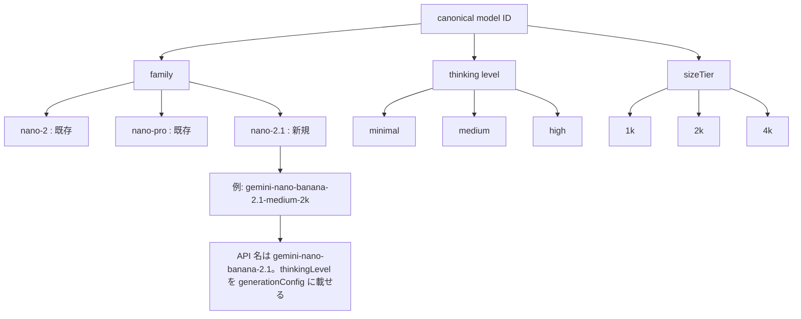
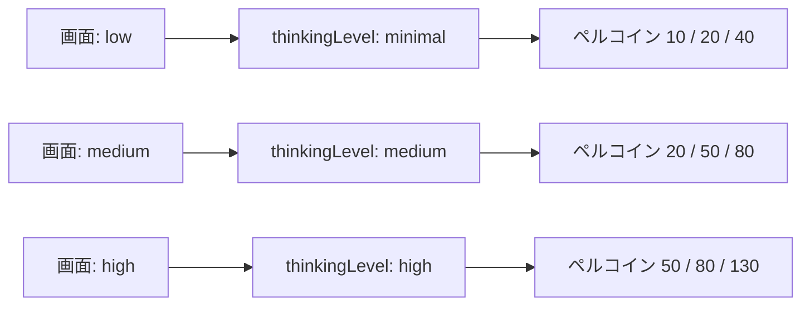
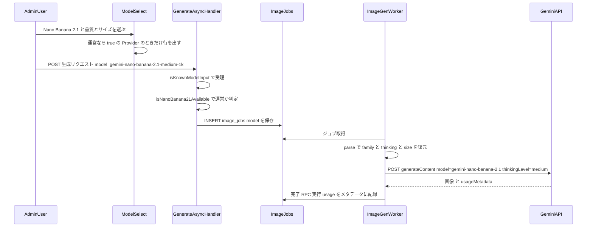
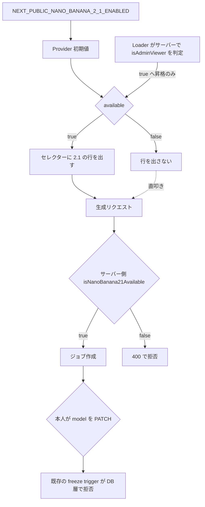
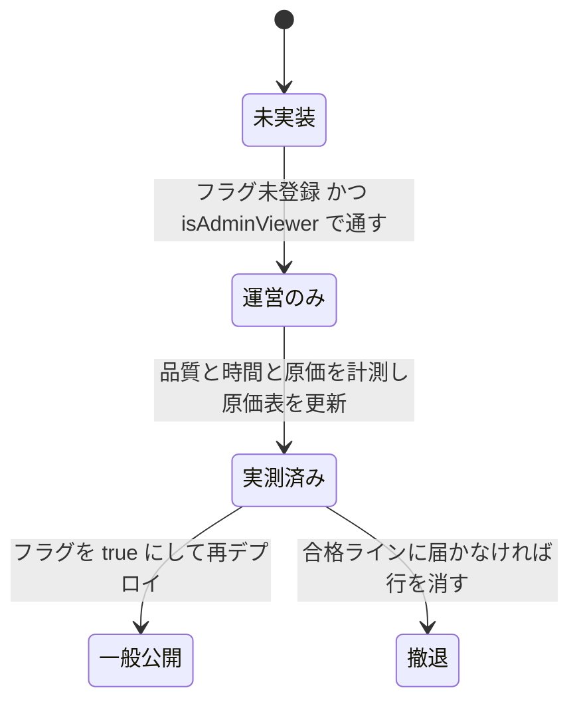
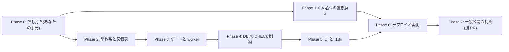

# Nano Banana 2.1 導入 + 期限切れプレビュー名の置き換え 実装計画

作成日: 2026-10-13
対象: ①`gemini-nano-banana-2.1`(Nano Banana 2.1)を**新しい生成モデルとして追加**する(第一段階は運営限定)。②すでに公式の停止予定日を過ぎているプレビュー名を使っている既存の Nano 2 / Nano Pro を、正式版(GA)の名前へ置き換える。

> ⚠️ この文書は**計画書のみ**。実装はまだしない。

---

## 0. ヒアリング結果(合意事項)

| 項目 | 決定 |
|---|---|
| 導入方針 | **既存モデルの置き換えはしない。新規追加**(Nano 2 / Nano Pro / GPT は残す) |
| 公開の進め方 | **A: まず運営だけで検証し、合格ラインを満たしたら全員に公開**(GPT 2.5 と同じ型) |
| サイズ | 1k / 2k / 4k(2.1 に 0.5k は無い) |
| 考える量 | **画面で選ばせる**。表示は GPT と同じ「品質」(low / medium / high)。内部では thinking level(minimal / medium / high)に対応させる |
| ペルコイン | **GPT に合わせる**(下表) |
| 期限切れのプレビュー名 | **今回の計画に含める**(Nano 2 と Pro の API 名を GA 名へ) |
| 別タスク(今回は入れない) | Gemini: 検索連動・参照画像14枚 / GPT: 背景透過・マスク・n(複数出力) |

### ペルコイン消費量(決定)

| 品質(内部の thinking level) | 1k | 2k | 4k |
|---|---:|---:|---:|
| low(minimal) | 10 | 20 | 40 |
| medium(medium) | 20 | 50 | 80 |
| high(high) | 50 | 80 | 130 |

GPT(`OPENAI_IMAGE_PERCOIN_COSTS`)と**まったく同じ数字**。

### 現行モデルのペルコイン(参考・変更しない)

| モデル | 消費 |
|---|---|
| Nano Banana 2 | 0.5k = 10 / 1k = 20 |
| Nano Banana Pro | 1k = 50 / 2k = 80 / 4k = 100 |
| ChatGPT Images 2.0・2.5 | 上の表と同じ |

---

## 1. コードベース調査結果

### 1-0. 調べた前提(2026-10-13 時点)

**Google 公式(ai.google.dev)で確認できたこと**

| 項目 | 内容 |
|---|---|
| モデル ID | `gemini-nano-banana-2.1`(Stable・2026-10-06 GA) |
| サイズ | 1K / 2K / 4K(既定 1K)。**0.5K は無い** |
| 価格 | 入力 $1.50 / 1M tok(テキスト・画像・動画)、出力画像 $30 / 1M tok。1枚あたり 1K $0.0336 / 2K $0.0504 / 4K $0.113 |
| thinking level | `minimal` / `medium` / `high`。**既定は medium**。**オフにできない**。Nano 2 は `minimal` / `high` のみ(既定 minimal) |
| thinking の課金 | 「thinking は常に走り、トークンは既定で課金される」。**1回あたりの量は公式に無い**。考える途中の画像は課金されない |
| 従来の `generateContent` での書き方 | `generationConfig.thinkingConfig.thinkingLevel`。**公式に REST の例は無く、SDK の例から推測した形**。大文字小文字も食い違う(表は小文字、SDK 例は `"High"`) |
| 廃止予定表 | `gemini-3.1-flash-image-preview` と `gemini-3-pro-image-preview` は**停止予定日 2026-06-25(すでに過ぎている)**。`gemini-3.1-flash-image`(GA)は停止日なし。`gemini-2.5-flash-image` は 2027-03-15 |

出典: Gemini Nano Banana 2.1 モデルページ / Pricing / Deprecations / Image generation(いずれも ai.google.dev/gemini-api/docs)

**Persta の本番(2026-10-13 取得)**

| 項目 | 結果 |
|---|---|
| 直近30日の生成 | 1,403 件中 Gemini は 20 件(約 1.4%) |
| プレビュー名での成功 | 10/12 にも成功(直近45日: 成功 28 件・失敗 1 件)。**停止予定日を過ぎても止められていない**=いつ止まってもおかしくない |
| 生成時間(Gemini の成功ジョブ・全期間) | Nano 2 0.5k: p50 15.8s / p90 19.3s(n=399)、Nano 2 1k: p50 19.2s / p90 29.6s(n=72)、Pro 1k: p50 26.3s / p90 30.0s(n=99)、Pro 2k: p50 32.0s(n=5)、Pro 4k: p50 51.6s / p90 56.9s(n=13) |
| 参考: GPT 2.5 計画書の合格ライン | ①同一性 ②生成時間 ③実原価 ④エラー・保存の事故なし |

### 1-1. Persta が今使っている Gemini のモデル名(⭐置き換え対象)

| 保存名(DB の `model`) | API に送る名前 | 公式の状態 |
|---|---|---|
| `gemini-3.1-flash-image-preview-512` / `-1024` | `gemini-3.1-flash-image-preview` | プレビュー・停止予定日 **過ぎている** |
| `gemini-3-pro-image-1k` / `-2k` / `-4k` | `gemini-3-pro-image-preview` | プレビュー・停止予定日 **過ぎている** |
| `gemini-2.5-flash-image`(旧データ・フォールバック) | 同名 | 2027-03-15 停止予定 |

API 名を決めている場所は**複数ある**(同じ関数が Node 側と Deno 側に二重に存在する)。

| 場所 | 内容 | ランタイム |
|---|---|---|
| `features/generation/types.ts:289-303` `toApiModelName()` | 保存名 → API 名 | Node(ゲスト同期経路ほか) |
| `supabase/functions/image-gen-worker/index.ts:719-727` `toApiModelName()` | 同上(コピー) | Deno(非同期 worker・本流) |
| `supabase/functions/image-gen-worker/index.ts:622-632` | `GeminiApiModel` の型 | Deno |
| `supabase/functions/image-gen-worker/index.ts:1156, 2590, 2637, 2643` | **`apiModel === "gemini-3.1-flash-image-preview"` という文字列比較で、`responseModalities` / `imageSize` の付与を分岐**している | Deno |
| `app/i2i/[slug]/generate/route.ts:19` | `const MODEL_NAME = "gemini-3.1-flash-image-preview"`(公開 i2i 経路。**`toApiModelName` を通らず直書き**) | Node |
| `features/generation/lib/guest-generate.ts:389-390` | ゲストの Gemini 同期呼び出し(`toApiModelName` を使う) | Node |
| `features/generation/lib/nanobanana-client.ts:50` | URL の組み立て | Node |

⚠️ **落とし穴(置き換え時に必ず見る)**: 文字列比較(上の4か所)は、API 名を GA 名へ変えると**黙って条件が外れる**。`requiresResponseModalities` が false になって `responseModalities` が送られなくなり、`imageSize` の付与条件も外れる。型は変わらないため typecheck では検出できない。API 名の定数化と、リクエスト形の単体テストが要る。

⚠️ **落とし穴(2.1 追加時)**: 両方の `toApiModelName()` は、どれにも一致しないと**`gemini-2.5-flash-image` を黙って返す**(`types.ts:303`・worker `:726`)。worker の `normalizeModelName` も未知の値を `gemini-2.5-flash-image` に丸める(`:681-710`・`console.warn` のみ)。新しい保存名を足し忘れると、**2.1 を選んだのに 2.5 が走り、2.1 の課金額が引かれる**事故になる。

### 1-2. モデル ID の型体系(family の先例)

- `shared/generation/gemini-banana-model.ts`: `GEMINI_BANANA_FAMILIES = ["nano-2", "nano-pro"]`、`composeGeminiBananaModel(family, sizeTier)`、`parseGeminiBananaModel()`、`getSizeTiersForFamily()`。**quality の軸は無い**。
- `shared/generation/openai-image-model.ts`: `family × quality × sizeTier` の 3 軸。canonical は `${family}-${quality}-${sizeTier}`。ペルコインも同ファイルの `OPENAI_IMAGE_PERCOIN_COSTS`。
- → **2.1 は Gemini 側の family に追加し、OpenAI 側と同じ 3 軸の形(family × thinking × size)で持つ**のが最小の変更になる。

### 1-3. 触る場所(GPT 2.5 導入の実績から逆引き)

GPT 2.5(`gpt-image-2.5-flare`)の導入で触ったファイルを実際に数えた(`GptImage25` / `isGptImage25Available` などの参照)。2.1 でも同じ場所が対象になる。

| 区分 | ファイル | 2.1 で必要な変更 |
|---|---|---|
| 型・定数 | `shared/generation/gemini-banana-model.ts` | family `nano-2.1`・thinking 軸・canonical 9 値・ペルコイン表・parse/compose |
| 型・定数 | `features/generation/types.ts` | `GeminiModel` union・`KNOWN_MODEL_INPUTS`・`normalizeModelName`・`toApiModelName`・`extractImageSize` |
| 設定 | `features/generation/lib/model-config.ts` | `MODEL_PERCOIN_COSTS`・`resolveEffectiveModelForAuthState`・`resolveRequestedModelFromUrl`・無料プラン許可リスト(公開時) |
| 環境 | `lib/env.ts` | `NEXT_PUBLIC_NANO_BANANA_2_1_ENABLED` と `isNanoBanana21Available(userId)`(`isGptImage25Available` と同じ形) |
| ゲート(サーバー) | `app/api/generate-async/handler.ts`・`app/(app)/style/generate-async/handler.ts`・`app/(app)/style/generate/handler.ts` | 運営以外が 2.1 を指定したら 400(REQ-006 と同じ) |
| ゲート(クライアント) | `features/generation/components/GptImage25AvailabilityProvider.tsx`・`GptImage25AvailabilityLoader.tsx`・`components/LocaleShell.tsx:53,69` | 同じ形で Nano 2.1 版を新設 |
| UI | `LockableModelSelect.tsx`(行の追加・遷移ルール)・`GeminiBananaSizeSelector.tsx`(family ごとのサイズ)・`GptImage2QualitySelector.tsx`(⭐OpenAI 専用 → 2.1 でも使えるよう一般化)・`GenerationModelControls.tsx` | 下の 1-4 |
| 表示 | `features/generation/lib/model-display.ts`・`model-tags.ts` | ブランド名「Nano Banana 2.1」・tier チップ・サイズ |
| 保存値 | `features/generation/lib/form-preferences.ts` の `PERSISTABLE_MODELS` | 2.1 の 9 値を追加 |
| worker | `supabase/functions/image-gen-worker/index.ts` | 型・`normalizeModelName`・`toApiModelName`・`extractImageSize`・`getPercoinCost`・`resolveGeminiRequestTimeoutMs`・リクエスト組み立て(thinkingConfig)・usage 記録 |
| worker | `supabase/functions/image-gen-worker/gemini-request-config.ts` | `buildGeminiGenerationConfig` に `thinkingLevel` を追加(純粋関数・Jest で単体テスト可) |
| DB | `supabase/migrations/` | `generated_images_model_check` と `image_jobs_model_check` に 9 値を追加(直近 `20260910120000_allow_gpt_image_2_5_flare_models.sql` が型) |
| 原価 | `features/admin-dashboard/lib/ai-cost-rates.ts` | `MODEL_COST_RATES` に 9 行(⭐未登録だと原価が 0 円で消える) |
| i18n | `messages/*.ts` 15 ファイル | モデル名・品質ラベル・説明・サイズ(下の 1-6) |

### 1-4. UI の現状(モデル選択まわり)

```
GenerationModelControls(共通・4導線から呼ばれる)
 ├─ LockableModelSelect        … 1段目: 2.5 / 2.0 / Nano Banana 2 / Nano Banana Pro
 ├─ GptImage2QualitySelector   … ⭐ parseOpenAIImageModel が null なら非表示(OpenAI 専用)
 ├─ GptImage2SizeSelector      … OpenAI 選択時のみ
 └─ GeminiBananaSizeSelector   … Gemini 選択時のみ(parseGeminiBananaModel)
```

- 呼び出し元 4 導線(`/style`・coordinate/じゆう・inspire・Creator Looks 詳細)は共通コンポーネントなので、1 か所直せば 4 導線に反映される(GPT 2.5 計画書 §1-4)。
- `LockableModelSelect` の行の並びは `MODEL_OPTIONS`。行クリックで family を切り替え、現在の size が新 family で有効なら維持する(`toOptionCanonicalValue`)。
- **品質セレクターは OpenAI 専用**。2.1 の thinking を「品質」として出すには、family を問わず使える形へ一般化する必要がある(ADR-002)。

### 1-5. 段階公開(運営限定)のパターン

GPT 2.5 計画書 §1-5・§1-6・§1-6b の実績をそのまま踏襲する。

- `lib/env.ts` に `isXxxPubliclyEnabled()` と `isXxxAvailable(userId) = 公開フラグ || isAdminViewer(userId)`。
- クライアントへは **Provider(初期値=フラグ) + Suspense 隔離した Loader が運営なら true へ昇格**(`GptImage25Availability*`)。
- サーバー側はジョブ作成前に**必ずゲートで弾く**。無料プランのモデル制限は UI だけで、サーバーは見ていない(意図的)。
- ✅ **`image_jobs.model` の作成後変更を DB 層で拒否する trigger は導入済み**(`20260910120100_freeze_image_jobs_model.sql`)。GPT 2.5 のとき必要になった TOCTOU 対策で、2.1 のゲートにもそのまま効く(新しい trigger は不要)。

### 1-6. i18n

- `messages/` は **15 言語**。`ja.ts` が型の正本で、他 14 ファイルは `satisfies DeepReplaceStrings<typeof jaMessages>`。**`ja.ts` にキーを足すと残り 14 ファイルすべてで typecheck が落ちる**ため 15 ファイル同時に足す。
- 既存キー: `modelNanoBanana2` / `modelNanoBananaPro` / `gptImage2QualityLabel` / `gptImage2QualityLow|Medium|High`(「素早く生成：30秒程度」など時間つき)/ `geminiBananaSizeLabel` / `geminiBananaSize05k|1k|2k|4k`(4k は「最高解像度：最大5504px」= Pro の値)。
- 2.1 用に足す想定: `modelNanoBanana21`、品質ラベル 3 つ(所要時間は**実測してから**書く)、サイズの説明(**2.1 の実際の出力ピクセル数は未確認**)、ツールチップ。

### 1-7. 原価表

`features/admin-dashboard/lib/ai-cost-rates.ts` の `gemini(outputUsd, tier, inputImageTokens)` ヘルパーに**入力単価の tier を 1 つ足す**($1.50 / 1M)。入力画像は 1,120 tok(Gemini 3 の既定)で計算されている。

2.1 の 1 生成あたり試算(ワンタップ・プロンプト約 1,640 tok・入力画像 1,120 tok・thinking の追加分は含めない):

| サイズ | 出力 | 入力(約 2,760 tok) | 合計 |
|---|---:|---:|---:|
| 1k | $0.0336 | $0.0041 | **$0.038** |
| 2k | $0.0504 | $0.0041 | **$0.055** |
| 4k | $0.113 | $0.0041 | **$0.117** |

### 1-8. 利益ラインの確認(合格ライン③の根拠)

`model-config.ts` のコメントに残る実測では、**GPT の 1 ペルコインあたり原価は ¥0.34〜0.70**(High が最も高く ¥0.64〜0.70)。2.1 でも **1 ペルコインあたり ¥0.70 以下**を上限とすると、各セルで許される原価は次のとおり($1 = ¥155 換算)。

| 品質 | サイズ | ペルコイン | 原価の上限 | thinking 抜きの試算 | 余裕 |
|---|---|---:|---:|---:|---:|
| low | 1k | 10 | $0.045 | $0.038 | **$0.007(約 230 tok 相当)** |
| low | 2k | 20 | $0.090 | $0.055 | $0.035 |
| low | 4k | 40 | $0.181 | $0.117 | $0.064 |
| medium | 1k | 20 | $0.090 | $0.038 | $0.052 |
| medium | 2k | 50 | $0.226 | $0.055 | $0.171 |
| medium | 4k | 80 | $0.361 | $0.117 | $0.244 |
| high | 1k | 50 | $0.226 | $0.038 | $0.188 |
| high | 2k | 80 | $0.361 | $0.055 | $0.306 |
| high | 4k | 130 | $0.587 | $0.117 | $0.470 |

⚠️ **いちばん薄いのは「low × 1k」(10 ペルコイン)。** minimal でも thinking は走るため、thinking のトークンが出力単価($30 / 1M)で課金されると仮定すると、**約 230 トークンで上限に届く**。thinking の量は公式に無く、**実測するまで利益が出るか分からない**。他のセルには十分な余裕がある。

### 1-9. 生成時間の既存設定

`resolveGeminiRequestTimeoutMs`(worker `:123`)は保存名ごとに分岐し、**未知の保存名は既定 60 秒に落ちる**。2.1 は thinking があるぶん遅い可能性があり、既定 60 秒のままでは high / 4k が確実に切れる。9 値それぞれに明示のタイムアウトを持たせる(初期値は ADR-007)。

---

## 2. 概要図

### 2-1. モデル ID の構造



### 2-2. 画面の「品質」と内部の対応



### 2-3. 生成リクエストのシーケンス



### 2-4. 運営限定ゲート(二重化 + 既存の freeze trigger)



### 2-5. 公開までの状態遷移



---

## 3. EARS(要件定義)

### 3-1. モデル選択

- **REQ-001** (状態駆動) — While the viewer is an admin viewer, the system shall display a "Nano Banana 2.1" row in the generation model selector on all four generation surfaces.
  運営プレビュー権限を持つ利用者に対し、4 つの生成導線すべてのモデルセレクターに「Nano Banana 2.1」の行を表示すること。
- **REQ-002** (状態駆動) — While `NEXT_PUBLIC_NANO_BANANA_2_1_ENABLED` is not `"true"` and the viewer is not an admin viewer, the system shall not display the "Nano Banana 2.1" row.
  フラグが未設定で運営でもない利用者には、2.1 の行を表示しないこと。
- **REQ-003** (イベント駆動) — When the user switches to the Nano Banana 2.1 row, the system shall preserve the currently selected size tier if valid, and otherwise fall back to `1k`; the quality shall default to `low`.
  2.1 の行へ切り替えたとき、現在のサイズが有効なら維持し、無効なら 1k へ落とす。品質は low を既定とすること。
- **REQ-004** (オプション) — Where the selected model family is `nano-2.1`, the system shall offer `low` / `medium` / `high` as quality options and `1k` / `2k` / `4k` as size options.
  2.1 を選択中の品質は low / medium / high、サイズは 1k / 2k / 4k の選択肢とすること(0.5k は出さない)。
- **REQ-005** (イベント駆動) — When the user changes the quality, the system shall display the corresponding Percoin cost for the selected size before the user submits.
  品質を変えたとき、選択中のサイズに対応するペルコイン消費量を送信前に表示すること。

### 3-2. 生成の実行

- **REQ-006** (異常系) — If a generation request specifies a `gemini-nano-banana-2.1-*` model and the requester is not an admin viewer while the public flag is off, then the system shall reject the request with HTTP 400 and not create an image job.
  段階公開中に運営以外が 2.1 を指定して直接リクエストした場合、400 で拒否しジョブを作らないこと(3 つのハンドラすべて)。
- **REQ-007** (イベント駆動) — When a 2.1 job is dispatched, the system shall call `gemini-nano-banana-2.1` with the thinking level that corresponds to the quality in the canonical ID and the image size that corresponds to the size tier.
  2.1 のジョブは、保存名の品質に対応する thinking level と、サイズに対応する画像サイズで `gemini-nano-banana-2.1` を呼ぶこと。
- **REQ-008** (イベント駆動) — When a 2.1 job completes, the system shall persist `generated_images.model` and `image_jobs.model` as the full canonical ID, and record the usage metadata (including thinking tokens) in the job metadata.
  完了時、family を含む canonical ID をそのまま保存し、thinking トークンを含む usage をジョブのメタデータに記録すること(原価の実測に使う)。
- **REQ-009** (状態駆動) — While the model is a 2.1 model, the system shall apply an explicit per-model request timeout and shall not fall back to the 60-second default.
  2.1 の 9 値すべてに明示のタイムアウトを持たせ、既定の 60 秒に落とさないこと。
- **REQ-010** (異常系) — If a canonical model is not registered in the worker's normalizer, then the system shall fail the job instead of silently running another model.
  worker は未登録の保存名を別のモデルへ丸めて実行せず、ジョブを失敗させること(2.1 を選んだのに 2.5 が走る事故を防ぐ)。

### 3-3. 課金と原価

- **REQ-011** (状態駆動) — While a 2.1 model is selected, the system shall charge the Percoin amount defined in §0 (identical to the corresponding ChatGPT Images quality and size), from a single shared table used by both the API and the worker.
  2.1 のペルコイン消費量は §0 の表(GPT と同額)とし、API と worker が**同じ 1 つの表**を参照すること。
- **REQ-012** — The system shall register every `gemini-nano-banana-2.1-*` canonical value in `MODEL_COST_RATES`.
  9 値すべてを原価表に登録すること(未登録は原価 0 円として消える)。
- **REQ-013** (状態駆動) — While thinking-token usage has not been measured, the system shall mark the 2.1 rates as `inputCompleteness: "partial"` in the admin cost dashboard.
  thinking トークンを実測するまでは、2.1 の単価を「入力ぶんが部分計上」と表示すること。

### 3-4. 表示

- **REQ-014** (イベント駆動) — When a post or generation history entry was generated with a 2.1 model, the system shall display the brand name "Nano Banana 2.1" and a quality chip.
  2.1 で生成された画像には「Nano Banana 2.1」と品質チップを表示すること(Nano Banana 2 と混同させない)。

### 3-5. 既存への非干渉

- **REQ-015** — The system shall keep the percoin costs, displayed names, allowed-model lists and DB-stored `model` values of every existing model unchanged.
  既存モデルのペルコイン・表示名・許可リスト・DB に保存する `model` の値を変えないこと。API に送る名前だけを GA 名に置き換える。
- **REQ-016** (異常系) — If a stored preference in `localStorage` names a 2.1 model but the viewer may not use it, then the system shall clamp the effective model to `FALLBACK_GENERATION_MODEL` without rewriting the stored value.
  localStorage に 2.1 が残っている利用者が権限を失った場合、保存値は書き換えず実効値だけ丸めること。
- **REQ-017** (異常系) — If a guest requests a 2.1 model, then the system shall reject it (2.1 is not in the guest-allowed list).
  ゲストは 2.1 を使えないこと。

### 3-6. プレビュー名の置き換え

- **REQ-018** (イベント駆動) — When an existing Nano Banana 2 job is dispatched, the system shall call `gemini-3.1-flash-image`; when an existing Nano Banana Pro job is dispatched, the system shall call `gemini-3-pro-image`.
  既存の Nano 2 は `gemini-3.1-flash-image`、Nano Pro は `gemini-3-pro-image` を呼ぶこと(DB の保存名は変えない)。
- **REQ-019** — The system shall send the same request shape (response modalities, candidate count, image size, aspect ratio) to the GA names as it sent to the preview names, with an automated test that fails if the conditional branch on the API name is missed.
  GA 名にもプレビュー名と同じ形のリクエスト(`responseModalities`・`candidateCount`・サイズ・比率)を送ること。API 名の分岐を取りこぼしたら落ちる自動テストを付けること。

---

## 4. ADR(設計判断記録)

### ADR-001: 新規追加は Gemini 側の family に足し、canonical は「family × thinking × size」の 3 軸にする

- **Context**: Gemini 側の canonical は family × size の 2 軸で、品質の軸が無い。GPT は family × quality × size の 3 軸。
- **Decision**: family `nano-2.1` を足し、canonical は `gemini-nano-banana-2.1-{minimal|medium|high}-{1k|2k|4k}` の 9 値とする。
- **Reason**: ペルコイン・原価表・UI ラベル・ゲスト許可・DB の CHECK 制約はすべて canonical を起点にしている。GPT と同じ形にすると、既存の仕組み(parse/compose・価格表・チップ)をそのまま真似できる。
- **Consequence**: 保存名は API 名と別物(`gemini-nano-banana-2.1-minimal-1k` を `gemini-nano-banana-2.1` に解決する)。解決関数を 1 か所に集約する。

### ADR-002: 画面では「品質」と呼び、内部では thinking level と呼ぶ

- **Context**: GPT の品質は絵の細かさ(出力トークン)。Gemini の thinking は描く前に考える量で、解像度は変わらない。ユーザーは「考える量 = 品質」でよいと判断した(2026-10-13)。
- **Decision**: 画面の見出しは「品質」(low / medium / high)にして、GPT と同じセレクターの形にする。内部の名前・保存名・ログでは `thinkingLevel`(minimal / medium / high)を使う。
- **Reason**: 利用者に新しい概念(thinking)を覚えさせない。価格の階段も GPT と揃っている。
- **Consequence**: ⚠️ **実際に差が見えなければ、medium / high で多くのペルコインを取る根拠が弱くなる。** → 合格ライン②で「low / medium / high の差が目視で分かること」を確認する。現在の品質セレクターは OpenAI 専用なので、family を問わず使える形へ一般化する(§1-4)。説明文は Gemini 用に別途持つ。

### ADR-003: ペルコインは GPT と同額にする

- **Context**: 2.1 の 1k は原価が約 $0.038 で、Nano 2(20 ペルコイン)より安い。
- **Decision**: §0 の表どおり、GPT の low / medium / high × 1k / 2k / 4k と同額(10〜130)。2.1 の行を GPT の 1 行と同じ感覚で選べるようにする。
- **Reason**: ユーザー決定。価格が品質でそろうと説明が要らない。
- **Consequence**: ⚠️ §1-8 のとおり low × 1k(10 ペルコイン)は余裕が約 $0.007 しかない。thinking の実測次第で**この 1 セルだけ値上げ(例: 15)や minimal の見直しが必要になる**。実測前に一般公開しない。

### ADR-004: 期限切れのプレビュー名は「API 名だけ」を置き換え、DB の保存名は変えない

- **Context**: 既存の保存名(`gemini-3.1-flash-image-preview-512` など)は DB の CHECK 制約・履歴・ペルコイン・原価表・表示のキーになっている。
- **Decision**: API に送る名前だけを `gemini-3.1-flash-image` / `gemini-3-pro-image` へ変える。保存名は変えない。
- **Reason**: 保存名を変えると、履歴データ・CHECK 制約・原価・表示の全部を移行する必要が出る(影響範囲が桁違い)。
- **Consequence**: 保存名に `preview` が残る(見た目の違和感のみ)。⚠️ **API 名の文字列比較による分岐(§1-1)を、定数化して漏れなく差し替える**。GA 名が同じリクエスト形で動くかは、公式に明記が無く、実際に呼んで確かめる(前提 #2)。

### ADR-005: 運営限定ゲートは GPT 2.5 と同じ型。freeze trigger は流用する

- **Context**: GPT 2.5 の導入で、`image_jobs.model` を作成後に書き換えるとゲートを迂回できることが分かり、DB 層の freeze trigger を導入した(`20260910120100_freeze_image_jobs_model.sql`)。
- **Decision**: Provider + Loader(クライアント)、3 つのハンドラのゲート(サーバー)、既存の freeze trigger(DB 層)の 3 層で守る。新しい trigger は作らない。
- **Reason**: 実績のある型を真似るほうが、取りこぼしが少ない。
- **Consequence**: ゲートの名前は `isNanoBanana21Available`。`resolveServerDefaultModel` の丸め先(`FALLBACK_GENERATION_MODEL`)は変えない(2.1 を既定にはしない)。

### ADR-006: デプロイ順序は「サーバーのゲート → worker → マイグレーション → UI」

- **Context**: GPT 2.5 計画書の ADR-005(補正済み)と同じ事情。`KNOWN_MODEL_INPUTS` が 2.1 を受理した時点で、CHECK 制約を先に広げると、ゲートより先に誰でも 2.1 を直接 POST できてしまう。
- **Decision**: ①ゲート入りの Next.js(UI なし)→ ②worker → ③CHECK 制約の migration → ④UI の Next.js。プレビュー名の置き換え(Phase 1)は独立して先に出す。
- **Reason**: 受付が先に閉じていれば、migration と worker は「だれも使えない状態」で安全に入れられる。
- **Consequence**: ③を先に出してはいけない。ロールバックは §8。

### ADR-007: タイムアウトは 9 値ごとに明示し、初期値は余裕を持たせて実測後に絞る

- **Context**: 既存の Gemini 実績は Nano 2 1k で p90 約 30 秒、Pro 4k で p50 約 52 秒。2.1 の所要時間は未測定で、thinking(特に high)は遅くなる可能性がある。
- **Decision**: 初期値は 1k = 120 秒、2k = 180 秒、4k = 300 秒(品質によらず同じ)。実測の p90 を見て絞る。
- **Reason**: 切れて失敗するコスト(課金済みでジョブ失敗 → 返金経路)のほうが、長く待つコストより大きい。
- **Consequence**: 実測で p90 が大きく下回った場合は、利用者の待ち時間の上限を縮める(生成バーの表示にも影響)。

---

## 5. 実装計画(フェーズ + TODO)

### フェーズ間の依存関係



### Phase 0: API の試し打ち(コードは書かない)✅ 2026-10-22 完了

**目的**: 公式に書かれていない 4 点を、実際に呼んで確かめる。**ここが決まらないと Phase 1 と Phase 3 のリクエストの形が確定しない。**
**注意**: Gemini の鍵は CLAUDE.md の許可範囲外。試験スクリプトの中だけで鍵を読み、画面・ファイルには出さない。2026-10-22 はユーザーの指示でエージェントが実行した(生成は費用を伝えて承認を得てから)。
**結果**: §10-1。生成は計 12 回(確認 1・3 で 4 回、確認 2・4 で 8 回)。回数は当初の 25 回から減らした(minimal は確認 1 で測れた・2k/4k の大きさは毎回同じ)。

- [x] 試験スクリプト(`.local/measure-gemini-image.mjs`)を作る。GPT 側の `.local/measure-openai-cost.mjs` を参考にする。入力画像は本番と同じ正規化(長辺 2048)をかけたもの
- [x] **確認 1**: `generationConfig.thinkingConfig.thinkingLevel` の書き方(`"minimal"` と `"MINIMAL"` のどちらが通るか)。`includeThoughts` は付けない
- [x] **確認 2**: `usageMetadata` に thinking のトークン数が出るか(`thoughtsTokenCount`)。出る値で minimal / medium / high を 1k で各 3 回測り(当初 5 回)、**thinking 分の実コスト**を算出する → §1-8 の low × 1k の判定
- [x] **確認 3**: GA 名(`gemini-3.1-flash-image` と `gemini-3-pro-image`)が、**今のリクエストの形**(`candidateCount: 1`・`responseModalities: ["TEXT","IMAGE"]`・`imageSize`・`aspectRatio`)で通るか
- [x] **確認 4**: 2.1 の 1k / 2k / 4k の**実際の出力ピクセル数**(ユーザー向けの文言「約〇〇px」に使う)と、所要時間(2k / 4k は各 1 回。p90 は Phase 6-C の本番の記録で見る)
- [x] 結果を本計画書の §10 に反映する

### Phase 1: 期限切れのプレビュー名を GA 名へ(既存モデルのみ・UI 変更なし)

**目的**: Nano 2 と Pro が、ある日突然止まるリスクを先に消す。2.1 とは独立。
**ビルド確認**: `npm run lint` / `typecheck` / `test` / `build -- --webpack` が通る。画面は何も変わらない。

- [ ] API 名を 1 か所の定数にまとめる(`features/generation/types.ts` の `toApiModelName` と worker の `toApiModelName`、`GeminiApiModel` 型)
- [ ] ⚠️ worker の文字列比較 4 か所(`index.ts:1156, 2590, 2637, 2643`)を、定数または「family の判定」へ置き換える(§1-1 の落とし穴)
- [ ] `app/i2i/[slug]/generate/route.ts:19` の `MODEL_NAME` も GA 名へ
- [ ] `buildGeminiGenerationConfig` と各分岐の**単体テスト**: GA 名で `responseModalities` / `candidateCount` / `imageSize` が従来どおり付くこと(REQ-019)
- [ ] 既存の保存名・ペルコイン・原価表・表示名は変えない(REQ-015)
- [ ] 参考: `tests/unit/features/generation/model-config.test.ts`・`tests/unit/shared/generation/gemini-banana-model.test.ts`

### Phase 2: 型体系・ペルコイン・原価表(UI 変更なし)✅ 2026-10-22

**目的**: 2.1 の 9 値を型として受け入れられる状態にする。**既存モデルの挙動は 1 ミリも変えない。**
**ビルド確認**: 全チェックが通る。2.1 はどの画面にも出ない。

**計画から変えたこと(2026-10-22)**
- **API の入力として受け付けるのは Phase 3 へ回した**(`KNOWN_MODEL_INPUTS`)。運営だけのゲートより先に受け付けると、一般の利用者が直接リクエストして 2.1 を指定できてしまうため。受け付けるかどうかはどの入口でも `isKnownModelInput` が先に決めるので、`normalizeModelName` は 2.1 の保存名をそのまま返す(既定のモデルへ丸めると、`getPercoinCost` が high × 4k を 10 で数える。`/code-review` の指摘で直した)。
- **worker には触らない**(ペルコイン表の共有も Phase 3 へ)。Phase 2 は Next.js だけで、デプロイ不要。
- 2.1 は既存の `GeminiBananaFamily` / `parseGeminiBananaModel` に混ぜず、同じファイルに別の型・関数(`parseNanoBanana21Model` など)で持つ。既存の型を広げると、その型を使う画面のコードまで変わるため。

- [x] `shared/generation/gemini-banana-model.ts`: 考える量の軸(`minimal | medium | high`)・`NanoBanana21CanonicalModel`(9 値)・`composeNanoBanana21Model` / `parseNanoBanana21Model`・サイズ(1k / 2k / 4k)・**ペルコイン表 `NANO_BANANA_2_1_PERCOIN_COSTS`**(§0 の値)・API 名 `GEMINI_API_MODEL_NAMES.nano21`
- [x] `features/generation/types.ts`: `GeminiModel` union・`toApiModelName`(2.1 は 2.5 flash に落とさない)・`extractImageSize`
- [x] `normalizeModelName` は 2.1 をそのまま返す
- [ ] → Phase 3: `KNOWN_MODEL_INPUTS`(ゲートと一緒に)
- [x] `features/generation/lib/model-config.ts`: `MODEL_PERCOIN_COSTS` に 2.1 の表を足す
- [x] `features/admin-dashboard/lib/ai-cost-rates.ts`: 入力単価の tier(`nano21: 1.5`)と 9 行。出力は公表の画像単価 + Phase 0 の考える分・画像以外の出力(約 250 tok)を $30 / 1M で数え、`basis: "derived"`(REQ-013 の「部分計上」の代わりに、測った分を入れて derived とした)
- [ ] → Phase 3: ペルコイン表を **worker からも同じファイルを import** する(worker の `getPercoinCost` は今ローカルのコピー。参照を共有し、未登録の既定値 20 に落ちないようにする)
- [x] 単体テスト: 9 値すべてで parse ⇄ compose の往復・ペルコイン(GPT 2.5 と同額・`getPercoinCost` も表どおり)・原価表の登録(REQ-012)・まだ入力として受け付けないこと
- [x] worker の `getGeminiRequestShape` を、API 名ごとに全部書かないと型エラーになる形にした。2.1 は Nano 2 と同じ形(worker のデプロイは Phase 3 で)

### Phase 3: ゲートと worker 対応(UI なし)✅ 2026-10-22

**目的**: サーバー側で運営だけが 2.1 を実行できる状態にする。
**ビルド確認**: 全チェックが通る。UI はまだ無いので、本番の挙動は変わらない。

- [x] `lib/env.ts`: `NEXT_PUBLIC_NANO_BANANA_2_1_ENABLED` と `isNanoBanana21PubliclyEnabled()` / `isNanoBanana21Available(userId)`(`isGptImage25Available` と同じ形)
- [x] `KNOWN_MODEL_INPUTS` に 9 値を足した(Phase 2 から回したもの)
- [x] 3 つのハンドラにゲートを足す: `app/api/generate-async/handler.ts`・`app/(app)/style/generate-async/handler.ts`・`app/(app)/style/generate/handler.ts`(REQ-006)。エラーコードは 2.5 と同じ `*_MODEL_NOT_AVAILABLE_FOR_USER`。ゲストの経路(`style/generate`・`coordinate-generate-guest`)は、ゲスト許可リストに 2.1 が無いので、その手前で `GUEST_MODEL_NOT_ALLOWED` になる(REQ-017)
- [x] `resolveEffectiveModelForAuthState` と `resolveRequestedModelFromUrl` に `nanoBanana21Available` を追加(REQ-016)。省略時は使えない扱いなので、画面(Phase 5)で渡すまでは 2.1 は常に丸められる
- [x] worker: 型・`normalizeModelName`・`toApiModelName`・`extractImageSize`・`getPercoinCost`(共有の表を読む・REQ-011)・`resolveGeminiRequestTimeoutMs`(1k 120 秒 / 2k 180 秒 / 4k 300 秒・ADR-007)
- [x] `gemini-request-config.ts`: `buildGeminiGenerationConfig` に `thinkingLevel` を追加(小文字のまま `thinkingConfig.thinkingLevel`)。本流と Creator Looks の段階1の 2 か所で渡す
- [x] worker: Gemini の `geminiAttempts[]` に `apiModel` と `geminiUsage`(`usageMetadata`・考える分を含む)を記録する(REQ-008)。既存の Nano 2 / Pro でも、送り先の名前と使用量が DB に残るようになる
- [x] 単体テスト: ゲート(運営・非運営・2.5 とは別)・残高確認が表どおりの額(high × 4k は 130)・考える量・タイムアウト・使用量の読み取り
- [ ] → 残し: **REQ-010(未登録の保存名で失敗させる)**。worker の `normalizeModelName` は、未知の値を今までどおり `gemini-2.5-flash-image` に丸める。例外にする場所がジョブの失敗処理(返金)の外にあり、投げるとジョブが処理中のまま残るおそれがあるため。2.1 の 9 値は明示して扱い、DB の CHECK 制約が保存できる値を決めているので、2.1 が丸められることはない

### Phase 4: DB の CHECK 制約

**目的**: `generated_images.model` と `image_jobs.model` が 2.1 の 9 値を受け入れる。
**ビルド確認**: `supabase db push --dry-run` でこの migration だけが出る。
⚠️ **ADR-006 のとおり、Phase 3 の Next.js が本番に出てから適用する。**

- [ ] `supabase/migrations/YYYYMMDDHHMMSS_allow_nano_banana_2_1_models.sql`: `20260910120000_allow_gpt_image_2_5_flare_models.sql` を型に、**既存の全値を残したまま** 9 値を末尾へ足す(DROP → ADD の全列挙)。2 テーブルとも
- [ ] migration の中で `pg_get_constraintdef` に 9 値と既存の全値が含まれることを自己検証する(GPT 2.5 の migration と同じ形)
- [ ] 完了 RPC の `p_model`(`20260730090000_expand_complete_rpc_model_params.sql`)には CHECK が無いこと、freeze trigger が有効なことを確認する

### Phase 5: UI と i18n

**目的**: 運営が 2.1 を選んで生成できる。
**ビルド確認**: 全チェックが通る。非運営には行が出ない。

- [ ] `LockableModelSelect.tsx`: `MODEL_OPTIONS` に「Nano Banana 2.1」を追加(位置は Nano 2 の隣)。`getCurrentRowValue`・`toOptionCanonicalValue`(品質 low、サイズ維持)・運営以外には行を出さない
- [ ] Provider + Loader を新設(`GptImage25AvailabilityProvider` / `Loader` を参考)し、`components/LocaleShell.tsx` に差し込む
- [ ] 品質セレクターを一般化: `GptImage2QualitySelector.tsx` が OpenAI 専用なので、2.1 でも描画できるようにする。ツールチップの説明文は Gemini 用に別のキーを使う(ADR-002)
- [ ] `GeminiBananaSizeSelector.tsx`: `nano-2.1` のサイズ(1k / 2k / 4k)とツールチップ。⚠️ 4k の文言は Pro の「最大 5504px」を流用しない(Phase 0 の確認 4 の実測値で書く)
- [ ] `features/generation/lib/model-display.ts`: ⚠️ 判定順に注意。`gemini-nano-banana-2.1-` を**先に**判定して「Nano Banana 2.1」を返す(既存の `startsWith("gemini-3.1-flash-image-")` に巻き込まれないが、順序を明示する)
- [ ] `features/generation/lib/model-tags.ts`: minimal → `tierLight`、medium → `tierBalanced`、high → `tierQuality`(⚠️ ここを忘れると品質チップが消える。GPT 2.5 計画書 §1-3 の落とし穴)
- [ ] `features/generation/lib/form-preferences.ts`: `PERSISTABLE_MODELS` に 9 値を追加
- [ ] i18n: `messages/ja.ts` を正本に、**15 ファイル同時**にキーを追加(§1-6)。モデル名「Nano Banana 2.1」はブランド名なので全言語同一。所要時間の文言は Phase 0 の実測後に書く
- [ ] 4 導線すべてで行・品質・サイズ・ペルコイン表示が出ることをスクリーンショットで確認(ローカル dev + Playwright)

### Phase 6: デプロイと実測

**目的**: 本番で運営だけが 2.1 を使える状態にして、合格ラインを計測する。
**ビルド確認**: 本番で運営アカウントの生成が成功し、`generated_images.model` に 2.1 の canonical 値が入る。

#### 6-A. デプロイ(ADR-006 の順序を厳守)

- [ ] **手順 0(Phase 1 の GA 名置き換え)**: 先に出す。worker をデプロイ → ⭐**完了判定**: Nano 2 と Pro を 1 件ずつ実際に流し、`geminiAttempts[].apiModel` が GA 名であることを確認(デプロイ成功は「新 bundle が走っている」とは別)
- [ ] **手順 1**: Phase 3 のゲート入り Next.js を本番に出す(UI なし)。**これより前に CHECK 制約を広げない**
- [ ] **手順 2**: `supabase functions deploy image-gen-worker`(Phase 3)。完了判定は手順 0 と同じ
- [ ] **手順 3**: `supabase db push --dry-run` で Phase 4 の migration だけが出ることを確認してから適用
- [ ] **手順 4**: Phase 5(UI)の Next.js を本番デプロイ。`NEXT_PUBLIC_NANO_BANANA_2_1_ENABLED` は**登録しない**
- [ ] 一般アカウントで 2.1 の行が出ないこと / 一般アカウントで直接 POST して 400 になることを実機確認
- [ ] ゲート迂回のネガティブ確認: 一般アカウントで別モデルのジョブを作り、`image_jobs.model` を 2.1 へ PATCH → 既存の freeze trigger が拒否すること

#### 6-B. smoke test(1 件ずつ)

- [ ] 9 値のうち low × 1k・medium × 2k・high × 4k の 3 件を生成し、成功すること、`generated_images.model` に canonical 値が入ること
- [ ] 多入力経路(One-Tap Style の dual プリセット)で 1 件
- [ ] 4k の出力サイズ(バイト数)を記録し、保存上限 25MB に収まること

#### 6-C. 合格判定のための測定(paired run)

⭐ 各 1 件では判定できない。同一入力(同じうちの子・同じプロンプト)で、2.1 の low / medium / high × 1k と、比較対象の Nano 2 1k・GPT 2.5 の low / medium × 1k を**順序を入れ替えながら**対で回す。最低でも各 10 ペア。

| 合格ライン | 判定方法 |
|---|---|
| ① 同一性 | paired の画像を並べて目視。Nano 2 以上であること |
| ② 品質の差が見える | 2.1 の low / medium / high で、**目視で差が分かる**こと(ADR-002 の根拠) |
| ③ 実原価 | `usageMetadata` から 1 生成あたりの USD を算出し、**各セルの上限(§1-8)以下**であること。特に low × 1k |
| ④ 生成時間 | provider の呼び出し時間の p50 / p90 を、既存の Nano 2 1k(p50 19.2s / p90 29.6s)と比較。極端に遅ければ ADR-007 を見直す |
| ⑤ 事故なし | エラー・保存の失敗・文字化け等が無いこと |

- [ ] 結果から原価表を実測値へ更新する(`inputCompleteness` を `counted` へ)
- [ ] ③が割れたセル(想定: low × 1k)は、ペルコインの見直しをユーザーと相談する

### Phase 7: 一般公開の判断(別 PR・別計画)

- [ ] 合格ライン(①〜⑤)を満たしたら、`NEXT_PUBLIC_NANO_BANANA_2_1_ENABLED=true` を登録して再デプロイ
- [ ] 無料プランの許可リスト(`BASE_FREE_PLAN_ALLOWED_MODELS`)に 2.1 のどのセルを開けるか決める。既定案は GPT と同じ「low / medium × 1k」。**実測の原価を見てから決める**
- [ ] お知らせ・NEW バッジの要否(GPT 2.5 の NEW バッジは期限付きだった)

---

## 6. 修正対象ファイル一覧

| ファイル | 操作 | 変更内容 | Phase |
|---|---|---|---|
| `.local/measure-gemini-image.mjs` | 新規 | 試し打ちスクリプト(コミットしない) | 0 |
| `shared/generation/gemini-banana-model.ts` | 修正 | family `nano-2.1`・thinking 軸・9 値・ペルコイン表 | 2 |
| `features/generation/types.ts` | 修正 | union・`KNOWN_MODEL_INPUTS`・正規化・API 名・サイズ | 1・2 |
| `features/generation/lib/model-config.ts` | 修正 | ペルコイン・実効モデル・URL 指定 | 2・3 |
| `features/admin-dashboard/lib/ai-cost-rates.ts` | 修正 | 入力 tier・9 行 | 2 |
| `lib/env.ts` | 修正 | `isNanoBanana21Available` ほか | 3 |
| `app/api/generate-async/handler.ts` | 修正 | ゲート | 3 |
| `app/(app)/style/generate-async/handler.ts` | 修正 | ゲート | 3 |
| `app/(app)/style/generate/handler.ts` | 修正 | ゲート(ゲスト経路) | 3 |
| `app/i2i/[slug]/generate/route.ts` | 修正 | `MODEL_NAME` を GA 名へ | 1 |
| `supabase/functions/image-gen-worker/index.ts` | 修正 | 型・正規化・API 名・タイムアウト・thinking・usage・ペルコイン | 1・3 |
| `supabase/functions/image-gen-worker/gemini-request-config.ts` | 修正 | `thinkingLevel` | 3 |
| `supabase/migrations/…_allow_nano_banana_2_1_models.sql` | 新規 | CHECK 制約(2 テーブル) | 4 |
| `features/generation/components/LockableModelSelect.tsx` | 修正 | 行の追加 | 5 |
| `features/generation/components/GptImage2QualitySelector.tsx` | 修正 | 2.1 でも描画できるよう一般化 | 5 |
| `features/generation/components/GeminiBananaSizeSelector.tsx` | 修正 | `nano-2.1` のサイズ | 5 |
| `features/generation/components/NanoBanana21AvailabilityProvider.tsx` / `…Loader.tsx` | 新規 | 運営限定の配信 | 5 |
| `components/LocaleShell.tsx` | 修正 | Provider / Loader の差し込み | 5 |
| `features/generation/lib/model-display.ts` | 修正 | ブランド名 | 5 |
| `features/generation/lib/model-tags.ts` | 修正 | 品質チップ | 5 |
| `features/generation/lib/form-preferences.ts` | 修正 | `PERSISTABLE_MODELS` | 5 |
| `messages/*.ts`(15 ファイル) | 修正 | 文言 | 5 |
| `tests/unit/shared/generation/gemini-banana-model.test.ts` ほか | 修正 | 9 値・ゲート・リクエスト形・UI | 1〜5 |

---

## 7. 品質・テスト観点

### 品質チェックリスト

- [ ] **エラーハンドリング**: 未登録の保存名で別モデルが黙って走らない(REQ-010)。Gemini 側の safety block・タイムアウトは既存の返金経路に乗る
- [ ] **権限制御**: ゲート 3 層(UI・サーバー 3 ハンドラ・freeze trigger)が揃っている
- [ ] **データ整合性**: CHECK 制約が Next.js のゲートより先に入っていない(ADR-006)。ペルコインの表が API と worker で 1 つ
- [ ] **セキュリティ**: 鍵をチャット・ログ・ファイルに出さない(Phase 0 は鍵を環境変数で渡す)
- [ ] **i18n**: 15 言語がそろっている

### テスト観点

| カテゴリ | テスト内容 |
|---|---|
| 正常系 | 9 値の parse ⇄ compose / ペルコイン / 原価表 / 表示名 / チップ |
| 正常系 | GA 名でも `responseModalities` / `candidateCount` / `imageSize` が付く(REQ-019) |
| 回帰 | 既存の Nano 2 / Pro / GPT の保存名・ペルコイン・表示名・許可リストがスナップショットと一致 |
| 異常系 | 未登録の保存名を worker が拒否する(REQ-010) |
| 権限 | 非運営の直接 POST が 400(3 ハンドラ)・ゲストは 2.1 を使えない・`image_jobs.model` の PATCH が拒否される |
| UI | 運営に行が出る / 非運営に出ない / 行を切り替えたときサイズが維持される / 品質で消費ペルコインが変わる |
| 実機確認 | 本番・運営アカウントで 4 導線から生成し、画像・課金・履歴の表示を確認 |

### テスト実装手順

実装完了後、`/test-flow` スキルに沿って実施する。

1. `/test-flow NanoBanana21` — 依存関係とスペックの状態を確認
2. `/spec-extract NanoBanana21` — EARS スペックを抽出
3. `/spec-write NanoBanana21` — スペックを対話的に精査
4. `/test-generate NanoBanana21` — テストコード生成
5. `/test-reviewing NanoBanana21` — テストレビュー
6. `/spec-verify NanoBanana21` — カバレッジ確認

⚠️ typecheck(tests/** 約 1,078 件)と lint(21 エラー)は main の既存赤。自分の変更の前後で件数を比べる。

---

## 8. ロールバック方針

| 対象 | 戻し方 |
|---|---|
| **UI(最速)** | `LockableModelSelect` の `MODEL_OPTIONS` から 2.1 の行を消して再デプロイ。既存データの表示は壊れない |
| **フラグ** | 一般公開後の緊急停止は `NEXT_PUBLIC_NANO_BANANA_2_1_ENABLED` を消して再デプロイ |
| **worker** | ①Next.js から 2.1 の受付を止める → ②2.1 の `queued` / `processing` が 0 件になるまで待つ → ③直前の版を `supabase functions deploy`。②を飛ばすと処理中のジョブを落とす |
| **GA 名への置き換え(Phase 1)** | 問題が出たら API 名の定数を元のプレビュー名へ戻して worker と Next.js を再デプロイ(DB の保存名は変えていないので、データの戻しは不要)。ただしプレビュー名は止まる可能性がある |
| **マイグレーション(CHECK)** | **戻さない。** 値を消すと、すでに 2.1 で生成された行が制約違反になる。追加した値は残す |
| **原価表** | 2.1 のエントリは残す(消すと既存の 2.1 データの原価が 0 円で消える) |
| **Git** | Phase ごとにコミットする。Phase 1 と Phase 2 は UI の変更を含まないので単独で revert できる |

⭐ 戻せないもの: CHECK 制約と原価表のエントリ。どちらも「値を足す」だけで既存を壊さない。

---

## 9. 使用スキル

| スキル | 用途 | フェーズ |
|---|---|---|
| `/project-database-context` | CHECK 制約と既存 model 値の確認 | Phase 4 |
| `/supabase-sync` | worker のデプロイ・migration の適用順の確認 | Phase 6 |
| `/git-create-branch` | ブランチ作成 | 実装開始時 |
| `/git-create-pr` | PR 作成(タイトル・本文は日本語) | 各 Phase 完了時 |
| `/test-flow` `/spec-extract` `/spec-write` `/test-generate` `/test-reviewing` `/spec-verify` | テスト一式 | テスト |

---

## 10. 前提と未確認事項

| # | 前提 | 確かめ方 | リスク |
|---|---|---|---|
| 1 | `generationConfig.thinkingConfig.thinkingLevel` の書き方と大文字小文字(公式に REST の例が無い) | Phase 0 確認 1 | リクエストが 400 になる。形が違えば Phase 3 の中身が変わる |
| 2 | GA 名 `gemini-3.1-flash-image` / `gemini-3-pro-image` が、今のリクエストの形で通る | Phase 0 確認 3 | 通らなければ Phase 1 の形を変える。**止まるのを待つしかなくなる前に確かめる** |
| 3 | `usageMetadata` に thinking のトークン数が出る・その課金単価 | Phase 0 確認 2 | 原価が分からず、**low × 1k(10 ペルコイン)の利益が判定できない**(§1-8) |
| 4 | 2.1 の 1k / 2k / 4k の実際の出力ピクセル数 | Phase 0 確認 4 | ユーザー向け文言が実際と食い違う(4k は Pro の「最大 5504px」を流用しない) |
| 5 | 2.1 の所要時間(特に medium の既定・high) | Phase 0 確認 4 と Phase 6-C | タイムアウト(ADR-007)・生成バーの表示に影響 |
| 6 | 2.1 が `candidateCount: 1` と `responseModalities` を従来どおり受理する | Phase 0 確認 1・3 | 受理しなければ Phase 3 のリクエスト組み立てを分ける |
| 7 | 2.1 の入力画像トークン数が 1,120(Gemini 3 の既定)のまま | `usageMetadata` で確認 | 原価表の `inputImageUsd` を分ける |
| 8 | 2.1 が多入力(`image[]` 相当の複数 `inline_data`)に対応する | Phase 6-B | 単入力経路だけに 2.1 を出す形へ縮める |
| 9 | Nano 2 の既存 0.5k の行き先は変えない(2.1 に 0.5k が無いため) | — | 変えるなら別タスク |

### 10-1. Phase 0 の結果(2026-10-22 実測)

条件: 入力は本番と同じ正規化をした 1 枚(1592×2048・JPEG)、`aspectRatio: "3:4"`、短い着せ替えの指示(テキスト 22 tok)。リクエストの形は今の worker と同じ(`candidateCount: 1`・`responseModalities: ["TEXT","IMAGE"]`・`imageConfig`)。生の記録は `.local/gemini-measure/`(git の対象外)。

**上の表の答え**

| # | 結果 |
|---|---|
| 1 | ✅ `generationConfig.thinkingConfig.thinkingLevel` で通る。**小文字 `"minimal"` も大文字 `"MINIMAL"` も 200**。計画どおり小文字で送る |
| 2 | ✅ GA 名 `gemini-3.1-flash-image`(Nano 2)・`gemini-3-pro-image`(Pro)とも、今の形で 200。`models` の一覧にもある。Phase 1 はそのまま進められる |
| 3 | ✅ `usageMetadata.thoughtsTokenCount` に出る。**minimal では項目ごと出ない(0)**。単価は公式に無いので、下の原価は出力画像と同じ $30 / 1M で見積もった(いちばん高い見方) |
| 4 | ✅ 3:4 で 1k = **896×1200**、2k = **1792×2400**、4k = **3584×4800**。返ってくるのは JPEG。4k は 1 枚 約 8.0MB(返ってきた JPEG のまま測った値。`generated-images` の上限は #548 で 25MB) |
| 5 | ✅ 下の表。いちばん遅い 4k medium でも 25.6 秒 |
| 6 | ✅ `candidateCount: 1` と `responseModalities` を受理した |
| 7 | ⚠️ **2.1 は入力画像を 1,120 tok と数える**(GA の Nano 2 / Pro は同じ画像を 258 tok)。原価表の前提(1,120)と同じなので直さなくてよい |

**トークンと時間(2.1・1 回ごと)**

| 品質(thinking) | サイズ | 回数 | 出力画像 tok | 画像以外の出力 tok | thinking tok | 時間 |
|---|---|---|---|---|---|---|
| low(minimal) | 1k | 2 | 1,120 | 232〜276 | 0 | 10.6〜12.2 秒 |
| medium | 1k | 3 | 1,120 | 210〜276 | 207〜481(平均 335) | 12.5〜13.8 秒 |
| high | 1k | 3 | 1,120 | 245〜272 | 743〜1,086(平均 870) | 14.0〜15.6 秒 |
| medium | 2k | 1 | 1,680 | 267 | 276 | 19.5 秒 |
| medium | 4k | 1 | 3,780 | 241 | 735 | 25.6 秒 |

- 出力画像の tok は単価表どおり(1k $0.0336・2k $0.0504・4k $0.1134)。
- `candidatesTokenCount` には、画像の tok のほかに毎回 約 250 tok が入る(`candidatesTokensDetails` には IMAGE しか載らない)。これも課金されるとみて見積もった。

**原価の見積もり(§1-8 の更新)**: 入力は本番のワンタップ相当 $0.0041、画像以外の出力と thinking は $30 / 1M、$1 = ¥155。

| 品質 | サイズ | ペルコイン | 原価の見積もり(平均) | 上限(1pc ¥0.70) | 1pc あたり |
|---|---|---|---|---|---|
| low | 1k | 10 | **$0.045** | $0.045 | **¥0.70(上限ちょうど)** |
| medium | 1k | 20 | $0.055(最大 $0.059) | $0.090 | ¥0.43 |
| high | 1k | 50 | $0.072(最大 $0.078) | $0.226 | ¥0.22 |
| medium | 2k | 50 | $0.071 | $0.226 | ¥0.22 |
| medium | 4k | 80 | $0.147 | $0.361 | ¥0.28 |

- **low × 1k は、いちばん高い見方で上限ちょうど**。thinking は 0 なので、§1-8 で心配した「minimal でも thinking で上限を超える」ことは起きなかった。上限に届くのは「画像以外の出力 約 250 tok」を $30 / 1M で数えた場合だけ。テキストの単価が安ければ余裕が出る。→ **10 ペルコインのまま進め、Phase 6-C で実際の請求額と照らす**。上限を超えていたら、その時点でこの 1 セルだけ見直す(ADR-003)。
- low 2k / 4k は測っていないが、thinking 0 なら $0.062 / $0.125 で、上限 $0.090 / $0.181 の内側。
- そのほかのセルは、上限の半分以下。

**ペルコインの再確認(ADR-003・2026-10-22)**: GPT と同じ数字のままにする。比べる相手は、利用の大半を占める GPT Images 2.5。本番の usage では、2.5 の 1k は low 約¥3.9 / medium 約¥4.8 / high 約¥8.1(#779 で原価カードも実測値に直した)。2.5 も品質による原価の差が小さいまま 10 / 20 / 50 で売っており、2.1(約¥7.0 / ¥8.5 / ¥11)と原価の作りが近い。2.1 だけ差を縮めると、2.5 の high が割高に見える。§1-8 の「GPT の 1 ペルコインあたり ¥0.34〜0.70」は 2.0 の実測で、2.5 の medium / high はこれよりずっと低い。

**タイムアウト(ADR-007)**: 実測はどれも 26 秒以内で、初期値(1k 120 秒・2k 180 秒・4k 300 秒)に十分な余裕がある。初期値はこのまま、Phase 6-C の p90 を見て絞る。

**文言(§1-6)**: 2.1 の 4k は「最大 4800px」(3:4 の長辺)。Pro の「最大 5504px」は流用しない。ほかの縦横比の長辺は未測定なので、文言は「約」をつけるか、Phase 6 で 1 回ずつ確かめる。

---

## 11. 別タスク(今回は入れない)

| 区分 | 内容 | 備考 |
|---|---|---|
| Gemini | 検索連動(グラウンディング) | Google の Web / 画像検索を見てから描く |
| Gemini | 参照画像を最大 14 枚 | 今は 2 枚(うちの子+スタイル) |
| GPT | 背景の透過 | `background`。PNG / WebP 出力のとき |
| GPT | マスク(部分編集) | 最初の 1 枚にだけかかる。プロンプト誘導で厳密ではない |
| GPT | n(複数出力) | ⚠️ #519 で全廃した経緯がある。再開時は理由を読み直す |
| 保留 | Nano Banana 2 Lite・Batch API | 今回の範囲外 |
