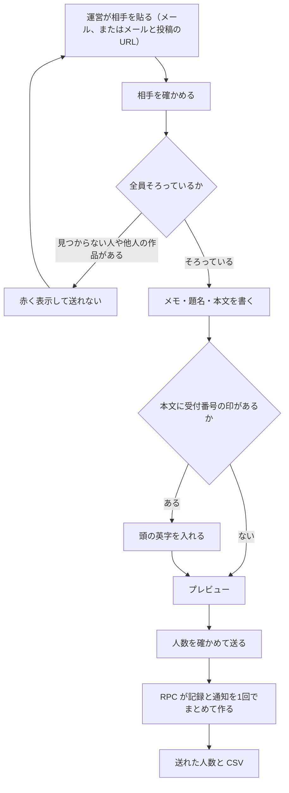
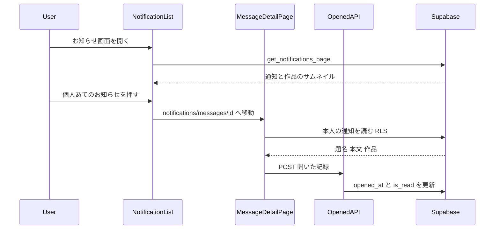
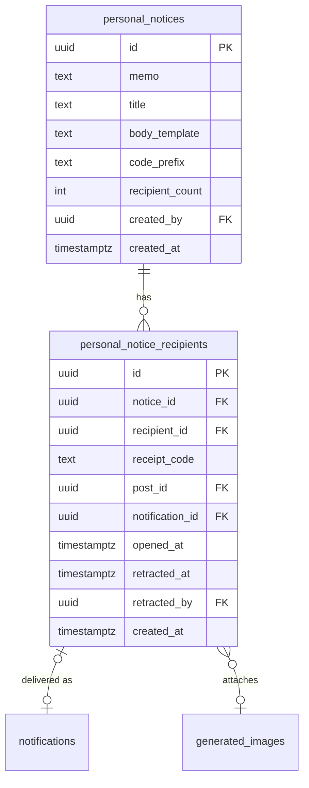
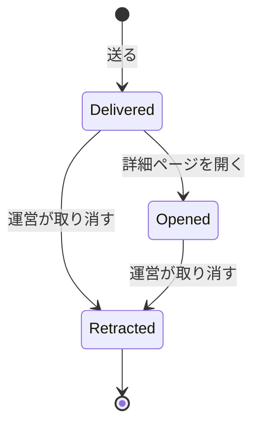
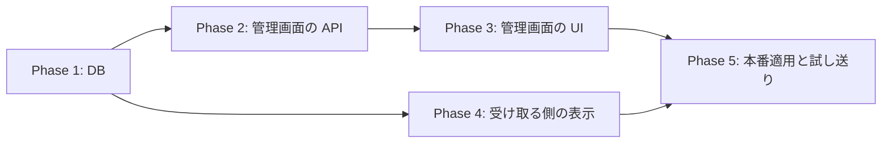

# 個人あてのお知らせ 実装計画

- 作成日: 2026-10-18
- 状態: 計画（未実装）
- 最初の使い道: ハロウィン企画「うちの子のベストショット with Halloween Magic」の当選連絡（結果発表は 11/7 ごろ。**10/31 までに本番**）
- 決定の経緯: 2026-10-18 のヒアリング（/implementation-planning）。決定事項は本書の「決まったこと」にすべて書く

## 決まったこと（ヒアリングの結論）

| 項目 | 決定 |
|---|---|
| 目的 | 運営が管理画面から、選んだ人だけに、題名と本文を自由に書いたお知らせを送る |
| 届く場所 | 「お知らせ」画面の「あなたへの通知」タブ（`notifications`）。「運営からのお知らせ」タブ（全員向け `announcements`）には出さない |
| 送り方 | **まとめて送る**。相手は「メールアドレス」または「メールアドレス, 投稿のURL」を1行に1人 |
| 受付番号 | 本文に `{受付番号}` と書くと、1人ずつちがう番号を自動で入れる（例 `HBS-7F3K`）。頭の英字は送るたびに決める。0/O・1/I などは使わない |
| 作品 | 1人ずつ任意で投稿を付けられる。付けられるのは**相手自身の公開中の投稿だけ**（違えば送れない） |
| 管理用のメモ | 送るたびに付ける（例「ハロウィン2026・ベストショット賞」）。一覧の絞り込み用。受け取った人には見えない |
| 送ったあと | 一覧（誰に・番号・送った日時・開いたか）、CSV 保存、1人ずつ取り消し、操作記録 |
| 取り消し | 相手のお知らせは消す。送った記録には「取り消し」の印を付けて残す（その番号が使えないと後から分かる） |
| 退会 | その人の記録とお知らせは消える（今の通知と同じ） |
| 汎用性 | ハロウィンに結びつく値は機能に持たせない。企画名・賞・フォームのリンクは本文に書く |

**入れないもの**: メール送信（規約で「連絡はお知らせでのみ」）、返信、画像・飾り、予約送信、送ったあとの書き換え、アプリでの表示（公開前に別作業）、本文の翻訳、ホームのポップアップ、ペルコインの付与（今までどおりボーナスの一括付与）、`{受付番号}` 以外の差し込み（賞ごとに分けて送る）。

**使い方の想定（ハロウィン企画）**: 賞ごとに分けて送る。クリエイティブ部門の Amazon ギフトカード 4名は作品つき、エンジョイ部門のハロウィン・マスター賞 10名は文だけ。ハロウィン・セレクション賞（ペルコイン 30名）にも作品つきで送れる（ペルコインはボーナスの一括付与で）。送る前に運営のアカウントへ試しに送り、確かめてから取り消す。

---

## コードベース調査結果（2026-10-18 時点の main = 814c6e9）

### 通知（`notifications`）
- 表: `supabase/migrations/20251213013611_notifications.sql`。`recipient_id` / `actor_id` は `auth.users` へ **ON DELETE CASCADE**（退会で消える）。`title` / `body` は TEXT NOT NULL、`data` は JSONB。
- 本番の CHECK（実測）
  - `notifications_type_check`: 21 種類。最後の改定は `20260806160000_add_creator_reward_daily_notification.sql`（`DROP CONSTRAINT IF EXISTS` → `ADD CONSTRAINT`、適用後に `RAISE EXCEPTION` で自己検証する書き方）。**新しい種類を足すにはこの CHECK の作り直しが要る**。
  - `notifications_entity_type_check`: `post / comment / user / style_template / catalog_entry / creator_looks_template`。新しい値は足さない（作品つきは `post`、作品なしは `user` で表す）。
- RLS: 本人の SELECT / UPDATE / DELETE のみ。直接 INSERT は禁止（"Prevent direct insert to notifications"）。→ 送るのは SECURITY DEFINER の RPC。
- トリガー: `trg_enqueue_push_on_notification_insert`（`enqueue_push_for_notification()`）。`push_category_for_notification_type(type)` が NULL の種類はプッシュを積まない。**新しい種類は NULL のまま（今回プッシュなし）**。`push_outbox.notification_id` は CASCADE なので、30 秒以内に取り消せばプッシュも出ない（将来プッシュを足したときに効く）。
- 一覧の取得: #745 で `get_notifications_page`（SECURITY INVOKER）に一本化済み（2026-10-18 本番）。`entity_type='post'` なら `entity_id` の投稿のサムネイルを自動で結合して返す → **作品つきは `entity_type='post'` にするだけで一覧の右に作品の画像が出る**。
- 一覧の表示: `features/notifications/components/NotificationList.tsx`
  - 匿名の種類（`ANONYMOUS_ACTOR_NOTIFICATION_TYPES`、`features/notifications/types.ts`）は運営ロゴで表示し、`actor_id` に本人を入れる決まり（ADR-011 / REQ-005）。新しい種類もここに入れる。
  - 文言は `features/notifications/lib/presentation.ts` の `formatNotificationContent`。どの case にも当たらない種類は `notification.title` / `notification.body` をそのまま出す。
  - ⚠️ **お知らせ画面を開くと未読がすべて既読になる**（`useNotifications.ts` の `autoMarkAllRead`）。`is_read` は「開いた」の意味にならない → **「開いたか」は詳細ページを開いた時刻を別に記録する**。
  - 押したときの移動先: `useNotifications.ts` の `handleNotificationClick`。`entity_type` の分岐より前に種類で分ける既存の書き方（措置通知・ボーナス・還元）に合わせる。
- 詳細ページの見本: `app/(app)/notifications/announcements/[id]/page.tsx` と `features/announcements/components/AnnouncementDetailScreen.tsx`（戻るリンク・日付・題名・白いカードの本文、開いたら既読の POST）。

### 管理画面
- ページの認可: `getUser()` + `getAdminUserIds().includes(user.id)`（例 `app/(app)/admin/bonus/bulk/page.tsx`）。API の認可: `requireAdmin()`（`lib/auth.ts`）。
- メニュー: `app/(app)/admin/admin-nav-items.ts`（サイドバーとモバイルの両方がここを読む）。
- 相手の確認: ボーナスの一括付与 `app/(app)/admin/bonus/bulk/BulkGrantClient.tsx` と `app/api/admin/bonus/bulk-lookup/route.ts`（`get_user_ids_by_emails`、service_role 専用・最大 300 件・CSV の数式インジェクション対策 `escapeCsvCell`）。
- 操作記録: `lib/admin-audit.ts` の `logAdminAction`。`admin_audit_log.action_type` に DB の CHECK は無い（実測）→ TS の union に足すだけ。
- 管理画面のフォームは浮いた箱でなく専用ページ（モバイルで揺れた経緯）。

### 投稿
- `generated_images`: `user_id` / `is_posted` / `moderation_status` / `storage_path_thumb` / `caption`。投稿の URL は `/posts/<id>`。
- 「公開中」= `is_posted = true` かつ `moderation_status` が公開扱い（実装時に、公開フィードの条件を定義している既存の関数・ビューを読んで同じ条件にする。書き写さず共有できるならそれを使う）。

### データアクセスの方針（`docs/architecture/data.ja.md`）
- 複数の表をまたぐ更新・原子的であるべき処理は SQL 関数へ。単純な1行の更新は route handler + service_role でよい。
- 新しい RPC は `REVOKE ... FROM PUBLIC, anon, authenticated` → `GRANT ... TO service_role`。適用後に `node scripts/check-rpc-grants.mjs`。

### 重なる PR（2026-10-18 時点）
- #745（一覧の RPC）: マージ・本番適用済み。本計画はその上に作る。
- #742（プッシュの一斉配信）・#746（画像つきプッシュ）: レビューで指摘があり、あと回し（ユーザー決定 A）。重なるのは `admin-nav-items.ts` と `lib/admin-audit.ts` の union の1行ずつ。あとからマージする側で合わせる。

---

## 1. 概要図

### 送る流れ（管理画面）

### 受け取る流れ

### データモデル

### 受け取った人ごとの状態

状態は列で表す（status 列は作らない）: Delivered = `opened_at IS NULL AND retracted_at IS NULL`、Opened = `opened_at IS NOT NULL AND retracted_at IS NULL`、Retracted = `retracted_at IS NOT NULL`。受け取った人が自分で通知を消した場合も `notification_id` が NULL になるだけで、記録は残る。

---

## 2. EARS（要件定義）

| ID | 要件（日本語） | Requirement (English) |
|---|---|---|
| PN-001 | 運営が相手と本文を指定して送ったとき、システムは相手ごとに記録1件と通知1件を、1つのトランザクションで作らなければならない（一部だけ届く状態を作らない） | When an admin sends a personal notice, the system shall create one recipient record and one notification per recipient in a single transaction. |
| PN-002 | 本文に `{受付番号}` があるとき、システムは相手ごとに `<頭の英字>-<4文字>` の番号を作り、本文の印を置き換えなければならない。番号は全体で重複してはならない（DB の UNIQUE） | When the body contains `{受付番号}`, the system shall generate a unique `<PREFIX>-<4 chars>` code per recipient and substitute it. |
| PN-003 | 番号の4文字は、見まちがえやすい文字（0 O 1 I L）を除いた英大文字と数字から作らなければならない | The code suffix shall use an unambiguous uppercase alphanumeric alphabet. |
| PN-004 | 本文に `{受付番号}` が無いとき、システムは番号を作ってはならない（頭の英字も求めない） | When the body has no placeholder, the system shall not generate codes. |
| PN-005 | 作品が付いた行で、その投稿が相手自身の公開中の投稿でないとき、システムは送信全体を拒否しなければならない（DB の関数でも確かめる） | If an attached post is not the recipient's own visible post, then the system shall reject the whole send. |
| PN-006 | 見つからないメールアドレス・重複した相手・退会中の相手がいるとき、システムは送信全体を拒否し、どの行かを返さなければならない | If any recipient is unknown, duplicated or deactivated, then the system shall reject the send and report the rows. |
| PN-007 | 1回に送れる相手は 1〜200 人でなければならない | The system shall accept 1 to 200 recipients per send. |
| PN-008 | 通知は運営ロゴで表示し、送った運営の情報を受け取った人に渡してはならない（`actor_id` は本人） | The notification shall be shown with the operator logo and shall not expose the sending admin. |
| PN-009 | 作品つきの通知は、一覧の右に作品のサムネイルを出さなければならない | Where a post is attached, the list item shall show its thumbnail. |
| PN-010 | 受け取った人が通知を押したとき、システムは詳細ページを開き、題名・日付・全文（改行を残し URL はリンク）・作品の画像と「作品を見る」を表示しなければならない | When the recipient taps the notice, the system shall open a detail page showing the title, date, full body with links, and the attached post. |
| PN-011 | 詳細ページを開いたとき、システムは `opened_at`（初回のみ）と通知の既読を記録しなければならない | When the detail page opens, the system shall record `opened_at` once and mark the notification read. |
| PN-012 | 本人以外・取り消し済みの詳細ページは 404 にしなければならない | If the viewer is not the recipient or the notice was retracted, then the detail page shall return 404. |
| PN-013 | 運営が1人分を取り消したとき、システムは相手の通知を消し、記録に `retracted_at` / `retracted_by` を残さなければならない（記録と番号は消さない） | When an admin retracts a recipient, the system shall delete the notification and keep the record marked as retracted. |
| PN-014 | 送信・取り消しのたびに、システムは `admin_audit_log` に残さなければならない | The system shall write an admin audit entry for each send and retraction. |
| PN-015 | 管理画面の API はすべて `requireAdmin()`、更新系は同一オリジン検査を通らなければならない。RPC は service_role だけが実行できなければならない | Admin APIs shall require admin and same-origin; the RPCs shall be executable by service_role only. |
| PN-016 | 新しい表は RLS を有効にし、利用者（anon / authenticated）から読めても書けてもならない | The new tables shall have RLS enabled with no access for anon or authenticated. |
| PN-017 | CSV を保存するとき、システムは数式として解釈される値を無害化しなければならない（既存の `escapeCsvCell` と同じ） | When exporting CSV, the system shall neutralize formula-like cells. |
| PN-018 | 相手が退会したとき、その人の記録と通知は消えなければならない（CASCADE） | When a recipient's account is deleted, their records and notifications shall be removed. |
| PN-019 | 新しい種類の通知はプッシュを積んではならない（今回はアプリ未対応のため） | The new notification type shall not enqueue push notifications for now. |

---

## 3. ADR（設計判断記録）

### ADR-001: 「あなたへの通知」（notifications）に新しい種類を足す。announcements は使わない
- **Context**: 全員向けの `announcements` は公開キャッシュ（`use cache`）と既読の仕組みが「全員に同じもの」前提。
- **Decision**: `notifications` に新しい種類 `admin_message` を足す。
- **Reason**: 1人ずつの表示・ベルの数字・退会時の CASCADE・#745 の一覧 RPC・将来のプッシュ（push_outbox）をそのまま使える。
- **Consequence**: `notifications_type_check` の作り直しが要る（マイグレーション・本番適用はユーザー承認）。アプリは公開前に新しい種類へ対応が要る。

### ADR-002: 送った記録は専用の2つの表に残す（通知の行だけにしない）
- **Context**: 番号と相手の対応は、賞品の受け渡しの正本。受け取った人は自分の通知を消せる（RLS で DELETE 可）。
- **Decision**: `personal_notices`（1回分）と `personal_notice_recipients`（1人分）を作り、通知は `notification_id`（ON DELETE SET NULL）でつなぐ。
- **Reason**: 通知が消されても・取り消しても、番号と記録が残る。番号の UNIQUE を DB で守れる。
- **Consequence**: 表が2つ増える。利用者からは触れない（RLS 有効・ポリシーなし）。

### ADR-003: 送信は1つの RPC（SECURITY DEFINER・service_role 専用）で原子的に行う
- **Context**: 1回の送信で3つの表に書く。途中で失敗すると「一部の人にだけ届く」。通知への直接 INSERT は RLS で禁止。
- **Decision**: `send_personal_notice(...)` が検証・番号の生成・3表への書き込みを1トランザクションで行う。取り消しも `retract_personal_notice_recipient(...)` にする。
- **Reason**: data.ja.md の方針（原子的な処理は SQL 関数）。作品の持ち主・公開中の確認を DB 層でも強制できる（PN-005）。
- **Consequence**: 管理者かどうかは API 層（`requireAdmin()`）で確かめ、RPC は service_role 専用にする（既存の `apply_user_style_template_decision` と同じ形）。`p_admin_user_id` は API がセッションから入れる（ボディからは受け取らない）。

### ADR-004: 「開いたか」は `opened_at` で記録する（`is_read` は使わない）
- **Context**: お知らせ画面を開くと未読がすべて既読になる（`autoMarkAllRead`）。
- **Decision**: 詳細ページを開いたときに `POST /api/notifications/messages/[id]/opened` で `opened_at` を初回だけ入れる（本人の行だけ・service_role の1行更新）。
- **Reason**: 当選者が実際に本文を読んだかを運営が判断できる（期限前の再連絡の判断材料）。
- **Consequence**: 一覧だけ見て押さなかった人は「未開封」に見える（意図どおり）。

### ADR-005: 作品は `entity_type='post'` で表し、作品なしは `entity_type='user'`（本人）にする
- **Context**: `entity_type` の CHECK を増やすと既存の分岐が増える。
- **Decision**: 作品つきは `entity_type='post', entity_id=<投稿>`、作品なしは `entity_type='user', entity_id=<本人>`。押したときの移動は種類で先に分ける。
- **Reason**: #745 の `get_notifications_page` が `post` のサムネイルを自動で結合する。CHECK を変えずに済む。
- **Consequence**: 押したときの分岐を `entity_type` の分岐より前に置く（置き忘れると投稿やプロフィールへ飛ぶ）。テストで固定する。

### ADR-006: 差し込みは `{受付番号}` だけにする
- **Context**: 賞ごとに文が違う。人ごとの差し込みを一般化すると、入力の形式・検証・プレビューが重くなる。
- **Decision**: 差し込みは受付番号と作品だけ。賞ごとに分けて送る。差し込みの置き換えは1か所（RPC 内の関数）にまとめ、あとから増やせる形にする。
- **Consequence**: 1回の企画で数回に分けて送る（当選者が十数人なら数分の作業）。

### ADR-007: 本文は文字だけ（改行・URL の自動リンク）。`announcements` のリッチテキストは使わない
- **Reason**: 当選連絡に飾りは要らない。保存形式が TEXT のままで、通知の一覧・将来のプッシュ・アプリでもそのまま出せる。
- **Consequence**: URL のリンク化は表示側で行う。`http(s)://` だけをリンクにし、`rel="noopener noreferrer"`・新しいタブ。

---

## 4. 実装計画

### フェーズ間の依存関係

PR は3つに分ける: **PR-A = Phase 1**（DB のみ）、**PR-B = Phase 2+3**（管理画面）、**PR-C = Phase 4**（受け取る側）。PR-B と PR-C は Phase 1 のマージ後に並行できる。目安: PR-A 10/21、PR-B・PR-C 10/27、本番での試し送り 10/29（予備 2 日）。

### Phase 1: データベース（PR-A）
目的: 表・制約・RPC・権限をそろえる。既存の動きは何も変えない。
ビルド確認: マイグレーションのみ（アプリのコードは変えない）。Supabase Preview ＋ プレビュー DB での挙動テスト。

- [ ] マイグレーション `supabase/migrations/<最新より後の時刻>_add_personal_notices.sql`
  - [ ] `notifications_type_check` を作り直し、`admin_message` を足す（`20260806160000_add_creator_reward_daily_notification.sql` の書き方を参考に、適用後の自己検証も入れる）
  - [ ] `personal_notices`: `memo`（1〜100字）、`title`（1〜60字）、`body_template`（1〜2000字）、`code_prefix`（NULL または `^[A-Z]{2,5}$`）、`recipient_count`、`created_by`（auth.users、ON DELETE SET NULL）、`created_at`
  - [ ] `personal_notice_recipients`: `notice_id`（CASCADE）、`recipient_id`（auth.users CASCADE）、`receipt_code`（UNIQUE、NULL 可）、`post_id`（generated_images、ON DELETE SET NULL）、`notification_id`（notifications、ON DELETE SET NULL）、`opened_at`、`retracted_at`、`retracted_by`（ON DELETE SET NULL）、`created_at`、`UNIQUE (notice_id, recipient_id)`、索引 `(notice_id)`・`(recipient_id)`
  - [ ] 2表とも RLS 有効・ポリシーなし。`REVOKE ALL ... FROM anon, authenticated`
  - [ ] `send_personal_notice(p_admin_user_id, p_memo, p_title, p_body_template, p_code_prefix, p_recipients jsonb)`（SECURITY DEFINER・`SET search_path = ''`）
    - 検証: 1〜200人・相手の重複なし・相手が存在し退会中でない・作品は本人の公開中の投稿・`{受付番号}` があるなら `code_prefix` 必須 → 違反は `RAISE EXCEPTION`（行番号つきのコード）
    - 番号: 安全な文字集合から4文字。UNIQUE 違反は数回まで作り直す
    - 書き込み: notices 1行 → 相手ごとに notifications（`type='admin_message'`、`actor_id=本人`、`title`、置き換え後の `body`、`data={personal_notice_recipient_id, receipt_code, post_id}`）→ recipients
    - 戻り値: 相手ごとの `recipient_row_id / recipient_id / receipt_code / notification_id`
  - [ ] `retract_personal_notice_recipient(p_admin_user_id, p_recipient_row_id)`: 未取り消しなら `retracted_at/by` を入れて通知を DELETE（取り消し済みなら何もしない＝冪等）
  - [ ] 2つの RPC を `REVOKE FROM PUBLIC, anon, authenticated` → `GRANT TO service_role`
  - [ ] 戻し方（DOWN）をファイル末尾のコメントに書く
- [ ] `scripts/check-rpc-grants.mjs` の許可リストは変えない（service_role 専用のため）
- [ ] プレビュー DB で挙動テスト（`supabase-preview-branch-sql-harness` の手順。修正前に流して FAIL を確認）: 正常（作品あり・なし・番号あり・なし）、他人の作品・非公開・削除済みの作品、重複・未知・退会中、201人、番号の重複時の作り直し、取り消しの冪等、通知を本人が消しても記録が残る、退会で消える、anon / authenticated から呼べない
- [ ] `.cursor/rules/database-design.mdc` と `docs/architecture/data.ja.md`（+ en）に表と RPC を追記

### Phase 2: 管理画面の API（PR-B）
目的: 相手の確認・送信・取り消し・一覧の API。
ビルド確認: `npm run build -- --webpack` が通る。

- [ ] `features/personal-notices/lib/schema.ts`: 入力の zod（行の解析＝メール／メール,投稿URL or ID、`/posts/<uuid>` の抽出、`{受付番号}` の有無、頭の英字）
- [ ] `features/personal-notices/lib/repository.ts`: service_role で RPC と一覧の読み取り（1000行の上限に注意。ページングで読む＝`persta-admin-dashboard-1000-row-cap` の教訓）
- [ ] `features/personal-notices/lib/render.ts`: プレビュー用の置き換え（RPC と同じ規則。結果をテストで突き合わせる）
- [ ] `POST /api/admin/personal-notices/lookup`: メールから相手（`get_user_ids_by_emails` を再利用）とプロフィール（ニックネーム・アイコン）、投稿（持ち主・公開中か・サムネイル）を返す。行ごとのエラー
- [ ] `POST /api/admin/personal-notices`: 送信（`requireAdmin()`・同一オリジン・`p_admin_user_id` はセッションから）→ `logAdminAction('personal_notice_send')`
- [ ] `GET /api/admin/personal-notices`（一覧・メモで絞り込み）、`GET /api/admin/personal-notices/[id]`（1回分の中身）
- [ ] `POST /api/admin/personal-notices/recipients/[id]/retract` → `logAdminAction('personal_notice_retract')`
- [ ] `lib/admin-audit.ts` の union に2つ追加
- [ ] `docs/API.md` に追記

### Phase 3: 管理画面の UI（PR-B）
目的: 送る・見る・取り消す画面。
ビルド確認: build が通り、手元の開発サーバーで管理画面を実描画（ログインは一時的な差し替えのみ・コミットしない）。

- [ ] `app/(app)/admin/personal-notices/page.tsx`（一覧）・`new/page.tsx`（送る）・`[id]/page.tsx`（中身）。認可は `getUser()` + `getAdminUserIds()`
- [ ] 送るページのクライアント（`BulkGrantClient.tsx` を参考）: 相手を貼る → 確かめる（赤い行は送れない）→ メモ・題名・本文・頭の英字 → プレビュー（一覧の1行＋詳細ページの見た目を、受け取る側と同じ部品で描く）→ 「○人に送る」→ 確認 → 結果と CSV
- [ ] 中身のページ: 相手ごとのアイコン・ニックネーム・番号・作品・開いたか・取り消し、CSV（`escapeCsvCell` を共有）
- [ ] `admin-nav-items.ts` に「個人あてのお知らせ」を追加
- [ ] 文言は日本語のみ（管理画面は既存どおり翻訳しない）

### Phase 4: 受け取る側の表示（PR-C）
目的: 一覧の見え方・詳細ページ・開いた記録。
ビルド確認: build が通り、320 / 390px と PC で実描画。

- [ ] `features/notifications/types.ts`: `NotificationType` に `admin_message`、`ANONYMOUS_ACTOR_NOTIFICATION_TYPES` に追加
- [ ] `NotificationList.tsx`: アイコン（既存の運営ロゴの扱いに合わせる）、本文は2行で省略
- [ ] `useNotifications.ts` の `handleNotificationClick`: `entity_type` の分岐より前に `admin_message` → `/notifications/messages/<通知id>`
- [ ] `app/(app)/notifications/messages/[id]/page.tsx`: `requireAuth()`、本人の通知をセッションのクライアントで読む（RLS）。種類が違う・無い・取り消し済みは `notFound()`。作品は持ち主と公開中を確かめてから出す
- [ ] `features/notifications/components/PersonalNoticeDetailScreen.tsx`: 「運営からのお知らせ」の詳細と同じ並び（戻る＝「あなたへの通知」タブ）。本文は `whitespace-pre-line`＋ URL の自動リンク。作品の画像と「作品を見る」（`/posts/<id>`）
- [ ] `POST /api/notifications/messages/[id]/opened`: 同一オリジン・ログイン必須・本人の行だけ `opened_at`（初回）と `is_read` を更新
- [ ] 15言語の `messages/*.ts` に表示用の文言（戻る・作品を見る・見つからない）
- [ ] アプリ側の対応はメモだけ残す（公開前に別作業。未知の種類が空白にならないか）

### Phase 5: 本番適用と試し送り
- [ ] PR-A マージ前に、本番データで COMMIT→ROLLBACK のリハーサル → 承認 → `supabase db push --linked`（`--dry-run` で1件だけか確認）→ `check-rpc-grants` → 本番の CHECK に `admin_message` が入ったことを SQL で確認
- [ ] PR-B・PR-C マージ → Vercel 反映 → 管理画面から運営のアカウント（内部アカウント）に試し送り → ユーザーが端末で見え方・作品・リンク・開いた記録を確認 → 取り消し → 相手の一覧から消えたことを確認
- [ ] 結果発表のときの手順書（賞ごとの送り分け・Google フォームの公開・CSV の照合）をメモリに残す

---

## 5. 修正対象ファイル一覧

| ファイル | 操作 | 変更内容 |
|---|---|---|
| supabase/migrations/<時刻>_add_personal_notices.sql | 新規 | 種類の CHECK・2表・2 RPC・権限 |
| .cursor/rules/database-design.mdc | 修正 | 表の追記 |
| docs/architecture/data.ja.md / data.en.md | 修正 | RPC の追記 |
| docs/API.md | 修正 | 管理 API と開いた記録の API |
| features/personal-notices/lib/schema.ts | 新規 | 入力の解析と検証 |
| features/personal-notices/lib/render.ts | 新規 | プレビュー用の置き換え |
| features/personal-notices/lib/repository.ts | 新規 | RPC と一覧の読み取り |
| app/api/admin/personal-notices/route.ts | 新規 | 一覧 GET・送信 POST |
| app/api/admin/personal-notices/lookup/route.ts | 新規 | 相手と作品の確認 |
| app/api/admin/personal-notices/[id]/route.ts | 新規 | 1回分の中身 |
| app/api/admin/personal-notices/recipients/[id]/retract/route.ts | 新規 | 取り消し |
| app/(app)/admin/personal-notices/page.tsx・new/page.tsx・[id]/page.tsx と各 Client | 新規 | 管理画面 |
| app/(app)/admin/admin-nav-items.ts | 修正 | メニュー1行 |
| lib/admin-audit.ts | 修正 | 操作の種類2つ |
| features/notifications/types.ts | 修正 | 種類と匿名の種類 |
| features/notifications/components/NotificationList.tsx | 修正 | アイコン・本文の省略 |
| features/notifications/hooks/useNotifications.ts | 修正 | 押したときの移動先 |
| app/(app)/notifications/messages/[id]/page.tsx | 新規 | 詳細ページ |
| features/notifications/components/PersonalNoticeDetailScreen.tsx | 新規 | 詳細の画面 |
| app/api/notifications/messages/[id]/opened/route.ts | 新規 | 開いた記録 |
| messages/*.ts（15言語） | 修正 | 詳細ページの文言 |
| tests/... | 新規 | 下の「テスト観点」 |

---

## 6. 品質・テスト観点

### 品質チェックリスト
- [ ] **エラーハンドリング**: RPC の例外コードを行ごとの日本語メッセージにする。送信の途中失敗は全体が戻る（一部だけ届かない）
- [ ] **権限制御**: 管理 API は `requireAdmin()`＋同一オリジン、RPC は service_role 専用、新しい表は利用者から読めない、詳細ページと開いた記録は本人だけ
- [ ] **データ整合性**: 番号の UNIQUE、`(notice_id, recipient_id)` の UNIQUE、作品の持ち主と公開中を DB で強制、CASCADE / SET NULL の向き
- [ ] **セキュリティ**: 本文は文字として描く（HTML として入れない）。リンクは `http(s)` だけ。CSV の数式対策。`p_admin_user_id` はセッションから
- [ ] **i18n**: 詳細ページの文言を15言語に。本文は書いたまま
- [ ] **ハロウィン企画**: 企画のコード・DB には触れない。お知らせ一覧の既存の種類の表示が変わらないことをテストで固定

### テスト観点

| カテゴリ | テスト内容 |
|---|---|
| 正常系 | 作品あり・なし／番号あり・なしで送れる。一覧に運営ロゴと作品のサムネイル。押すと詳細ページ。開いた記録が1回だけ入る。取り消すと相手の一覧から消え、記録は残る |
| 異常系 | 見つからないメール・他人の作品・非公開の作品・重複・201人・頭の英字なしで `{受付番号}` → 送れず、どの行かが出る。通信の失敗で全体が戻る |
| 権限テスト | 未ログイン・一般の利用者が管理 API を呼べない。他人の詳細ページ・取り消し済みは 404。anon / authenticated から RPC を呼べない（`has_function_privilege`） |
| 既存の動き | いいね・コメント・ボーナス・措置などの既存の種類の表示と移動先が変わらない（既存テストを変えずに通す） |
| 実機確認 | 320 / 390px・PC で、一覧の1行と詳細ページ。長い本文・URL の折り返し。本番で運営のアカウントへの試し送り |

わざと壊してテストが落ちることも確かめる（変異テスト。例: 持ち主の確認を外す・番号の置き換えを外す・押したときの分岐を後ろに置く・開いた記録を毎回上書きする）。

---

## 7. ロールバック方針

- **DB**: 追加だけ。戻すときは2つの RPC と2表を DROP し、`notifications_type_check` を元の21種類に戻す（`admin_message` の通知が残っていると戻せないので、先に DELETE。本番での実行はユーザー承認）。手順はマイグレーションの末尾にコメントで書く
- **画面**: PR-B / PR-C は revert で戻せる。PR-C だけ戻すと、届いた通知は既定の表示（題名と本文）になり押しても移動しない＝壊れはしない
- **機能フラグ**: 使わない（管理画面からしか送れないため、送らなければ利用者に何も起きない）
- **Git**: PR ごとに squash マージ。フェーズごとに revert できる

---

## 8. 使用スキル

| スキル | 用途 | フェーズ |
|---|---|---|
| `/git-create-worktree` | 作業場所 | 各 PR の開始時 |
| `/project-database-context` | DB 設計の参照 | Phase 1 |
| `supabase-sync` | 本番適用と同期確認 | Phase 5 |
| `/git-create-pr` | PR 作成（日本語） | 各 PR |
| `/code-review` | 一般の利用者に見える変更・権限とデータの変更のレビュー | PR-A・PR-C |
| `/test-flow` ほか | テストの流れ | 各フェーズ |

## 未決事項（実装中に確かめる）
- 「公開中の投稿」の正確な条件（公開フィードの既存の条件を読み、同じものを使う）
- 一覧のアイコン（運営ロゴの既存の扱いに合わせる。見た目が分かれるなら実画面で2〜3案）
- 送信の上限 200 人は仮。ボーナスの一括付与（300件）との揃え方
