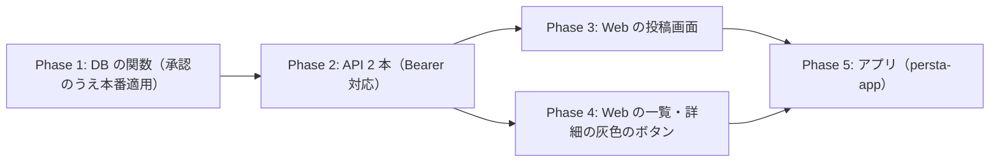

# 未投稿の原本から作った投稿を「原本にする」計画書

作成: 2026-10-23 / 状態: **計画のみ（未着手）**。ユーザー指示「今はハロウィン企画の確認に集中する」。Web とアプリ（persta-app）の両方で進める。

## 0. きっかけと決まったこと

2026-10-23 06:54、運営アカウントの投稿（ハロウィンのお菓子）で、ホームの「このカタログで生成する」が出なかった。

- 原因：この投稿は、**まだ投稿されていない自分の下書き**のプロンプトから作った派生の投稿だった（マイページの下書きから作り直したもの）。
- 一覧のボタンは、原本が公開されているときだけ出す決まり（`resolveSourcePromptSummaries` → `fetchPubliclyUsableOrigins` が `is_posted` と `moderation_status='visible'` を見る）。原本が未投稿なので「使えない」と返り、ボタンは何も出なかった。
- 本人は、理由がわからなかった（ユーザー談「ボタンが単純に表示されていなかった。非活性で、カタログ元が非公開のようです的な文があれば気づけた」）。

### ユーザーが決めたこと（2026-10-23）

| 項目 | 決定 |
|---|---|
| 投稿画面 | 原本が自分の未投稿の下書きのとき、注意の文と「この投稿を原本にする」**ボタン**を出す（チェックボックスではない） |
| ボタンの動き | 押す → 確認のモーダル → 処理中の表示 → 完了するとボタンにチェックマーク |
| 最初の状態 | 原本にしない（本人が押したときだけ原本になる） |
| 原本がほかの人のもので公開が終わっているとき | 投稿画面には**何も出さない** |
| 投稿したあと（一覧・詳細） | ボタンを灰色で押せない形で出し、理由の文を出す。本人とそれ以外で文を分ける |
| アプリ | Web と同じ形で対応する |
| 「プロンプトの中身は見えません」 | 書かない（投稿画面に「プロンプトを非公開にする」があるため） |

### エージェントが決めたこと（ユーザーに伝え済み・違えば直す）

- 原本にしたあと投稿せずに画面を離れても、**原本のまま残す**。原本にする処理は投稿とは別で、画像は本人のもののため。
- 原本が「公開停止」（`moderation_status='removed'`）のときは、原本にするボタンも注意の文も出さない。審査で止めた投稿のプロンプトを、別の投稿として出さないため。
- 原本にしたあとの利用数とクリエイター還元は、この投稿に付く（原本は本人の下書きなので、ほかの人の取り分は変わらない）。
- プロンプトを見せるかどうかは、投稿画面の「プロンプトを非公開にする」のとおり。原本にしても変えない。

## 1. 文言（日本語・決定）

### 1-1. 投稿画面（原本が自分の未投稿の下書きのとき）

| 状態 | 文言 |
|---|---|
| 注意の文 | ⚠️ このカタログの原本は、まだ投稿されていません。このまま投稿しても、ほかのユーザーさんはこのカタログで生成できません。 |
| ボタン（押す前） | この投稿を原本にする |
| ボタンの下の説明 | 原本にすると、ほかのユーザーさんもこのカタログで生成できるようになります。 |
| ボタン（処理中） | （くるくる）原本にしています… |
| ボタン（完了） | ✓ 原本にしました（押せない状態） |
| 完了後の注意の文 | この投稿を原本にしました。投稿すると、ほかのユーザーさんもこのカタログで生成できます。 |
| 失敗したとき | 原本にできませんでした。時間をおいて、もう一度お試しください。（ボタンは押す前に戻る） |

確認のモーダル:

| 場所 | 文言 |
|---|---|
| 見出し | この投稿を原本にしますか？ |
| 本文 | この投稿をカタログの原本として扱います。原本にしたあとは、元に戻すことはできません。 |
| ボタン | 原本にする ／ キャンセル |

原本がほかの人のもので公開が終わっているとき・原本が投稿済みのとき・原本が公開停止のときは、何も出さない。

### 1-2. 一覧と詳細（投稿したあとで、原本が使えないとき）

「このカタログで生成する」を灰色で押せない形で出し、その下に文を出す。

| 見ている人 | 文言 |
|---|---|
| 投稿した本人・原本が自分の下書き | このカタログの原本が投稿されていないため、ほかのユーザーさんも利用できません。原本を投稿すると利用できます。[原本はこちら]（`/posts/<原本の ID>` へのリンク） |
| 投稿した本人・原本がほかの人のカタログ | このカタログは公開されていないため、利用できません。 |
| ほかの人 | このカタログは公開されていないため、利用できません。 |

- `/posts/[id]` は、未投稿の画像でも本人は開ける（`features/posts/lib/server-api.ts` の `isPostOwner`）。
- 一覧のボタンの上の見出し（My ORIGINAL など）や引用の形は今のまま。
- 文言は 15 言語。日本語を正本に訳す。

## 2. 今の作り（調べたこと）

| 場所 | 今の動き |
|---|---|
| `features/posts/lib/prompt-action-cache.ts` / `source-prompt-reference.ts` | 一覧のボタンの可否。原本が使えないとき `unavailableSummary(originPostId)` を返す（`isAvailable: false`・原作者などは null）。閲覧者に依存しない値なので全員でキャッシュを共有（`cacheLife("minutes")`） |
| `features/posts/components/PostFeedCard.tsx` | `promptAction?.isAvailable` が false だと引用カードもボタンも出さない |
| `features/posts/components/SourcePromptReferenceCard.tsx` | 詳細の同じ導線 |
| `features/posts/components/PostComposerPage.tsx`（`app/posts/new/[imageId]`） | 投稿画面。`PromptVisibilityField` がある |
| `generated_image_prompt_secrets` | プロンプトの本文はここだけ（PROMPT-SECRECY-001）。**派生の画像には行が無い**（原本の行だけ。2026-10-23 に今回の投稿で確認） |
| `validate_derived_prompt_source` | 本人に限り未投稿の原本を許す（マイページの下書きから作り直せるようにする例外） |
| 投稿の型 `GeneratedImageRecord` | `source_post_id` / `source_author_id` を持つ |

## 3. 作りの方針

### 3-1. 原本にする（DB の関数・新規）

`promote_generated_image_to_original(p_image_id uuid)`（`SECURITY DEFINER`・`authenticated` だけに `EXECUTE`）。1 つのトランザクションで:

1. `p_image_id` の画像の持ち主が `auth.uid()` であることを確かめる。
2. その画像の `source_post_id` の原本が、**同じ人のもの**で、`is_posted = false` で、`moderation_status <> 'removed'` であることを確かめる。満たさなければ例外。
3. 原本の `generated_image_prompt_secrets` の行を、この画像の行として写す（`prompt_owner_id` は本人・`source_kind` は今と同じ値）。すでに行があれば例外（二重に原本にしない）。
4. この画像の `source_post_id` と `source_author_id` を null にする。

⚠️ 権限: 引数を足す・関数を作り直すと EXECUTE が既定の PUBLIC に戻る落とし穴がある（メモリ「ワンポイントアドバイス」）。作成後に `REVOKE ... FROM PUBLIC, anon` と `GRANT ... TO authenticated` を必ず書く。`auth.uid()` は service_role の代わりにならない（メモリ「RPC が anon から実行できた」）。

### 3-2. API（Web とアプリで共通）

- `GET /api/posts/[id]/origin-status`（本人のみ・Bearer 対応）: 投稿画面で「注意と原本にするボタンを出すか」を返す。返すのは `canPromote`（原本が自分の未投稿の下書きで、公開停止でない）だけ。
- `POST /api/posts/[id]/promote-to-original`（本人のみ・Bearer 対応）: 3-1 の関数を呼ぶ。成功したら `revalidatePromptActions()` と、ハロウィンの対象作品の失効（`revalidateHashtagCampaignSubmissions()`）を呼ぶ。原本が変わるので、一覧のボタンとハロウィンのボタンの判定が変わるため。

### 3-3. 一覧と詳細の灰色のボタン

- サーバーの `prompt-actions` は**変えない**（閲覧者に依存しない値のまま。本人かどうかで返す値を変えると、全員で共有しているキャッシュが壊れる）。
- 画面の側で判定する: `promptAction` があって `isAvailable` が false なら灰色のボタンを出す。
  - 本人（`currentUserId === post.user_id`）で、かつ `post.source_author_id === currentUserId` なら「原本はこちら」つきの文。リンク先は `promptAction.originPostId`。
  - それ以外は「このカタログは公開されていないため、利用できません。」
- 見出し（My ORIGINAL など）を決める `isViewerResolved` の待ち方は、今の引用カードと同じにする。

### 3-4. アプリ（persta-app）

- 投稿画面に同じ注意とボタン・確認のモーダル。3-2 の API を Bearer で呼ぶ。
- 一覧・詳細の灰色のボタンと文も同じ。画面は Web のモバイル版を正本にする（メモリ「Webモバイル版が正本」）。
- Web が先、アプリはそのあと（API が先に要るため）。

## 4. 要件（EARS）

- **REQ-001** — When the post composer opens for an image whose source post is the viewer's own unposted and not-removed image, the system shall show the notice and the "promote to original" button.
  原本が自分の未投稿（公開停止でない）の下書きのとき、投稿画面に注意とボタンを出すこと。
- **REQ-002** — While the source post belongs to another user, is posted, or is removed, the system shall show neither the notice nor the button on the composer.
  それ以外のときは、投稿画面に何も出さないこと。
- **REQ-003** — When the user confirms the modal, the system shall copy the source post's prompt secret to this image and clear its source fields atomically, and show a checked, disabled button on success.
  確認のあと、1 つのトランザクションで原本にし、成功したらチェックつきの押せないボタンにすること。
- **REQ-004** — If the requester is not the owner of both images, or the source is posted or removed, then the system shall reject the promotion without changing any row.
  持ち主でない・原本が投稿済みや公開停止のときは、何も変えずに拒否すること（DB の関数の中で確かめる）。
- **REQ-005** — When a feed or detail CTA is unavailable, the system shall show a disabled button with the viewer-specific message (author with own unposted source: link to the source; others: generic).
  一覧・詳細で使えないときは、灰色のボタンと、見ている人に合わせた文を出すこと。
- **REQ-006** — The system shall keep `prompt-actions` viewer-independent and shared across viewers.
  `prompt-actions` は閲覧者に依存しない値のまま共有すること。
- **REQ-007** — When an image is promoted, the system shall invalidate the prompt-actions cache and the hashtag-campaign submissions cache.
  原本にしたら、一覧のボタンとハロウィンの対象作品のキャッシュを失効させること。

## 5. 進め方

- Phase 1: マイグレーション。プレビューの DB で、持ち主でない・原本が投稿済み・公開停止・二重に原本にする、の 4 つが拒否されることを確かめる（メモリ「プレビューDBで挙動テスト」）。
- Phase 2: API のテスト（本人以外は 403・条件外は 400・成功でキャッシュの失効が呼ばれる）。
- Phase 3: 投稿画面。ボタンは共通の `Button` の `pending` を使う（メモリ「処理中ボタンの作法」）。モーダルは浮いた箱で入力の揺れが出ないよう、既存の確認モーダルと同じ部品にする。
- Phase 4: 一覧と詳細。灰色のボタンと 3 つの文。
- Phase 5: アプリ。

## 6. テストの観点

| 区分 | 内容 |
|---|---|
| 正常 | 自分の未投稿の下書きが原本 → 注意とボタン → 原本にする → 投稿 → ほかの人の一覧にボタンが出る |
| 境界 | 原本にしたあと投稿せずに離れる → 原本のまま。もう一度投稿画面を開くと、注意もボタンも出ない |
| 異常 | ほかの人の画像の ID で原本にする → 拒否。原本が投稿済み・公開停止 → 拒否。二重に押す → 2 回目は拒否 |
| 権限 | 未ログイン・anon は関数を実行できない |
| 表示 | 一覧で、本人（自分の下書きが原本）・本人（ほかの人が原本）・ほかの人の 3 通りの文 |

## 7. 戻し方

- DB の関数は足すだけ。戻すときは関数を DROP する（承認のうえ）。原本にした画像は、写したプロンプトの行と、消した `source_post_id` を戻せないので、戻す前に対象の画像 ID を記録しておく。
- 画面とアプリは、ボタンを出さないようにするだけで元に戻る。

## 8. 別タスク

- 原本にするボタンを、投稿したあとの一覧・詳細にも出すか（今回は投稿画面だけ。一覧・詳細は「原本はこちら」のリンク）。
