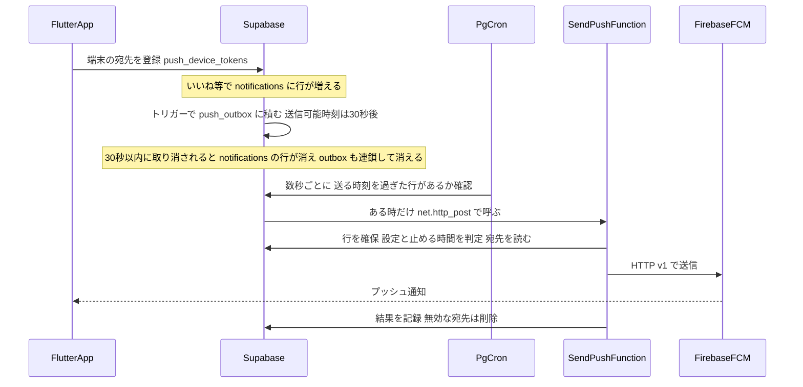
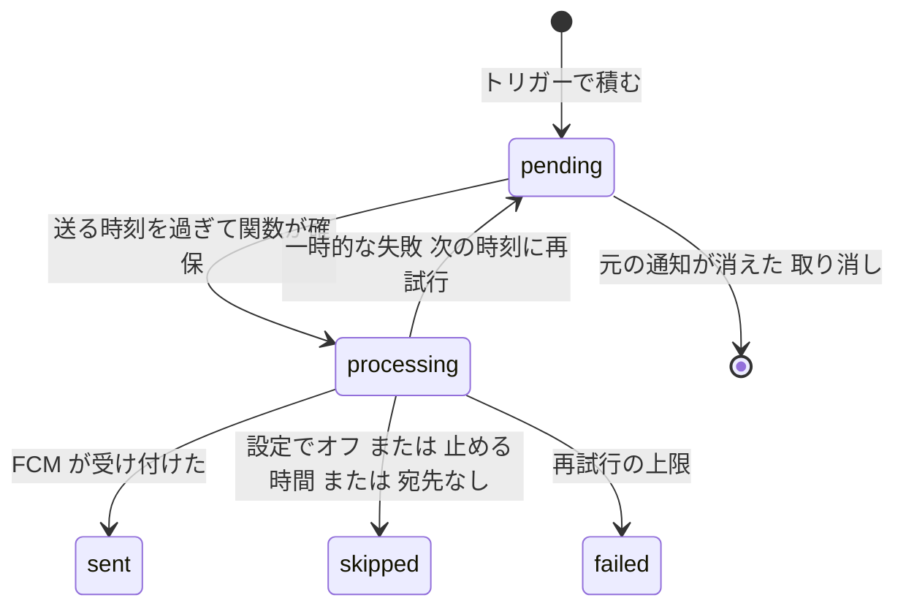
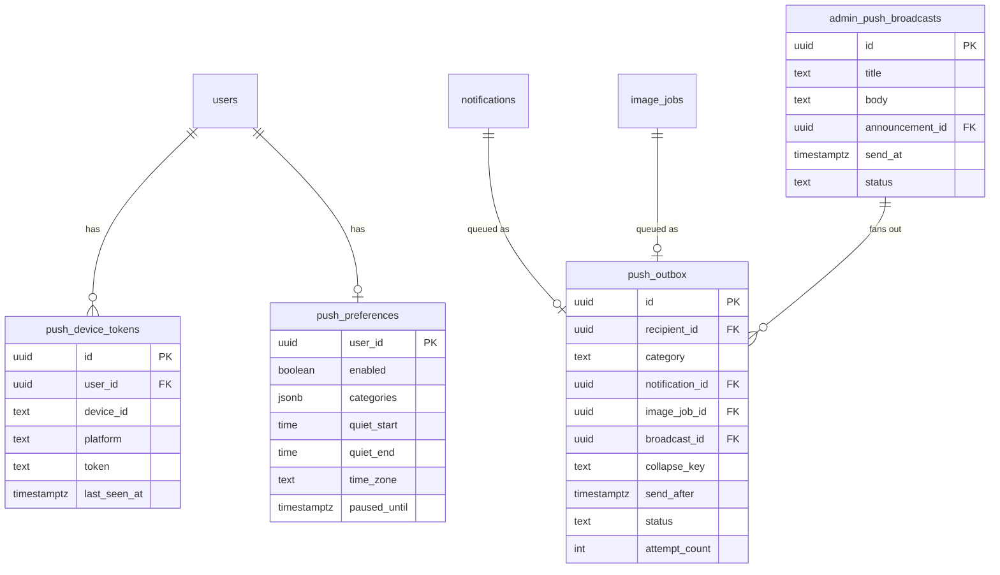
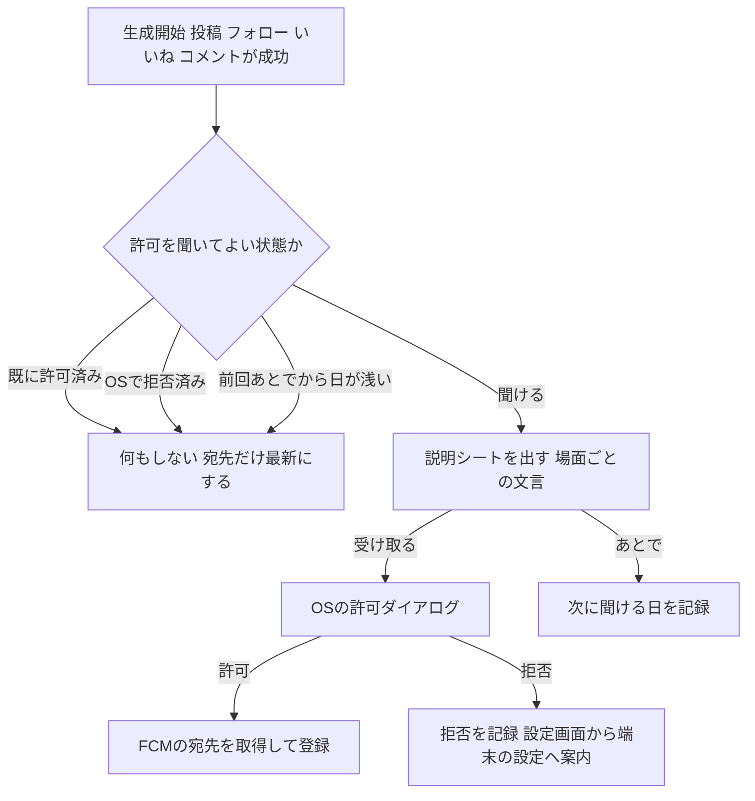
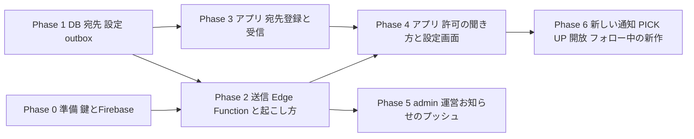

# アプリのプッシュ通知 実装計画

作成日: 2026-10-13
対象: Flutter アプリ（persta-app, iOS / Android）＋ Supabase（このリポジトリ）
関連: `docs/planning/flutter-app-parity-implementation-plan.md`（同等化計画では Push を対象外にしていた。§21, §568）

## 0. 決まったこと（ヒアリング 2026-10-13）

| 項目 | 決定 |
|------|------|
| 対象 | アプリ（iOS・Android）だけ。Web（ブラウザ）のプッシュ通知・メール通知は対象外 |
| 配信 | Firebase Cloud Messaging（FCM, HTTP v1）。iOS も FCM 経由（APNs 鍵を Firebase に登録） |
| 許可の聞き方 | 行動の直後（生成開始・投稿・フォロー・いいね・コメント）に、アプリの説明シート →「受け取る」なら OS の許可ダイアログ。「あとで」は日をあけて次の機会に再度 |
| 送るタイミング | 通知が記録されてから **30 秒後**。その間に取り消された（行が消えた）ものは送らない。**生成完了だけは待たずにすぐ送る** |
| 種類の設定 | 種類ごとにオン・オフ。**止めるのはプッシュ通知だけ**（アプリの通知タブには今までどおり全部並ぶ） |
| 通知を止める時間 | 利用者が決める（Instagram の静かモード相当）：止める時間帯（開始・終了）と一時停止（1時間・8時間・明日の朝まで）。既定は止めない |
| いいね | 投稿ごとにまとめる（30 秒の待ちの間に付いたものを1通に） |
| 生成完了 | プッシュだけ。通知タブには残さない（結果は CREATE の一覧で見られる） |
| 運営からのお知らせ | admin の「運営お知らせ」に「プッシュ通知も送る」を付け、別に全体プッシュの送信画面も設ける |
| 端末の宛先テーブル | 新設 `push_device_tokens`。未使用の `push_subscriptions` は削除（本番 0 行・参照なしを確認済み） |
| 公開の進め方 | 最初から全員に送る（アプリ未公開で、届くのは運営の端末だけ） |

### 送る種類と既定値

| 設定キー | 内容 | 既定 | 元になる記録 |
|----------|------|------|--------------|
| `likes` | いいね（投稿ごとにまとめる） | オン | `notifications.type = like` |
| `comments` | コメント・返信 | オン | `comment` |
| `follows` | 新しいフォロワー | オン | `follow` |
| `generation` | 画像の生成が完了／失敗 | オン | `image_jobs.status`（**新規**。通知タブには残さない） |
| `creator_activity` | プロンプト・スタイルが使われた／投稿された／回数の節目、Creator Looks の投稿 | オン | `derived_post_published` `derived_usage_milestone` `style_preset_post_published` `style_preset_usage_milestone` `creator_looks_post_published` |
| `percoin` | ペルコインの受け取り（ボーナス・クリエイター還元） | オン | `bonus` `usage_reward_earned` |
| `moderation` | 審査の結果（カタログ・スタイル・Creator Looks・投稿の削除／異議申し立て） | オン | `catalog_entry_*` `style_template_*` `creator_looks_*`（投稿以外） `post_moderation_*` |
| `pickup` | 投稿が PICK UP に入った | オン | **新規**（Phase 6） |
| `unlock` | 次のスタイルが開放された | オン | **新規**（Phase 6） |
| `following_posts` | フォロー中の人の新しい作品 | オフ | **新規**（Phase 6） |
| `announcements` | 運営からのお知らせ（企画の案内など宣伝を含む） | オフ | admin の配信 |

## 1. コードベース調査結果

### 通知の記録（Supabase）

- `public.notifications`（`supabase/migrations/20251213013611_notifications.sql:10-25`）
  - 列：`recipient_id` `actor_id` `type` `entity_type` `entity_id` `title` `body` `data jsonb` `is_read` `read_at` **`pushed_at` `push_status (pending|sent|failed, 既定 pending)`** `created_at`、のちに `comment_id`（`20251215150320:27`）
  - `push_status` / `pushed_at` はどこからも書かれておらず、**本番 9,060 行がすべて `pending`**（2026-10-13 実測）。送信を始めると過去分が一斉に届くため、開始時点以前は対象外にする（ADR-004）
  - type の CHECK は `20260806160000_add_creator_reward_daily_notification.sql:31-57`（21 種）
  - RLS：本人のみ SELECT / DELETE、INSERT は `WITH CHECK (false)`
- 作られ方
  - `create_notification(...)`（最新 `20251215150320:96-190`、service_role のみ実行可）。自分宛てはスキップ。`notification_preferences` の like/comment/follow を見て、オフなら**記録自体をしない**
  - いいね・フォローは一意制約に当たると **UPDATE**（`created_at` を進める）。ボーナス・付与系は直接 INSERT（約 50 か所）、`usage_reward_earned` は UPSERT で `created_at` と `is_read` を戻す（`20260806160000:98`）
  - TS からの直接 INSERT：`app/api/admin/style-templates/[id]/decision/route.ts:135`、`app/api/admin/catalog/entries/[id]/decision/route.ts:171`
- 取り消しで行が消える（＝30 秒の間に消えたら送らない、が自然に成り立つ）
  - いいね取り消し `delete_notification_on_like_removal`、フォロー解除 `delete_notification_on_follow_removal`（`20251214185550:160-220`）
  - コメント削除（`20251215150320:196-210`、`20260417035038:88`）、`comment_id` は ON DELETE CASCADE
  - 投稿の取り下げで派生・スタイル系の通知を削除（`20260804200000:194` ほか）
- `notification_preferences`（`20251213013611:109-143`）：`like/comment/follow/push_enabled`。UI からの参照は無い（Web・アプリとも）
- `push_subscriptions`（`20251213013611:83-103`）：未使用・本番 0 行

### 定期実行と Edge Function

- pg_cron の例：`20260504162011_schedule_cleanup_temp_images_cron.sql`（Vault の秘密を読み `net.http_post` で Edge Function を Bearer 付きで呼ぶ）
- 1 分未満の間隔は `image-gen-worker-cron`（30 秒）だけ。高頻度ポーリングが **Disk IO 枯渇の一因**になった経緯あり（`20260809120000_reduce_cron_polling_disk_io.sql`）。高頻度ジョブは `cleanup_cron_job_run_details()` の `v_noisy_job_names` に足す決まり
- 送信待ち（outbox）の前例：`20260728130200_add_moderation_notification_outbox.sql`（`event_key` 一意・`delivery_status`・`attempt_count`・`available_at`、毎分の dispatcher）
- トリガーから pg_net を呼ぶ前例：`20260602101200_creator_looks_enqueue_extraction_rpc.sql:68-105`（例外を握って親トランザクションを巻き戻さない）
- Edge Function：`cleanup-temp-images` `extract-creator-looks-prompt` `image-gen-worker` `style-template-cleanup`。`_shared` は無い。呼び出し元の確認は関数ごとの秘密と `Authorization` の一致（例 `cleanup-temp-images/index.ts:34-47`）

### 生成完了

- 成功：RPC `complete_image_job_with_prompt_secrets`（`20260730200100:361`）が `generated_images` を入れたあと最後に `image_jobs.status = 'succeeded'`（冪等）
- 失敗：worker が直接 `status = 'failed'`（`image-gen-worker/index.ts:1694` ほか。リトライは `queued` に戻す）
- `image_jobs` に AFTER トリガーは無い → `AFTER UPDATE OF status ... WHEN (OLD.status IS DISTINCT FROM NEW.status AND NEW.status IN ('succeeded','failed'))` で両経路を拾える

### 運営お知らせ（admin）

- 画面 `app/(app)/admin/announcements/*`、API `app/api/admin/announcements/route.ts`（POST）・`[id]/route.ts`（PATCH）、`requireAdmin()`（`lib/auth.ts:62-81`）、`logAdminAction`
- `admin_announcements`（`20260419120000:7-21`）：`status (draft|published)`・`publish_at`（**未来日時の予約公開あり**）。送ったかどうかの列は無い
- ナビ：`app/(app)/admin/admin-nav-items.ts:156-157`

### PICK UP・スタイル開放・投稿

- PICK UP：`popular_prompt_rankings` を `recompute_popular_prompts()`（最新 `20261005100000:39`）が毎時作り直す（`DELETE` → `INSERT`）。履歴は無い → 入れ替えの直前と直後を比べれば「新しく入った投稿」が分かる
- スタイル開放：状態は毎回 TS で計算（`features/collections/lib/collection-unlock*.ts`、`resolve-preset-unlock-state.ts`）。**開放の出来事は保存されていない**
- 投稿の公開：`generated_images.is_posted` false→true の AFTER UPDATE OF is_posted トリガーが既に複数（`20260804200000:168` ほか）。`generated_images` は更新の多い表なので `UPDATE OF is_posted` ＋ WHEN で絞る

### アプリ（persta-app）

- Firebase・ローカル通知・ディープリンクの仕組みは**何も無い**（`firebase_*`・`flutter_local_notifications` なし、iOS `aps-environment` なし、Android `google-services` プラグイン・`POST_NOTIFICATIONS` なし）
- 起動：`lib/main.dart:10-28`、Supabase 初期化 `lib/presentation/providers/app_bootstrap_provider.dart:9-16`。`AppRouter` は `lib/app.dart:16` の `useMemoized`（外から触れる口が無い）
- ログイン状態：`authSessionProvider`（`lib/presentation/providers/auth_session_provider.dart:24`）。X ログインは deep link 経由で非同期に完了するため、宛先の登録はこの状態の変化で行う
- ログアウト：すべて `AuthRepository.signOut()`（`lib/domain/repository/auth_repository.dart:407-412`）を通る。退会は `account_page.dart:200-233` → `POST /api/account/deactivate`
- 通知タブ：`notifications_page.dart`、遷移の決め方 `lib/domain/logic/notification_presentation.dart:306-340`（Web の `features/notifications/hooks/useNotifications.ts:578-668` と同じ規則）
- 未読バッジ：60 秒ごとのポーリング（`unread_notification_provider.dart`。本番の Realtime publication は空）
- 許可を聞く場所：生成開始 `coordinate_view_model.dart:594`（成功 653）・`style_generate_view_model.dart:312`（成功 349-355）、投稿 `post_composer_view_model.dart:135`（成功 158）、フォロー `follow_view_model.dart:109`・`prompt_reference_view_model.dart:121-149`、いいね `post_detail_view_model.dart:106`、コメント `comments_view_model.dart:174,243`
- 設定の置き場所：マイページの右メニュー（`my_page_page.dart:86-160`、アカウント・言語・ログアウト）
- テスト：`test/test_app.dart` の `pumpPerstaApp` で各 provider を Fake に差し替え。CI は format・analyze・test（`.github/workflows/flutter-ci.yml`）

## 2. 概要図

### 全体の流れ

### 送信待ちの状態

### データモデル

### 許可を聞く流れ（アプリ）

## 3. EARS（要件定義）

| ID | 種別 | 要件 |
|----|------|------|
| REQ-001 | イベント | When a notification row is inserted for a user with a registered device, the system shall queue a push to be sent 30 seconds later. / 通知が記録されたら、30 秒後に送る予約を積む |
| REQ-002 | 異常 | If the notification row is deleted before it is sent (unlike, unfollow, comment deletion, unposting), then the system shall not send it. / 送る前に通知が消えたら送らない |
| REQ-003 | イベント | When an image job becomes succeeded or failed (final), the system shall send a push immediately without adding it to the notification list. / 生成が完了・失敗したら、待たずに送り、通知タブには残さない |
| REQ-004 | 状態 | While the recipient has turned off the push category, the system shall not send pushes of that category, and the in-app notification list shall be unchanged. / 種類をオフにしている間は送らない（通知タブは変わらない） |
| REQ-005 | 状態 | While the recipient is inside their quiet hours or pause, the system shall not send pushes and shall mark them skipped. / 止める時間帯・一時停止中は送らない |
| REQ-006 | イベント | When several like notifications for the same post become due together, the system shall send one push summarising them. / 同じ投稿へのいいねは1通にまとめる |
| REQ-007 | イベント | When the app obtains or refreshes an FCM token while signed in, the app shall upsert it to `push_device_tokens` for that user and device. / 宛先を取得・更新したら登録する |
| REQ-008 | イベント | When the user signs out or deactivates, the system shall remove that device's token. / ログアウト・退会で宛先を消す |
| REQ-009 | 異常 | If FCM reports a token as unregistered or invalid, then the system shall delete it. / 無効な宛先は消す |
| REQ-010 | イベント | When the user completes a trigger action (start generation, publish, follow, like, comment) and permission is undetermined and not snoozed, the app shall show the explanation sheet before the OS dialog. / 行動の直後、未決定なら説明シート→OS ダイアログ |
| REQ-011 | イベント | When the user taps a push, the app shall open the same destination as tapping the item in the notification list. / 押したら通知タブと同じ行き先へ |
| REQ-012 | 状態 | While the app is in the foreground, the app shall show a push as an in-app banner, and shall not show a generation-complete push for a job it is already displaying. / 開いている間は画面上部に小さく出す（画面に出している生成の完了は出さない） |
| REQ-013 | イベント | When an admin publishes an announcement with "push" on, or sends a broadcast, the system shall send it to users whose `announcements` category is on, at the publish time. / 運営お知らせ・全体配信は「運営からのお知らせ」をオンの人に、公開時刻に送る |
| REQ-014 | 状態 | Where the push system starts, only notifications created after the start time shall be sent. / 開始時点より前の通知は送らない |
| REQ-015 | 権限 | Only the owner shall read or write their tokens and preferences; only service role shall read the outbox and send. / 宛先・設定は本人だけ、送信待ちは service role だけ |

## 4. ADR（設計判断）

### ADR-001: 配信は FCM（HTTP v1）に一本化
- **Context**: iOS と Android の両方に送る。Android は FCM が実質唯一の経路
- **Decision**: iOS も FCM 経由（APNs 鍵を Firebase に登録）。Edge Function から FCM HTTP v1 を呼ぶ
- **Reason**: 送信側の実装が1つで済む。アプリも `firebase_messaging` 1つで両 OS の宛先を扱える
- **Consequence**: Firebase プロジェクトとサービスアカウント鍵の管理が増える。鍵は Supabase の Edge Function の秘密に置く

### ADR-002: 送信待ち（outbox）テーブルを挟み、行の削除で取り消す
- **Context**: 30 秒待ってから送る／その間の取り消しは送らない。いいねはまとめる
- **Decision**: `notifications` の AFTER INSERT（と、いいね・フォローの UPDATE で `created_at` が進んだとき、`usage_reward_earned` の UPSERT）で `push_outbox` に `send_after = now() + 30s` で積む。`push_outbox.notification_id` は `notifications(id) ON DELETE CASCADE`
- **Reason**: 取り消しは既に「通知の行を消す」で表現されているので、CASCADE だけで「送らない」が成り立つ。モデレーション通知の outbox（`20260728130200`）と同じ形で、再試行と冪等が DB で守れる
- **Consequence**: `notifications` への書き込みにトリガーが1つ増える。積むのは宛先（`push_device_tokens`）を持つ人だけに絞り、未登録の人の分は積まない

### ADR-003: 起こし方は「数秒ごとの確認 → あるときだけ関数を呼ぶ」
- **Context**: 30 秒後に送るには定期的に確認する必要があるが、高頻度ポーリングが Disk IO 枯渇の一因になった
- **Decision**: pg_cron（10 秒ごと）で SQL 関数 `push_outbox_kick()` を実行。送る時刻を過ぎた `pending` が**ある時だけ** `net.http_post` で `send-push` を呼ぶ。生成完了と即時配信は積んだトリガーから直接 `net.http_post`（例外は握る）
- **Reason**: 何も無い時は軽い索引参照だけで終わり、`net._http_*` への書き込みが増えない
- **Consequence**: 送られるまで 30〜40 秒。`push_outbox_kick` を `cleanup_cron_job_run_details` の高頻度ジョブ一覧に足す

### ADR-004: 開始時点より前の通知は送らない
- **Context**: 本番の 9,060 行がすべて `push_status = 'pending'`
- **Decision**: outbox は新設のトリガーで積んだ分だけを送る（既存の行は積まない）。既存の `push_status` は使わず、送った結果は `push_outbox` に持つ。`notifications.push_status/pushed_at` は参照しない列として残す（削除は別途）
- **Reason**: 過去分の一斉送信を構造的に起こさない
- **Consequence**: `push_status` が使われないまま残る（docs に「未使用」と明記する）

### ADR-005: 種類の設定はプッシュ専用に新設（`push_preferences`）
- **Context**: 既存 `notification_preferences` はオフにすると**記録自体をしない**。決定は「止めるのはプッシュだけ」
- **Decision**: `push_preferences` を新設（全体オン・オフ、種類ごとの `categories jsonb`、止める時間帯、タイムゾーン、一時停止の終わり）。`notification_preferences` は触らない
- **Reason**: 通知タブの中身と、端末に届けるかを分けて扱える
- **Consequence**: 設定が2つの表に分かれる（既存の方は UI が無いので利用者は意識しない）

### ADR-006: 止める時間帯と一時停止は送信時に判定し、まとめ送りはしない
- **Context**: Instagram の静かモードは終わったあとに見逃した通知をまとめて見せる
- **Decision**: 止めている間の分は `skipped` にして送らない。アプリの通知タブに残っているので、終了後の要約プッシュは送らない（第 1 版）
- **Reason**: 要約の生成・配信時刻の管理が増える割に、通知タブで代わりがきく
- **Consequence**: 要約が欲しくなったら後で `quiet_digest` を足す

### ADR-007: 生成完了は通知タブに残さず、プッシュだけ
- **Decision**: `image_jobs` の AFTER UPDATE OF status トリガーで `push_outbox`（`category = generation`, `send_after = now()`）に積み、その場で `send-push` を呼ぶ。`notifications` には書かない
- **Reason**: 決定どおり。生成のたびに通知タブが増えるのを避ける
- **Consequence**: 生成完了は止める時間帯・一時停止に従う（自分の操作の直後だが、静かにしたい時間の設定を優先）。アプリが前面にいて同じジョブを表示中なら、アプリ側で出さない

### ADR-008: 宛先は新しいテーブル `push_device_tokens`、`push_subscriptions` は削除
- **Decision**: ユーザー決定（A）。`push_device_tokens (user_id, device_id, platform ios|android, token, app_version, last_seen_at)`、UNIQUE(device_id) と UNIQUE(token)（1 台の端末・1 つのトークンは同時に 1 人にだけ結びつく。同じ端末で別のアカウントにログインし直したら付け替える）。本人だけ RLS。`push_subscriptions` は同じマイグレーションで DROP（本番 0 行・参照なしを確認済み）
- **Reason**: 「subscriptions」は Web Push とサブスク（課金）と紛らわしい
- **Consequence**: `.cursor/rules/database-design.mdc` と `docs/architecture/data.*.md` の記述を直す

### ADR-009: アプリは宛先を RPC で登録する（Web API を通さない）
- **Decision**: アプリは Supabase の RPC `register_push_device(device_id, platform, token, app_version)` / `unregister_push_device(device_id)` を直接呼ぶ。表への直接の書き込みは許さず、本人の行の SELECT だけ RLS で許す。ログアウトは `signOut()` の直前に `unregister_push_device`。退会は `/api/account/deactivate` でサーバー側からその人の全宛先を消す
- **Reason**: 同じ端末で別のアカウントにログインし直したとき、前の人の行（同じ `device_id`・同じ `token`）を消して付け替える必要があり、RLS の本人 CRUD では書けない（2026-10-13 Phase 1 実装時に変更。当初は直接 upsert の案）
- **Consequence**: 利用者は RPC の中で `auth.uid()` から決め、引数では受け取らない

### ADR-010: スタイル開放・PICK UP 入り・フォロー中の新作は後の段階
- **Context**: スタイル開放は出来事が保存されておらず TS で毎回計算。PICK UP は毎時作り直し
- **Decision**: Phase 6 に分ける。PICK UP は `recompute_popular_prompts()` の中で入れ替えの前後を比べて新しく入った投稿に通知を記録。スタイル開放は生成成功時（`complete_image_job_with_prompt_secrets` の後）に開放数の変化を判定する方法を Phase 6 の着手時に決める。フォロー中の新作は `is_posted` false→true トリガーでフォロワーへ（既定オフの人は積まない）
- **Reason**: 既存の通知を届ける部分（Phase 1-5）を先に動かす

## 5. 実装計画（フェーズ＋TODO）

### フェーズ間の依存関係

リポジトリ：Phase 1・2・5・6（DB 部分）はこのリポジトリ（PR を出しユーザーがレビュー・マージ）。Phase 3・4 と Phase 6 のアプリ部分は persta-app。

### Phase 0: 準備（運営の作業）
目的: 送信に必要な鍵と設定ファイルをそろえる

- [ ] Firebase プロジェクトを作成し、iOS アプリ（`ai.persta.app`）と Android アプリ（`ai.persta.app`）を登録
- [ ] Apple Developer：App ID にプッシュ通知の権限を付け、APNs 認証キー（.p8）を作って Firebase に登録
- [ ] Firebase のサービスアカウント鍵（JSON）を作り、Supabase の Edge Function の秘密 `FCM_SERVICE_ACCOUNT_JSON` に登録（チャットやファイルに貼らない）
- [ ] `GoogleService-Info.plist`・`google-services.json` を persta-app に置く（どちらも公開されて問題ない設定ファイルだが、リポジトリに入れるかは Phase 3 で決める）
- [ ] 送信関数の呼び出し用の秘密 `PUSH_SEND_SECRET` を Vault と Edge Function の両方に登録

### Phase 1: データベース
目的: 宛先・設定・送信待ちの表とトリガー
ビルド確認: Supabase Preview でマイグレーションが通る／既存の通知の作成・削除が今までどおり動く

- [ ] `push_device_tokens` 作成・RLS（本人のみ）・`push_subscriptions` を DROP
- [ ] `push_preferences` 作成・RLS（本人のみ）。行が無い人は既定値（`likes` 〜 `moderation` と `generation` はオン、`following_posts` と `announcements` はオフ）として扱う関数 `push_category_enabled(user_id, category)`
- [ ] `push_outbox` 作成（`notification_id` ON DELETE CASCADE、`image_job_id`、`category`、`collapse_key`、`send_after`、`status pending|processing|sent|skipped|failed`、`attempt_count`、`last_error`）。RLS は全拒否（service role のみ）。`(status, send_after)` の部分索引と、CASCADE 用の `notification_id`・`recipient_id` の索引。`broadcast_id` は Phase 5 で足す（元が1つだけの CHECK `push_outbox_single_source_check` も同時に作り直す）
- [ ] `notifications` の AFTER INSERT トリガー：type → category の対応表で積む（宛先が無い人・自分宛ては積まない）。いいねは `collapse_key = like:{entity_id}`
- [ ] いいね・フォローの UPSERT（一意制約で UPDATE）と `usage_reward_earned` の UPSERT で `created_at` が進んだときも積み直す（既存の `pending` があれば `send_after` を延ばす。延ばすのは最初に積んでから 5 分まで）
- [ ] `image_jobs` の AFTER UPDATE OF status トリガー（succeeded／failed のみ、リトライの queued は除外）で積み、即時に送信関数を呼ぶ（`20260602101200` の例外を握る作法）
- [ ] `push_outbox_kick()`：送る時刻を過ぎた `pending` がある時だけ `net.http_post`。pg_cron を 10 秒ごとに登録し、`cleanup_cron_job_run_details` の高頻度一覧に追加
- [ ] `claim_push_outbox(limit)`（`FOR UPDATE SKIP LOCKED` で `processing` に）と `finish_push_outbox(...)`（結果の記録・再試行の予約）の RPC（service role のみ）。確保の前に、送る時刻を 1 時間（生成完了は 15 分）過ぎた行は `skipped`（`expired`）、確保したまま止まって確保 5 回目の行は `failed`（`stale_claim`）にして送らない。記録は形の合わない項目を飛ばす（1 件で全体を失敗させない）
- [ ] テスト：取り消しで outbox が消える／30 秒の `send_after`／自分宛て・宛先なしは積まない（`supabase-validate-plpgsql-without-applying` の作法で事前検証）

### Phase 2: 送信（Edge Function `send-push`）
目的: outbox を確保して FCM に送る
ビルド確認: `deno check` が通る／運営の端末に実際に届く

- [ ] `Authorization: Bearer PUSH_SEND_SECRET` の確認（`cleanup-temp-images/index.ts:34-47` と同じ）
- [ ] サービスアカウント鍵から OAuth トークンを作る（RS256 の JWT を Web Crypto で署名し、1 時間使い回す）
- [ ] `claim_push_outbox` → 受け手ごとに `push_preferences` と止める時間帯（`time_zone` で現地時刻）・一時停止を判定 → `skipped` か送信
- [ ] いいねのまとめ：同じ `collapse_key` の確保分を1通に（「〇〇さんほか N 人があなたの投稿にいいねしました」）。表示文は `notifications.title/body`（日本語）を使い、まとめは関数側で組み立てる
- [ ] ペイロード：`notification`（タイトル・本文）、`data`（`type` `entity_type` `entity_id` `comment_id` `data` の行き先に必要なキー、`image_job_id`）、iOS `aps.badge` に未読数、Android `channel_id` に category
- [ ] FCM の `UNREGISTERED`／`INVALID_ARGUMENT`（宛先）は `push_device_tokens` から削除。429・5xx は `send_after` を延ばして再試行（上限 5 回で `failed`）
- [ ] テスト：判定（種類オフ・止める時間帯の日付またぎ・一時停止）とまとめ文の組み立てを純関数にしてユニットテスト

### Phase 3: アプリ — 宛先の登録と受信（persta-app）
目的: 届いた通知を表示し、押したら正しい画面へ
ビルド確認: `flutter analyze`・`flutter test` が通る／実機（iPhone・Android）で受信と遷移

- [ ] 依存：`firebase_core`・`firebase_messaging`・`flutter_local_notifications`（Android のチャンネルと前面表示）。Dart 3.10 と freezed 2.x の制約（`pubspec.yaml:31-34`）に合う版を選ぶ
- [ ] iOS：`aps-environment` の権限、Background Modes（remote-notification）、`AppDelegate` の設定。Android：`google-services` プラグイン、`POST_NOTIFICATIONS`、通知アイコン、種類ごとのチャンネル
- [ ] `PushTokenRepository`（`push_device_tokens` の upsert／delete）と `PushMessagingService`（FirebaseMessaging を包む。テストでは Fake）
- [ ] 登録：`authSessionProvider` がログイン状態になった時と `onTokenRefresh` で upsert。`device_id` は端末ごとに1回作って保存
- [ ] ログアウト：`AuthRepository.signOut()` の直前に自分の端末の行を削除
- [ ] 押したとき：`notificationDestination` と同じ規則で行き先を決める（`AppRouter` を provider から触れるようにする）。起動していない状態から押された場合（`getInitialMessage`）も同じ
- [ ] 前面：画面上部に小さく出す（押すと同じ行き先）。生成完了は、表示中のジョブ（`activeJobs`）と同じなら出さない
- [ ] 未読バッジ：受信時に `unreadNotificationProvider.refresh()`

### Phase 4: アプリ — 許可の聞き方と設定画面
目的: 行動の直後に聞き、利用者が設定を変えられる
ビルド確認: 同上

- [ ] `PushPermissionPrompter`：状態（未決定・許可・拒否・あとで の日時）を保存し、聞ける時だけ説明シート → OS ダイアログ。「あとで」は 3 日あける（回数の上限も設ける）
- [ ] 呼ぶ場所：生成開始（`coordinate_view_model.dart:653`・`style_generate_view_model.dart:349`）、投稿（`post_composer_view_model.dart:158`）、フォロー（`follow_view_model.dart:109`・`prompt_reference_view_model.dart`）、いいね（`post_detail_view_model.dart:106`）、コメント（`comments_view_model.dart:174,243`）。場面ごとの説明文（例：生成「完成したらお知らせしますか？」）
- [ ] 通知設定の画面：マイページの右メニューに「通知設定」。全体のオン・オフ、一時停止（1時間／8時間／明日の朝まで）、止める時間帯（開始・終了）、種類ごとのオン・オフ。端末で拒否されている時は端末の設定を開く案内
- [ ] `push_preferences` の読み書き（本人だけ RLS）。タイムゾーンは端末のものを保存
- [ ] 文言（ja・en）

### Phase 5: admin — 運営からのお知らせのプッシュ
目的: 運営お知らせと全体配信をプッシュで送る
ビルド確認: `npm run lint`・`typecheck`・`test`・`build -- --webpack`

- [ ] `admin_push_broadcasts`（タイトル・本文・行き先・`announcement_id`・`send_at`・`status`・送信数）作成。RLS 全拒否、admin API から service role で操作
- [ ] 運営お知らせのフォームに「プッシュ通知も送る」を追加。公開（`publish_at` が未来なら予約）と同時に `admin_push_broadcasts` を作る
- [ ] 全体配信の画面（`/admin/push-broadcasts`）：作成・予約・送信履歴。`requireAdmin()` と `logAdminAction`。ナビに追加
- [ ] 配信：`send_at` を過ぎた broadcast を `push_outbox_kick` が見つけたら、`announcements` がオンの宛先へ outbox を展開（大量になるのでバッチ）
- [ ] 押したらお知らせの詳細（`AnnouncementDetailRoute`）へ

### Phase 6: ペルスタならではの新しい通知
目的: PICK UP 入り・スタイル開放・フォロー中の新作
ビルド確認: Phase 1 と同じ

- [ ] PICK UP 入り：`recompute_popular_prompts()` で入れ替え前の `post_id` 集合と比べ、新しく入った投稿の作者に通知を記録（type を CHECK に追加、通知タブにも出す）。同じ投稿の再突入は 1 日 1 回まで
- [ ] スタイル開放：判定の置き場所を決める（生成成功の RPC の後に SQL で開放数を数える／Next の内部 API で TS の判定を使う、のどちらか）。type を追加
- [ ] フォロー中の新作：`is_posted` false→true トリガーで、`following_posts` がオンのフォロワーにだけ outbox を積む（通知タブには載せない／載せるかは着手時に決める）
- [ ] アプリの通知タブ・行き先に新しい type を追加

## 6. 修正対象ファイル一覧

| ファイル | 操作 | 変更内容 |
|----------|------|----------|
| `supabase/migrations/<ts>_add_push_device_tokens_and_preferences.sql` | 新規 | 宛先・設定の表、RLS、`push_subscriptions` の DROP |
| `supabase/migrations/<ts>_add_push_outbox.sql` | 新規 | outbox、トリガー（notifications・image_jobs）、claim／finish RPC、kick 関数と cron、高頻度ジョブ一覧の更新 |
| `supabase/functions/send-push/index.ts` ほか | 新規 | FCM 送信、判定・まとめの純関数 |
| `supabase/config.toml` | 修正 | `send-push` の `verify_jwt = false` |
| `supabase/migrations/<ts>_add_admin_push_broadcasts.sql` | 新規 | 全体配信の表 |
| `app/api/admin/push-broadcasts/route.ts`・`[id]/route.ts` | 新規 | 全体配信の作成・一覧 |
| `app/(app)/admin/push-broadcasts/*` | 新規 | 全体配信の画面 |
| `app/(app)/admin/announcements/AnnouncementForm.tsx` | 修正 | 「プッシュ通知も送る」 |
| `app/api/admin/announcements/route.ts`・`[id]/route.ts` | 修正 | broadcast の作成 |
| `app/(app)/admin/admin-nav-items.ts` | 修正 | ナビに追加 |
| `app/api/account/deactivate/*` | 修正 | 退会で宛先を削除 |
| `.cursor/rules/database-design.mdc`・`docs/architecture/data.ja.md`・`data.en.md` | 修正 | 新しい表、`push_subscriptions` の削除、`push_status` は未使用と明記 |
| `docs/API.md` | 修正 | admin の新しい API |
| persta-app `pubspec.yaml`・`ios/Runner/*`・`android/app/*` | 修正 | Firebase・権限・チャンネル |
| persta-app `lib/services/push_messaging_service.dart` | 新規 | FirebaseMessaging の包み |
| persta-app `lib/domain/repository/push_*_repository.dart` | 新規 | 宛先・設定の読み書き |
| persta-app `lib/presentation/components/push_permission_sheet.dart` | 新規 | 説明シート |
| persta-app `lib/presentation/screens/my_page/notification_settings_page.dart` | 新規 | 通知設定の画面 |
| persta-app `lib/app.dart`・`lib/routes/*` | 修正 | 押したときの遷移 |
| persta-app `assets/i18n/*.i18n.json` | 修正 | 文言 |

## 7. 品質・テスト観点

### 品質チェックリスト

- [ ] **取り消し**：30 秒以内のいいね取り消し・フォロー解除・コメント削除・投稿の取り下げで送られない
- [ ] **過去分**：開始前の 9,060 行が送られない
- [ ] **権限**：宛先・設定は本人だけ。outbox と broadcast は service role だけ。送信関数は秘密が無いと 401
- [ ] **冪等**：同じ outbox の二重送信が起きない（`FOR UPDATE SKIP LOCKED`・状態遷移）
- [ ] **負荷**：何も無い時に `net.http_post` を呼ばない。高頻度ジョブのログ掃除に入っている
- [ ] **秘密**：サービスアカウント鍵を Git・ログ・チャットに出さない
- [ ] **i18n**：アプリの文言は ja・en。プッシュ本文は `notifications.title/body`（現状日本語）を使う

### テスト観点

| カテゴリ | テスト内容 |
|----------|-----------|
| 正常系 | いいね → 30 秒後に届く／生成完了がすぐ届く／押すと投稿詳細へ |
| 取り消し | 30 秒以内の取り消しで outbox が消え、送られない |
| まとめ | 同じ投稿への複数のいいねが1通になる |
| 設定 | 種類オフ・止める時間帯（日付またぎ）・一時停止で送られず、通知タブには残る |
| 宛先 | ログアウトで消える／無効な宛先は消える／別のアカウントでログインし直すと付け替わる |
| 許可 | 未決定なら説明シート、あとでは 3 日出ない、OS 拒否後は出ない |
| 実機 | iPhone・Android でアプリ停止中・裏・前面のそれぞれで受信と遷移 |

## 8. ロールバック方針

- **送信を止める**：pg_cron の `push_outbox_kick` を `cron.alter_job(active := false)`、生成完了の即時呼び出しはトリガーの中で設定値（`app_settings` などの 1 行）を見て止められるようにする
- **DB**：新しい表とトリガーは追加だけ（既存の通知の作成・削除の動きは変えない）。戻すときはトリガーを DROP → 表を DROP
- **アプリ**：宛先の登録をやめれば送信されない（宛先が無い人には積まない）
- **Git**：フェーズごとに PR を分ける

## 9. 使用スキル

| スキル | 用途 | フェーズ |
|--------|------|----------|
| `/project-database-context` | DB 設計の参照 | Phase 1 |
| `supabase-validate-plpgsql-without-applying`（作法） | 本番に残さずトリガー・関数を検証 | Phase 1・6 |
| `/spec-extract`・`/spec-write`・`/test-generate` | 送信の判定・まとめのテスト | Phase 2・5 |
| `/git-create-pr` | PR 作成 | 各フェーズ |

## 10. 運営へのお願い（まとめ）

1. Firebase プロジェクトの作成と、iOS・Android アプリの登録（Phase 0）
2. Apple Developer での APNs 認証キー（.p8）の作成と Firebase への登録
3. サービスアカウント鍵の Supabase への登録
4. 実機での受信確認（iPhone と Android 端末）
